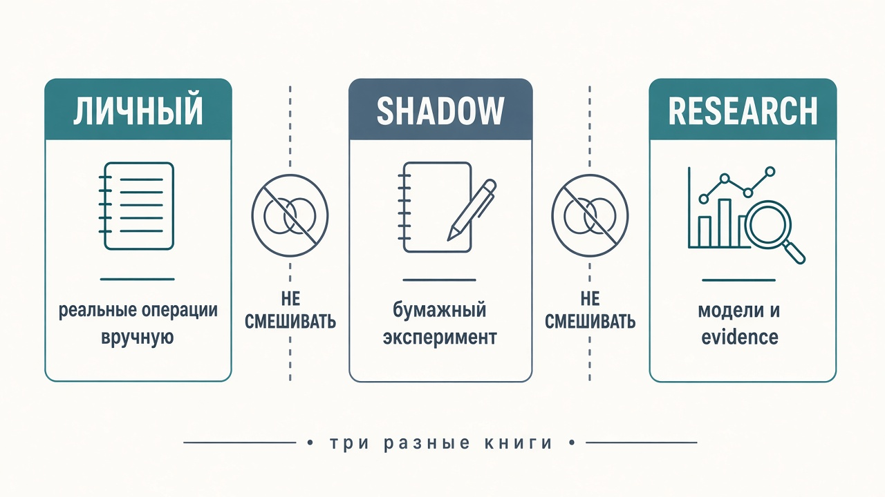

# Kraken за 30 минут

## Визуальный ориентир

Три книги учёта и целевой цикл решений — схема для быстрого «схватывания» границ системы:

*Иллюстрация Vault: Личный ≠ Shadow ≠ Research. Не скриншот UI и не доказательство runtime.*

## Что это

**Kraken** — целевое имя зрелого состояния ProjectAI: локальная Docker-first инвестиционно-аналитическая система для российского рынка.  
Это **не** отдельный микросервис и не брокерский робот с автоторговлей.

## Три книги учёта (не смешивать)

| Книга | Смысл |
|---|---|
| **Personal** | ручной учёт реального портфеля пользователя |
| **Shadow** | виртуальный paper/эксперимент решений и исполнений |
| **Research** | датасеты, модели, evidence — не production trading |

## Главный цикл (целевой)

Prediction → Meta/trust → Policy → Risk → Order Intent → Execution Adapter → Outcomes → Learning → Decision Memory  

Сейчас цикл **частично** реализован: Shadow и Personal живут; champion ML и broker execution — нет.

## Жёсткие инварианты

1. Prediction ≠ Trading  
2. Missing price ≠ 0  
3. Point-in-Time: только данные `≤ t`  
4. Raw candles immutable  
5. Decision ≠ Order ≠ Fill  
6. LLM не калькулятор и не SoT чисел  

## Что уже полезно пользователю (подтверждено релизами / main)

- Портфель, рекомендации, покрытие данных  
- MOEX EOD + catch-up  
- Shadow портфели и журнал решений (V4 в main; V4.1 UX — на review)  
- Portfolio Hub с fail-closed valuation (#91)  
- Intelligence / Evidence / Dataset research (не = прибыльность)

## Чего нет / нельзя без Owner

- Broker import / sync  
- Автономная торговля реальными деньгами  
- Dataset V5  
- Decision-attributed P&L (запрошен Owner, не реализован)

Далее: [[Что такое Kraken]] · [[Kraken сегодня]] · [[Карта всей системы]]
