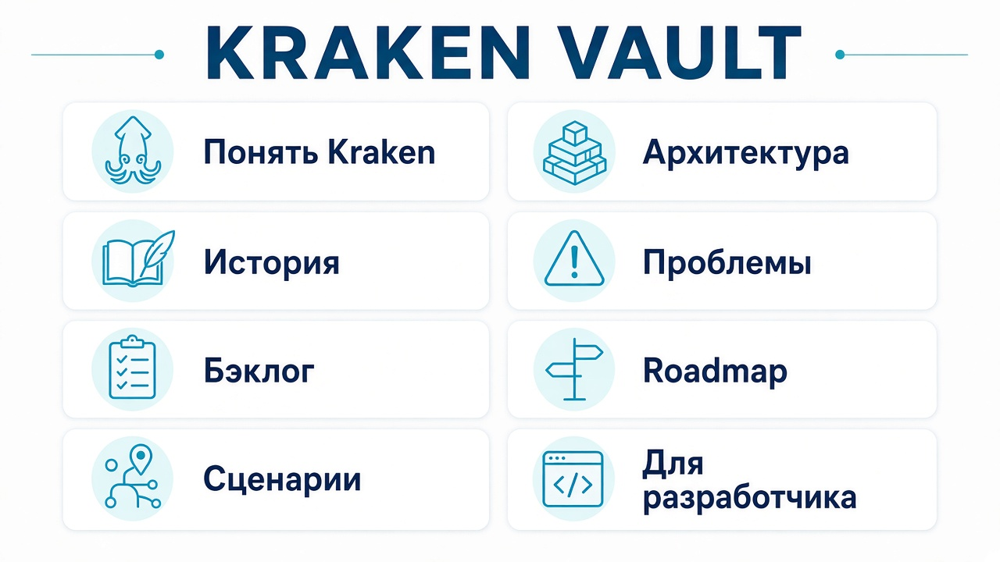

# KRAKEN Vault


## Визуальный ориентир



*Карта входа в базу знаний. Иллюстрация Vault; не скриншот приёмки и не доказательство runtime.*

**Живая база знаний и управления развитием** ProjectAI / Kraken.  
**Режим:** Obsidian Vault в репозитории ProjectAI · каталог `knowledge-vault/` · sync через git pull/push.

**Baseline кода:** `origin/main` `73c2e25e6aed323174b11dea4514946d5897f54b` (проверено 2026-11-23)  
**Продуктовая метка:** Kraken **1.05** · техн. `VERSION` **1.0.0**

---

## Куда идти

```text
KRAKEN VAULT
│
├── Понять Kraken .............. [[Что такое Kraken]] · [[Kraken за 30 минут]] · [[Kraken сегодня]]
├── Изучить архитектуру ....... [[Карта всей системы]] · [[Модули]]
├── Что уже сделано ........... [[Хронология Kraken]] · [[История версий]]
├── Текущие проблемы .......... [[Все проблемы]] · [[Критические проблемы]]
├── Задачи .................... [[ВЕСЬ БЭКЛОГ]] · [[Сейчас]]
├── Roadmap ................... [[Roadmap Kraken]] · [[Kraken в будущем]]
├── История разработки ........ [[04-ИСТОРИЯ РАЗРАБОТКИ/Хронология Kraken]]
└── Начать работу ............. [[Первый день разработчика]]
```

## Быстрые ссылки

| Раздел | Заметка |
|---|---|
| Как пользоваться | [[Как пользоваться Vault]] |
| Источники истины | [[Источники истины]] |
| Глоссарий | [[Глоссарий]] |
| Навигация по проекту | [[Навигация по проекту]] |
| Правила | [[Правила ведения Vault]] |
| Статус заполнения | [[Статус заполнения]] |
| QA | [[VAULT_AUDIT]] |

## Три горизонта (сводка)

| Горизонт | Суть |
|---|---|
| **Сейчас** | Journal V4.1 (#100/#101) acceptance · PR B ledger integrity · Gate 0 UX baseline |
| **Следующее** | Cost basis / P&L / XIRR · Income calendar · Decision-attributed P&L |
| **Позже / запрещено без Owner** | Broker import · Broker trading API · Real-money autonomy · Dataset V5 |

## Важно

Vault объясняет и планирует.  
**Факт merge / CI / Issue** — только GitHub.  
**Статус проекта** — Master Context.  
См. [[Источники истины]].
