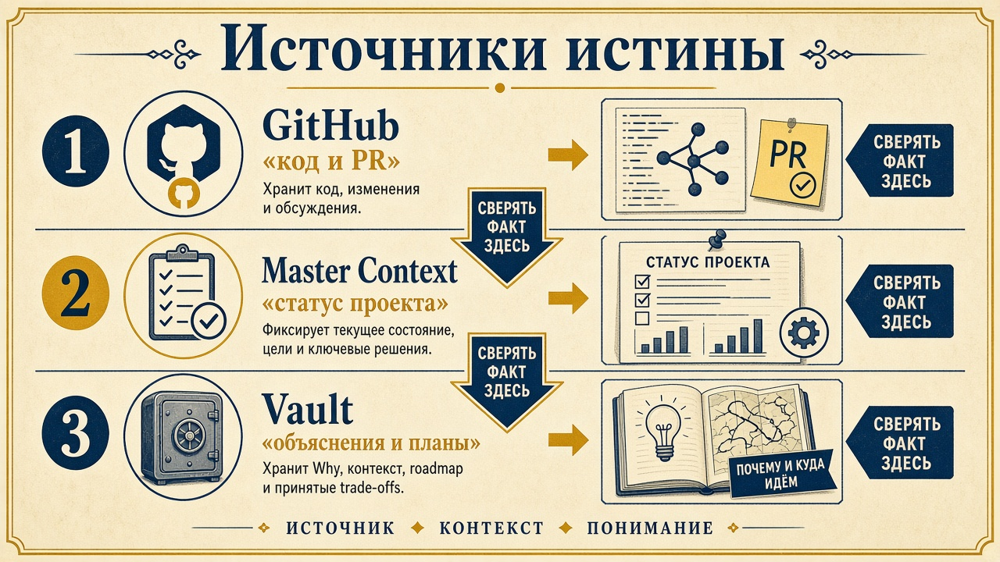

# Источники истины

## Визуальный ориентир

*GitHub → Master Context → Vault. Иллюстрация Vault; не скриншот приёмки.*

## Иерархия

1. **GitHub `UberSerg/ProjectAI`** — код, PR, CI, Issues, ADR, тесты  
2. **`docs/development/CHATGPT_MASTER_CONTEXT.md`** — проверенный статус и хронология событий  
3. **`knowledge-vault/`** (этот Obsidian Vault в том же репозитории) — педагогика, история, backlog/roadmap  

Vault **не** может сам объявить PR смерженным или функцию «работающей».

## Синхронизация

- В начале работы: подтянуть `origin` — чужие правки Vault тоже.  
- После значимого изменения: обновить заметки → commit → push.  
- Правило агентов: `.cursor/rules/45-knowledge-vault.mdc`.  
- Локальный ярлык `E:\kraken Vault` допустим только как junction на `<clone>/knowledge-vault`.

## Разделение факта и плана

| Утверждение | Где подтверждать |
|---|---|
| Код существует | дерево `main` / PR diff |
| Тесты зелёные | CI run на точном SHA |
| Смержено | merge commit на `main` |
| Видно в UI | browser + идентифицированный worktree/Docker mount |
| Принято Owner | запись в Master Context / комментарий Owner |
| В релизе | `CHANGELOG` / tag / `manifest.ts` |

## Ссылки

- Полный реестр: [[Реестр источников]]
- Правила статусов: [[Правила ведения Vault]]
