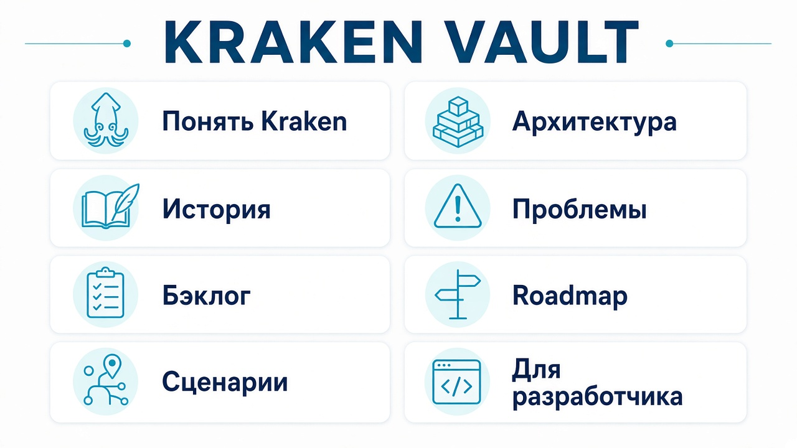

# Навигация по проекту


## Визуальный ориентир



*Карта разделов Vault. Иллюстрация Vault; не скриншот приёмки.*

## Логическая карта Vault

| Каталог | Содержание |
|---|---|
| `00-ГЛАВНАЯ` | вход, глоссарий, SoT |
| `01-ПРОДУКТ` | зачем Kraken, сегодня/завтра, сценарии |
| `02-АРХИТЕКТУРА` | карта системы + паспорта модулей |
| `03-ТЕРМИНЫ` | один термин — одна заметка |
| `04-ИСТОРИЯ РАЗРАБОТКИ` | хронология, события, версии |
| `05-КАТАЛОГ ПРОБЛЕМ` | bugs / risks / debt |
| `06-БЭКЛОГ` | epics → features → tasks |
| `07-ПЛАНИРОВАНИЕ` | roadmap, спринты, зависимости |
| `08-БУДУЩЕЕ KRAKEN` | идеи vs approved goals |
| `09-ПРОБЛЕМЫ И АНТИПАТТЕРНЫ` | учебные ловушки |
| `10-ПРАКТИЧЕСКИЕ СЦЕНАРИИ` | end-to-end примеры |
| `11-РАЗРАБОТЧИКАМ` | onboarding |
| `_meta` | правила, шаблоны, QA |

## Код ProjectAI (ориентиры)

```text
backend/app/modules/*     доменные модули
backend/app/api           HTTP
frontend/src/pages        экраны
frontend/src/features     UI-фичи
docs/                     архитектура и продукт
```

Подробнее: [[Карта всей системы]], [[Как устроен код]].
