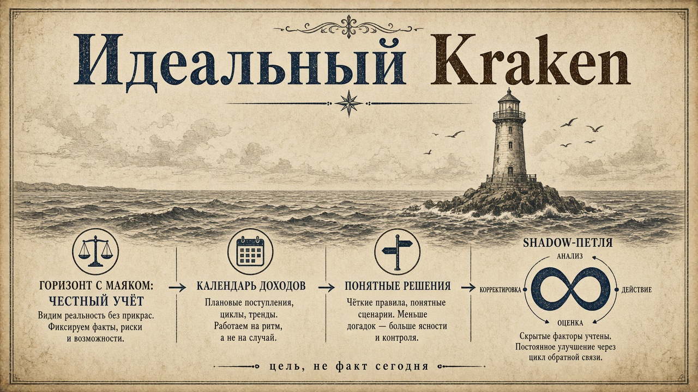

# Kraken в будущем

## Визуальный ориентир

*Цель, не факт сегодня. Иллюстрация Vault; не скриншот приёмки.*

Будущее Kraken в документах разложено на три полки. Их нельзя смешивать.

| Полка | Что это | Можно ли кодить |
|---|---|---|
| Подтверждённое направление | competitive roadmap 2026-11-19, ручной учёт, честный P&L | только после явной задачи на конкретный Gate |
| Исследовательский горизонт | `future-intelligence-roadmap.md` | нет, это направление, не заказ |
| Запрет без владельца | брокер, автономия, Dataset V5, сеть, массовый backfill | нет |

Подробные ярлыки: [[Отложенные идеи]]. Картина «когда-нибудь»: [[Идеальный Kraken]].

## Ближний продукт — быт инвестора

Roadmap без импорта брокера ставит порядок такой:

1. **Gate 0.** Надёжный кабинет: пять понятных мест (обзор, портфель, доходы, решения, рынок), честные пустые состояния, демо-портфель, который переживает обновление страницы.
2. **Gate 1.** Журнал, которому можно верить: лоты и штуки, себестоимость, реализованный и нереализованный результат, XIRR там, где он считается, комиссии один раз.
3. **Gate 2.** Календарь дивидендов и купонов с различием «объявлено / ожидается / получено» и без выдуманной даты отсечки.
4. **Gate 3.** Сравнение с бенчмарком, ребаланс как предложение, цели. Несколько личных портфелей не склеиваются с Shadow.
5. **Gate 4.** Совет на русском и P&L, привязанный к решению, только после лотовой аллокации и цен as-of. Если звена нет — экран говорит, чего не хватает.
6. **Gate 5.** Полировка, телефон, по желанию — нестандартные активы. Это не условие первого конкурентного релиза.

Глобальные рынки, криптовалюта, вклады, недвижимость и публичное сообщество — отдельные будущие решения, не пропуск к первому релизу.

## Дальний контур — обучение

`docs/architecture/future-intelligence-roadmap.md` описывает **направление**: симулятор → walk-forward → Shadow → сигналы → брокер только как сменяемый адаптер. Часть фундамента уже в коде (PIT-датасет, technical agent, сырые свечи, H1 по сплитам). Остальное — план. Meta Model, полноценный self-learning контур и автономное исполнение из этой схемы **не собраны** и этой заметкой не заказываются.

Каноническая evidence-кампания 1.04 честно показала: текущие фундаментальные и событийные добавки V4 не дали прироста на отложенном окне относительно BASE. Следующий шаг intelligence (живой LLM, банковская отчётность, Dataset V5) в Current State от 07.10.2026 явно «не начинать без задачи». Более поздний Master Context этот запрет не снимал.

## Что должно остаться истинным и через год

- в момент решения `t` видны только факты, известные к `t`;
- сырые свечи не переписываются «очищенной» историей;
- отсутствующая цена не становится нулём;
- совет, ордер и исполнение — три записи;
- исследовательский прогон не переключает production Candidate сам.
