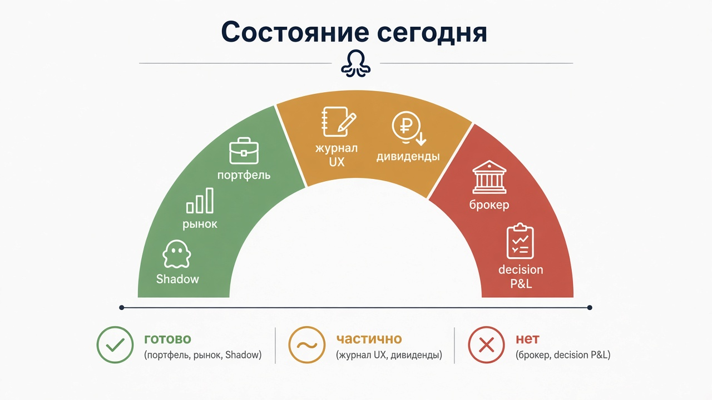

# Kraken сегодня

## Визуальный ориентир

*Что уже есть, что частично, чего нет. Иллюстрация Vault; не скриншот приёмки и не доказательство runtime.*

Снимок на **2026-11-23**. Код, от которого отсчитываем факты Vault: `origin/main` `73c2e25e6aed323174b11dea4514946d5897f54b`. Тема коммита — расширение Master Context под Vault (история, бэклог, roadmap), не новая торговая функция.

`docs/development/KRAKEN_CURRENT_STATE.md` — **устаревший** handoff от 07.10.2026 (baseline тогда `58283d81…`, PR #79). Его нельзя читать как «что происходит сегодня». Живой статус проекта — Master Context. Факт merge — только GitHub.

## Что считается выпущенным продуктом

| Метка | Дата | Смысл | Тег |
|---|---|---|---|
| Kraken V1.0 | 2026-09-27 | первый рабочий baseline | `v1.0.0`, SHA релиза `b815b1ae389e18c0c1a2a922007e543f214d9fde` |
| Kraken 1.01 | 2026-09-28 | несколько личных портфелей, черновик учёта | нет git-tag |
| Kraken 1.02 | 2026-09-29 | комиссии, Daily Decision, Shadow Realism | нет |
| Kraken 1.03 | 2026-09-30 | Personal Decision Memory | нет |
| Kraken 1.04 | 2026-10-04 | Research Evidence и каноническая кампания | нет |
| Kraken 1.05 | 2026-10-07 | Intelligence Stack V1 | нет |

Технический `VERSION` все эти шаги оставался `1.0.0`.

## Что уже влито и можно описывать как код main

Подтверждено историей main / Master Context (не путать с «владелец принял внешний вид»):

- ручной личный портфель и несколько независимых портфелей (модель V2 сменила одиночный `/primary`);
- Portfolio Hub: полная и частичная оценка, отсутствие цены не рисуется нулём (PR #91, merge `512628b`);
- Shadow: догон пропущенных дней, реализм V3, журнал решений (PR #85 merge `a1c165b`; журнальный UI V4 — PR #99 merge `95f2fd8`);
- Design System V2 (PR #98, merge `8fbea8d`);
- Company Intelligence, комитет, риск-сценарии, новости ЦБ/MOEX, макро, 60-минутный слой MOEX (PR #79, продукт 1.05);
- Dataset V3/V4 и Evidence Engine — **только research**. Production Candidate остаётся на Dataset V2. Кампания V4 не показала прироста OOS относительно BASE (это факт отчёта, не «модель плохая навсегда» и не разрешение строить V5).

## Что открыто и не принято

На момент снимка Master Context 2026-11-23, **без живого API GitHub в этой сессии**:

| PR | Тема | HEAD из context | Как читать |
|---|---|---|---|
| #100 | журнал, read-model | `5d65ebb…` | OPEN, не merge |
| #101 | журнал V4.1, UI | `88eb135…` | OPEN, зависит от #100 |
| #97 | контекст / аудит Agent 00 | `26b3c67…` | OPEN, конфликт с context |
| #83 | docs cleanup | — | OPEN, вне текущего продукта |
| #58 | дивиденды PIT / календарь / universe V3 | — | OPEN research, не трогать без задачи |

Владелец 2026-10-30 **не принял** вид журнала: нужны понятные русские статусы и цветные плашки. Отдельный запрос — P&L, отнесённый к конкретному решению. В #100/#101 такого расчёта нет. Пока это требование, не функция.

Локальный Docker мог показывать старый frontend после merge #98/#99. Это гипотеза про mount, не доказательство, что кода нет в git. См. [[Устаревший Docker mount]].

## Чем занят продукт прямо сейчас

Утверждённое направление планирования — конкурентный учёт без брокера (2026-11-19) и локальный Vault. Следующий исполнимый этап **не начат кодом**: владелец выбирает волну. В Vault ближайший предлагаемый спринт — Gate 0, см. [[План текущего этапа]]. PR B (целостность ручных операций) и PR C (гонки загрузки UI) записаны как PLANNED, их веток «потому что они упомянуты» создавать нельзя.

Сеть, порты, firewall и авторизация с 2026-10-28 отложены. Их нельзя прикладывать попутно.
