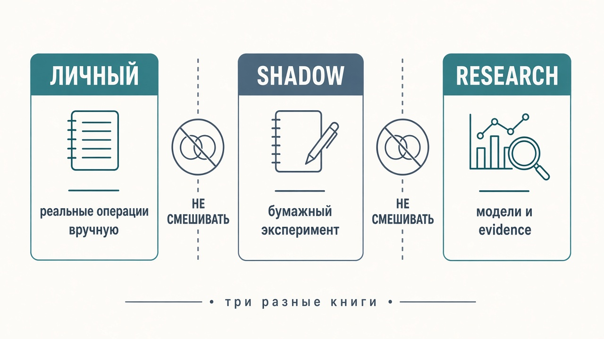

# Personal vs Shadow vs Research

## Визуальный ориентир

*Личный, Shadow и Research не смешиваются. Иллюстрация Vault; не скриншот приёмки и не доказательство runtime.*

Три книги отвечают на три вопроса. Складывать их NAV, P&L или «доходность Kraken» в одну строку — ошибка продукта.

| | Personal | Shadow | Research |
|---|---|---|---|
| Вопрос | что я реально держу и записал | что было бы, если следовать правилам эксперимента | какой датасет и модель честны на будущем окне |
| Деньги | рубли владельца, ввод руками | виртуальные | нет портфеля инвестора |
| Источник правды | журнал `personal_operations` | ордера, исполнения, NAV эксперимента | dataset run, dossier, метрики |
| Можно ли править задним числом | нет; исправление — новая запись SUPERSEDED/CANCELLED | историю LIVE не переписывают | прогон воспроизводим, не «подчищается» |
| Попадает в «Мой портфель» | да | нет | нет |
| Меняет production Candidate | нет | нет | нет, пока нет отдельного promote |

## Personal

Журнал операций → проекция кэша и позиций → снимок `load_personal_snapshot` → экраны. Аналитика не имеет права читать сырой `ManualPortfolio` как второй источник правды. После `ACTIVE` старые прямые записи остатков закрыты.

Candidate, Shadow и Research в этот снимок не подмешиваются. Несколько личных портфелей изолированы: сброс одного не чистит другой. Тестовые портфели (`is_test`) не должны становиться книгой владельца.

Если рыночная цена известна, а себестоимость нет, стоимость позиции может быть известна, а P&L — нет. Пустая себестоимость не обязана обнулять NAV. Цена покупки не подменяет текущую рыночную.

## Shadow

Это paper-контур: решение на конец дня, исполнение на официальном открытии следующей допустимой сессии (ADR 0007, ADR 0009). Внутридневная котировка может помочь увидеть open, но не становится обучающей свечой и не пишет NAV на каждый рефреш.

Журнал Shadow и Personal Decision Memory — разные места. Первое хранит эксперимент. Второе хранит совет, показанный живому портфелю, и последующее наблюдение. Одна таблица на оба смысла запрещена протоколом.

Старые эксперименты V1/V2 не переписываются новой семантикой V3 и не получают выдуманный след решения.

## Research

Dataset Spec версионируется. Смена смысла признаков или лейблов — новая версия, не тихая замена `pit_daily_core` v1. Production Candidate V0/V1 закреплены на Dataset V2. V3 и V4 — исследовательские контуры. Канонический dossier кампании 1.04 (`fe5609a2…`) — аудит, не приказ переключить модель.

Инструмент из каталога MOEX может оцениваться в личном портфеле и при этом не входить в исследовательскую вселенную. Каталог ≠ право прогнозировать.

## Практический тест

Если фраза звучит как «Kraken заработал 12%», спросите: в какой книге, за какой период, с дивидендами или без, полная оценка или частичная, LIVE или повтор истории. Без этих ответов процента нет. Учебные разборы: [[Пользовательские сценарии]] и раздел `10-ПРАКТИЧЕСКИЕ СЦЕНАРИИ`.
