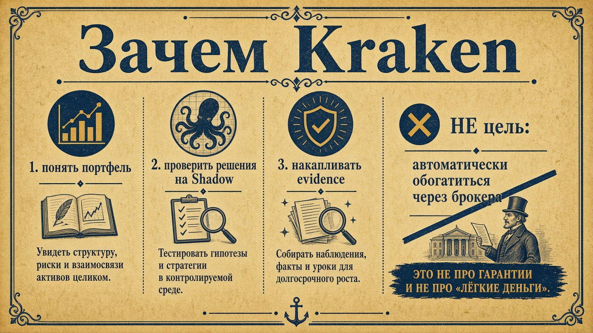

# Зачем существует Kraken

## Визуальный ориентир

*Понять, проверить, накапливать evidence. Иллюстрация Vault; не скриншот приёмки.*

Kraken нужен частному инвестору, который хочет **сам учитывать** российские акции, фонды и облигации и при этом видеть, *почему* система что-то советует. Ориентир повседневного учёта — практический уровень Snowball Income, но без подключения брокерского счёта. Это решение владельца от 2026-11-19, зафиксированное в competitive roadmap и в Master Context. Документ — план, не разрешение начинать все волны сразу.

## Какую боль закрывает

Таблица в брокерском приложении отвечает «сколько сейчас на счёте». Она плохо отвечает на другие вопросы:

- пополнение — это прибыль или просто новые деньги;
- продана часть позиции — какая себестоимость у остатка и что уже зафиксировано;
- цена одной бумаги не пришла — можно ли честно назвать стоимость всего портфеля;
- рекомендация на экране — это совет или уже сделка;
- модель в исследовании стала лучше на истории — можно ли ею пользоваться в личном портфеле.

Kraken существует, чтобы эти вопросы имели разные, проверяемые ответы. Личный журнал операций — источник правды по деньгам. Рыночная цена — отдельный факт. Исследовательский прогон — третья книга, которую нельзя тихо подменить в «Мой портфель».

## Зачем рядом Shadow и исследования

Личный учёт хранит то, что инвестор реально сделал. Он не доказывает, что совет системы был хорошим: человек мог не последовать совету, а рынок мог пойти в любую сторону.

Shadow — стенд, где решение, ордер и исполнение записываются без реальных денег и без подглядывания в уже известную цену. Research — место, где сравнивают датасеты и модели на walk-forward, не включая их в прод. Путь к любым реальным деньгам в документах один: история → walk-forward → бумага → сигналы → подтверждение человеком → маленький капитал → ограниченная автономия. Последние ступени **запрещены**, пока владелец отдельно их не откроет. См. [[Автономность и ограничения]].

## Зачем не брокерский импорт

Импорт отчёта или API счёта кажется быстрым стартом. Для Kraken он закрыт: чужой файл легко смешать с ручным журналом, дважды учесть комиссию и потерять происхождение цифры. Быстрый ручной ввод — осознанный продукт, не временная дыра. Выгрузка **собственных** записей Kraken допустима; она не должна превратиться в импорт брокера под другим именем.

## Что инвестор должен чувствовать в удачный день

Открыл обзор, увидел кэш и оценённые бумаги, понял, полная оценка или частичная, внёс операцию руками, прочитал совет на русском и оставил его советом, пока сам не записал сделку. Технические идентификаторы, статусы `FILLED` и номера внутренних ордеров — не язык первого экрана. Это отдельное требование владельца к журналу (2026-10-30): слитый код журнала V4 не равен принятому виду.
