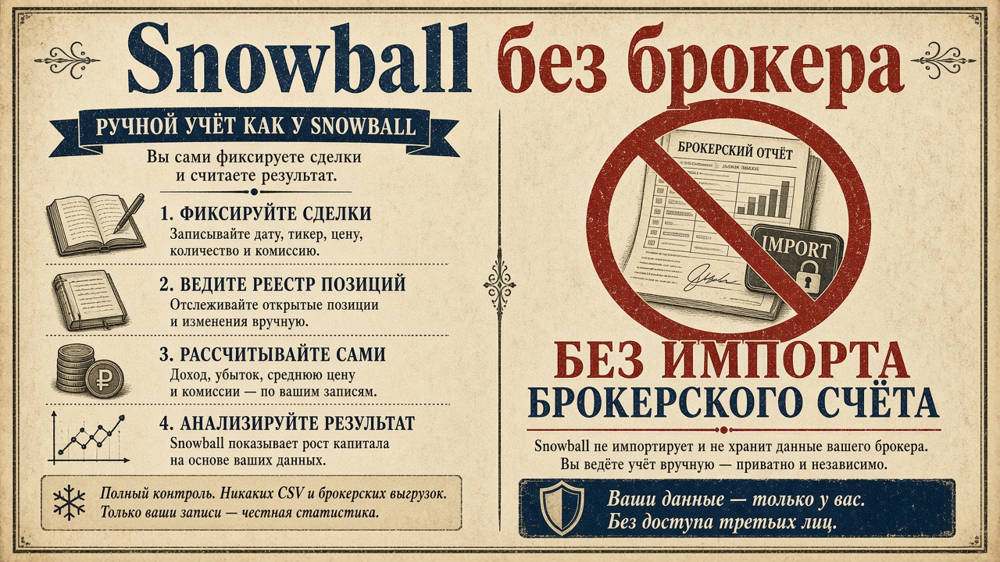

# Конкурентное позиционирование

## Визуальный ориентир

*Паритет UX без импорта счёта. Иллюстрация Vault; не скриншот приёмки.*

Решение владельца 2026-11-19: повседневный учёт и кабинет Kraken должны дойти до практического уровня **Snowball Income** для выбранного инвестора — и отличаться тем, чего у типичного дневника портфеля нет. Документ roadmap сам предупреждает: это приоритет, не приказ сливать открытые PR и не утверждение, что паритет уже есть.

## С кем сравниваем

Первый конкурентный срез — ручной учёт российских акций, облигаций и фондов, по которым у Kraken есть цены и корпоративные события с происхождением. Не входят в обязательный первый релиз: другие страны, криптовалюта, вклады, недвижимость, лента сообщества.

Публичные страницы Snowball (сайт, тарифы, справка), просмотренные 2026-11-19, обещают ручные позиции и сделки, дивиденды и купоны, комиссии, налоги, полный P&L, годовую XIRR, бенчмарки, аллокацию и ребаланс, несколько портфелей, разложение результата, календарь событий, пользовательские активы. Это реклама и справка. Как именно у них устроена математика, Kraken не знает и не копирует «на глаз».

## Где Kraken уже стоит рядом

На main к 2026-11-19 у личного портфеля были вкладки holdings / history / decision / analysis / payments / compare / rebalance. Hub умеет полную и частичную оценку. Обзор показывает NAV, кэш, P&L и качество данных. Рынок MOEX, фундаментал, Shadow и журнал существуют. Наличие вкладки не равно полированному сценарию и не равно принятой математике XIRR.

## Чем Kraken намерен отличаться

Не скоростью импорта брокера — импорта нет и не планируется.

Отличие — контур доказательства:

- Company Intelligence: несколько независимых взглядов и комитет, который не сглаживает спор в одну «уверенность»;
- Daily Decision на русском: что рассмотреть, почему, что изменилось, где неизвестность;
- память решения отдельно от факта сделки;
- Shadow, где совет, ордер и исполнение можно разобрать по времени и издержкам;
- отказ подменять неизвестное нулём или нейтральным сигналом.

Пока бухгалтерский фундамент дырявый, отличие нельзя ставить впереди учёта. Gate 4 идёт после себестоимости. Иначе «умный P&L решения» будет красивой ошибкой.

## Чего Kraken сознательно не обещает в этой гонке

- синхронизацию счёта, отчётов и сделок брокера;
- отправку заявок;
- доступ к данным счёта «только почитать позиции» под видом рыночных данных (рыночный read-only провайдер — другая возможность, без счёта и без торговли, и только после отдельной оценки);
- публичный шар или сообщество как условие первой версии.

Собственную выгрузку и резервную копию записей Kraken roadmap разрешает.

## Как поймём, что догнали

Десять проверок scorecard (сокращённо): человек вносит портфель без инструкции; частичная цена не называется полной; внесение денег не считается доходом; календарь различает факт и ожидание; бенчмарк совпадает по датам и валюте; ребаланс учитывает кэш, лот и комиссию и не торгует сам; совет, виртуальная книга и повтор истории подписаны по-разному; узкий экран не разваливается; в UI и API нет импорта брокера; тесты соразмерны риску, а не запускают весь завод на правку текста.

Пока эти пункты не пройдены в браузере на известном SHA, формулировка «мы как Snowball, только умнее» — маркетинговая, и Vault её не использует.
