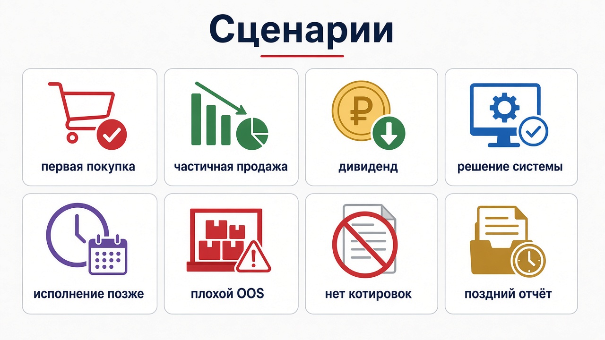

# Пользовательские сценарии

## Визуальный ориентир

*Сюжеты инвестора. Иллюстрация Vault; не скриншот приёмки.*

Сценарий здесь — путь человека, а не список экранов. Паритет со Snowball проверяется такими путями, а не похожими названиями вкладок. Пошаговые разборы лежат в [[Индекс сценариев]].

## Уже осмысленные пути

Они опираются на то, что продукт обещает в релизах 1.01–1.05. Где приёмка владельца или целостность журнала ещё открыты, это сказано прямо.

1. **Завести личный портфель и начать учёт.** Черновик → операции → активный журнал. Технические id не нужны, чтобы понять, что деньги внесены.
2. **Внести сделку руками.** Покупка, продажа, дивиденд, комиссия. Штуки и лоты не должны расходиться с превью и с записью. Это как раз дыра PR B, пока он не сделан.
3. **Понять результат.** Пополнение не прибыль. Реализованное отдельно от нереализованного. Нет себестоимости — нет фиктивного P&L.
4. **Увидеть качество оценки.** Полный NAV, частичный NAV или «не знаем». Ноль вместо дырки запрещён.
5. **Прочитать совет.** Daily Decision объясняет, что рассмотреть, и не двигает журнал. Зафиксировать решение — запись в память, не ордер брокеру.
6. **Вести эксперимент.** Shadow показывает сигнал, решение и исполнение разными датами. Пример владельца, который надо уметь показать, не склеивая: сигнал 2026-09-03, отметка решения 2026-09-07, исполнения 2026-09-08. NAV именно на 2026-09-03 и выдуманный P&L к этому следу не рисуют.
7. **Держать несколько книг.** Дивидендный и основной портфели не смешиваются. Shadow не попадает в сумму «мои деньги».
8. **Спросить исследования.** Evidence и ablation читаются как отчёт. Они не переключают модель, которой пользуется личный экран.

## Пути, которые продукт хочет, но ещё не сданы

Календарь ожидаемых выплат, сравнение с индексом на общих датах, предложение ребаланса с лотами и комиссией без автоотправки, цели накопления с явными допущениями, узкий телефон. Это Gate 2–5. Пока их нет в виде принятого сценария, экран не должен притворяться, что выплата «точно будет».

## Чего сценарий делать не должен

- просить логин брокера или файл отчёта;
- предлагать «исполнить всё» одной кнопкой в реальный счёт;
- показывать исследовательский сигнал V3/V4 как уже действующий план покупок;
- подставлять 0 ₽, когда котировки нет;
- считать совпадение даты совета и даты покупки доказательством, что человек купил «из-за Kraken», пока связь не подтверждена.

Критерии из scorecard roadmap: незнакомый человек создаёт портфель и операцию; депозит не раздувает доходность; календарь помечает неизвестную сумму как неизвестную; ребаланс остаётся планом; в интерфейсе нет импорта брокера.
