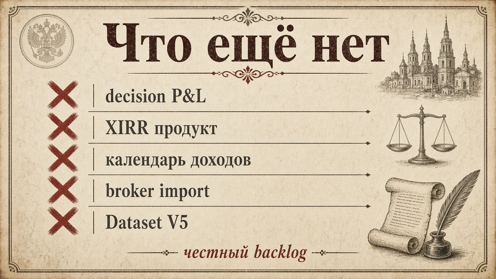

# Что пока не реализовано

## Визуальный ориентир

*Честный список пробелов. Иллюстрация Vault; не скриншот приёмки.*

Список отделяет «ещё нет» от «запрещено начинать без владельца». Второе собрано в [[Отложенные идеи]].

## Учёт, который инвестор ждёт каждый день

По модели V2 и roadmap Gate 1 **ещё не являются готовой паритетной бухгалтерией**:

- денежно-взвешенная XIRR и честный time-weighted return как продукт;
- полный разбор реализованного результата по лотам при серии покупок и частичных продаж — как принятый пользовательский отчёт;
- P&L, отнесённый к конкретному решению или ордеру Kraken (владелец запросил 2026-10-30; в открытых #100/#101 расчёта нет);
- календарь дивидендов и купонов уровня «ожидается / получено» с покрытием источников (ADR 0010 и 0014: провайдер дивидендов для production не READY; выдумывать `ex_date` нельзя);
- налоговый учёт и валютная переоценка доходов как законченная модель;
- полный BUY/SELL учёт облигаций (черновая позиция и грязная цена могут жить; новые сделки могут оставаться закрытыми);
- правка операции с аудиторским следом вместо тихой перезаписи журнала;
- импорт брокерского отчёта — не «ещё не успели», а **запрет**.

PR B (лоты против штук, дата операции, идемпотентность комиссии) на 2026-10-28 записан как PLANNED. Пока он не влит и не проверен, ручной ввод нельзя считать полностью доверенным журналом. Это формулировка самого roadmap Gate 0.

## Интерфейс

- журнал в том виде, который владелец готов назвать принятым (цветные статусы, русский язык, группы по бумагам);
- подтверждение, что запущенный Docker показывает именно текущий `main`, а не старый worktree;
- цельный мобильный проход 320/390 px как принятый Gate 0;
- пять первичных разделов навигации как законченный каркас (обзор, портфель, доходы, решения, рынок) — цель Gate 0, не отчёт о сдаче.

Скриншоты владельца 2026-10-30: после merge #98/#99 на экране был старый UI. Код в git при этом содержал новые блоки. Расхождение не закрыто независимой проверкой mount.

## Исследования, которые не стали продуктом

- Dataset V5 и смена production Candidate;
- перевод Candidate V0/V1 с Dataset V2;
- совокупный «процент точности Kraken»;
- вселенная с лейблами total return в обучении;
- банковский фундаментал для SBER в 1.05 честно `NOT_AVAILABLE`;
- исторический вневыборочный корпус новостей за 2023 не заявлен: новости копятся вперёд;
- LLM-извлечение событий не настроено; выдуманного текста нет — и это правильно.

## Безопасность и масштаб

Настоящий вход пользователей, разграничение прав, закрытие портов и смена сетевых привязок — отложены владельцем 2026-10-28. Пока USER/OWNER не защищают данные.
