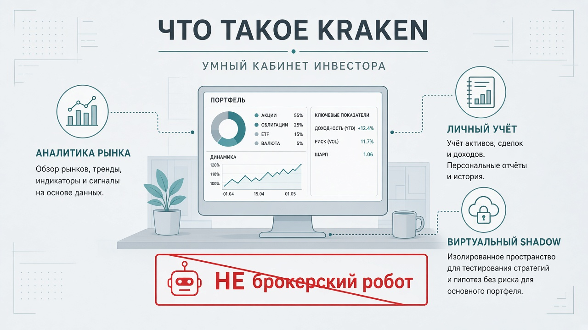

# Что такое Kraken

## Визуальный ориентир

*Аналитический кабинет, не брокерский робот. Иллюстрация Vault; не скриншот приёмки и не доказательство runtime.*

**Kraken** — имя зрелого состояния ProjectAI: локальной инвестиционно-аналитической системы для частного инвестора на российском рынке. Это не модуль, не пакет, не класс и не микросервис. В коде нет и не должно появляться `modules/kraken` только потому, что так называется продукт.

Технически это **модульный монолит** (ADR 0001): один backend-образ, явные слои и пакеты `backend/app/modules/*`, сменяемые адаптеры за портами. Рядом — frontend-кабинет и Docker Compose. Две базы PostgreSQL разделены сознательно: операционные данные и [[Decision Memory DB]].

Продуктовая метка на `origin/main` от 2026-11-23 — **Kraken 1.05** (экран «О Kraken», `frontend/src/version/manifest.ts`). Технический SemVer в корневом `VERSION` — **1.0.0**. Официальный git-tag и GitHub Release есть только у **Kraken V1.0** (`v1.0.0`, 2026-09-27). Микровыпуски 1.01–1.05 — заметки для инвестора, не отдельные теги.

## Чем Kraken занимается

Система ведёт три разные «книги», которые нельзя складывать в одну цифру. Подробно: [[Personal vs Shadow vs Research]].

| Книга | Для кого | Деньги |
|---|---|---|
| Personal | реальный ручной учёт владельца | да, но ввод руками |
| Shadow | виртуальный эксперимент решений | нет |
| Research | датасеты, модели, evidence | нет, и это не торговля |

Целевой контур решения, когда он собран целиком:

рынок → признаки → прогноз → оценка доверия → политика → риск → намерение ордера → адаптер исполнения → исход → память решения.

Прогноз не торгует. Политика предлагает. Риск может урезать или запретить. Исполнение только проводит уже сформированное намерение. Сегодня этот контур **частично** живой: рынок, личный портфель, Shadow, журнал и intelligence-снимок компании есть; чемпионская модель, которая сама ведёт реальные деньги, — нет.

## Чем Kraken не является

По тексту релиза V1.0 и по действующим запретам владельца Kraken сегодня — не:

- брокерский робот и не автоторговля;
- доказанно прибыльная система;
- multi-user SaaS с настоящей авторизацией;
- импорт брокерских отчётов.

Режим USER / OWNER — переключатель подробности интерфейса (`localStorage`), не вход в аккаунт. См. [[USER vs OWNER mode]].

## Как читать остальные заметки

- Зачем продукт нужен: [[Зачем существует Kraken]]
- Что уже можно использовать: [[Kraken сегодня]] и [[Основные возможности]]
- Чего нет: [[Что пока не реализовано]]
- Куда продукт хочет прийти и что запрещено без владельца: [[Kraken в будущем]], [[Отложенные идеи]]
- Короткий маршрут: [[Kraken за 30 минут]]
