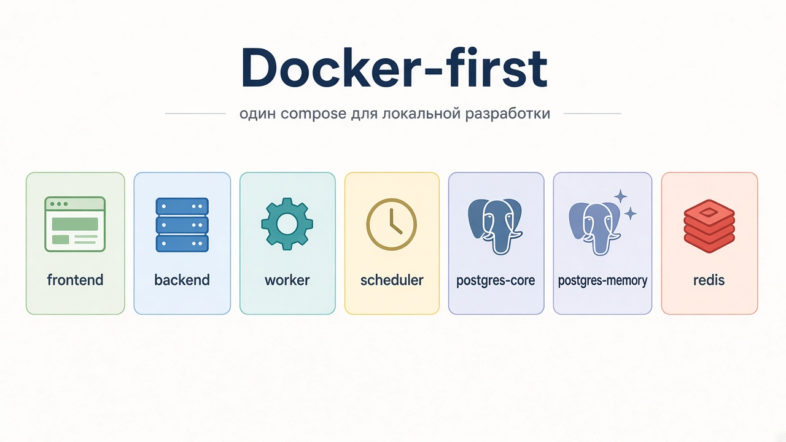

# Docker и сервисы


## Визуальный ориентир



*Локальный compose-контур Kraken. Иллюстрация Vault; не скриншот приёмки и не доказательство runtime.*

**Baseline:** `origin/main` `73c2e25e6aed323174b11dea4514946d5897f54b`  
**Источники:** `docs/architecture/docker-development.md`, ADR 0003, `docker-compose.yml`. `[GITHUB_VERIFIED]`  
Живой `docker compose ps` в этом проходе не снимался. `[runtime: unverified]`

См. [[Инфраструктура]], [[Хранилища]], [[Backend API]], [[Frontend]].

## Сервисы compose

| Сервис | Образ / роль | Контейнер | Порт хоста по умолчанию |
|---|---|---|---|
| `postgres-core` | `postgres:16-alpine` | `projectai-postgres-core` | `5432` |
| `postgres-memory` | `pgvector/pgvector:pg16` | `projectai-postgres-memory` | `5433` |
| `redis` | `redis:7-alpine` | `projectai-redis` | `6379` |
| `backend` | приложение, Uvicorn `--reload` | `projectai-backend` | `8000` |
| `worker` | Celery worker | `projectai-worker` | не публикует свой HTTP |
| `scheduler` | Celery beat | `projectai-scheduler` | не публикует свой HTTP |
| `frontend` | Vite | `projectai-frontend` | `5173` |

Порты задаются переменными `HOST_*` с этими значениями по умолчанию. Секреты и содержимое `.env` в Vault не копируются.

Файл `docker-compose.release.yml` в корне есть. Его сервисы в этот паспорт не разбирались.

## Как поднимают стенд

Документ разработки:

```text
copy .env.example .env
docker compose up -d --build
```

Windows: `Copy-Item .env.example .env`.

Горячая перезагрузка:

- backend монтирует `./backend/app`;
- frontend монтирует `./frontend/src` и включает Vite HMR с `usePolling` для Windows/WSL.

Документ предлагает редактировать `E:\!AI\ProjectAI`. Фактический worktree, из которого запущен compose, может быть другим. Master Context описывает случай, когда UI не совпал с уже влитым main, и называет вероятной причиной монтирование старого worktree. Это `REPORTED` / гипотеза, не независимая проверка этой машины.

## Health

- Docker healthcheck backend бьёт в `/api/v1/system/health/live`.
- Готовность зависимостей: `/api/v1/system/health/ready` (Core + Memory + Redis).
- Экран системы смотрит на `/api/v1/system/health` (есть probe worker).

Миграции из документа:

```text
docker compose exec backend alembic -c alembic_core.ini upgrade head
docker compose exec backend alembic -c alembic_memory.ini upgrade head
```

## Флаги, которые по умолчанию выключены

Их наличие в документах не означает, что на машине владельца они включены.

| Флаг | Где сказано | Смысл |
|---|---|---|
| `MARKET_UPDATE_ENABLED=false` | обзор Market Data | планировщик инкрементального обновления рынка выключен |
| `INTRADAY_MARKET_ENABLED` default false | ADR 0007 | intraday OPEN/LAST в Redis выключен |
| `DAILY_RESEARCH_CYCLE_*`, `EOD_READINESS_RETRY_*` | Shadow Realism V2 | автономный EOD-цикл и повтор готовности |

Включение unattended Shadow в ADR 0009 связано с `RESEARCH_LIVE_MODE` (или эквивалентными флагами).

## Сеть

Решение владельца 2026-10-28 в Master Context: смена публикации портов, firewall, привязок и доступности Postgres/Redis **отложена**. Паспорт фиксирует порты compose как есть и не предлагает их закрывать в рамках описания.

## Связанное

[[Docker-first]] · том данных не удалять командой `down -v`, если цель — сохранить историю.
