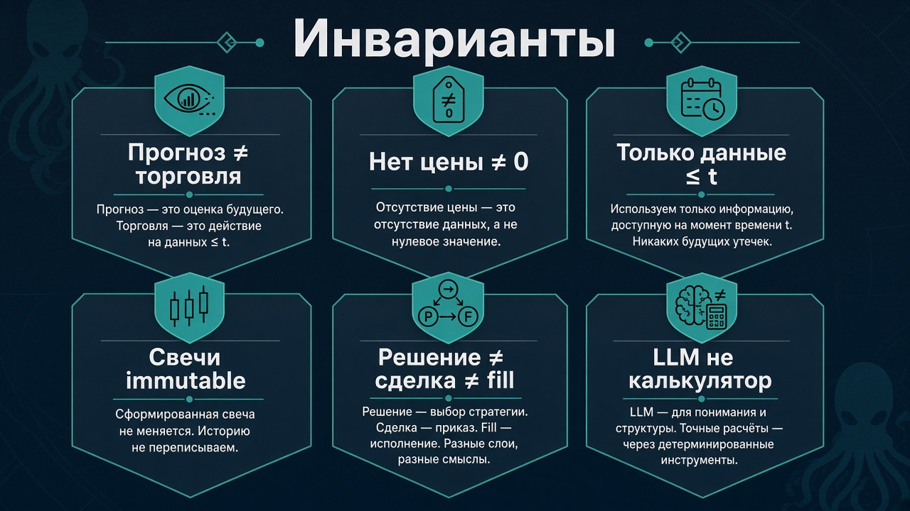

# Архитектурные принципы

## Визуальный ориентир

*Жёсткие правила корректности. Иллюстрация Vault; не скриншот приёмки и не доказательство runtime.*

**Baseline:** `origin/main` `73c2e25e6aed323174b11dea4514946d5897f54b`  
Принципы ниже приняты ADR и обзором на этом SHA. `[GITHUB_VERIFIED]`  
См. [[Карта всей системы]], [[Потоки данных]].

## Форма системы

1. **Модульный монолит** (ADR 0001). Границы пакетов есть. Микросервисы появляются только при операционной нужде.
2. **Docker-first** (ADR 0003). PostgreSQL, Redis и приложение живут в контейнерах. Исходники примонтированы для hot reload.
3. **Две базы** (ADR 0002). Рыночный OLTP и [[Decision Memory DB]] развиваются отдельно.
4. **Чистота домена.** Порт не ходит в базу. Сервис собирает point-in-time вход. См. [[Слои архитектуры]].
5. **Четыре роли решения разделены:** прогноз оценивает, [[Торговая политика]] предлагает цель, [[Риск]] может сузить или остановить, [[Исполнение]] выполняет намерение. Обзор и Master Context повторяют это как инвариант.

## Время и честность данных

6. **[[Point-in-Time (PIT)]].** В момент `t` доступно только то, что было известно `≤ t`.
7. **`known_at` и экономическая дата — разные поля** ([[known_at vs effective_date]]). Для отчётности `period_end` не подменяет публикацию (ADR 0015). Для дивиденда `record_date` / `ex_date` не подменяют момент раскрытия (ADR 0014).
8. **Метки будущего — это Y.** Форвардная доходность не входит в вектор признаков `X(t)`.
9. **Проверка идёт вперёд по времени** ([[Walk-forward]]). Случайное перемешивание дат контракты исследований запрещают.
10. **Сырые свечи неизменяемы** (ADR 0005, [[Raw candles]]). Корпоративное действие — событие, не «починка» свечи.
11. **Три доходности не смешиваются:** сырая, механическая (сплит), полная ([[Total return]]). Пустой дивидендный ряд — это пробел покрытия, а не нулевой денежный поток.
12. **Смена смысла X/Y требует новой версии спецификации.** `pit_daily_core` v1 заморожен. Активная версия в коде равна 1.
13. **Пропуск цены не равен нулю** ([[Missing price ≠ zero]]). Частичный NAV не выдаётся за полный. Неизвестность сильнее выдуманного числа.
14. **Записанный факт и реконструкция различаются** ([[LIVE vs COUNTERFACTUAL_REPLAY]]). Повторный прогон не переписывает живую историю задним числом.

## Рынок и вселенные

15. **Каталог инструментов и исследовательская вселенная — разные множества** (ADR 0011). Облигация в ручном портфеле не становится автоматически объектом прогноза.
16. **Обнаружение бумаги и обогащение карточки разведены** (ADR 0012). Справочник может расти, пул Candidate — только явной сменой версии вселенной.
17. **Кредит, оценка и допуск в стратегию независимы** (ADR 0013). Успешная оценка облигации при кредите `SOURCE_NOT_READY` допустима.
18. **Жизненный цикл раскрытия дивиденда и право на total return — разные фильтры** (ADR 0014). Рекомендация совета директоров сама по себе не является денежным потоком держателя.
19. **Решение на закрытии дня и внутридневное исполнение разделены** (ADR 0007). Intraday живёт в Redis и не загрязняет обучение.
20. **Ключевая ставка ЦБ — рублёвый hurdle**, а не безрисковая ставка и не процент на кэш портфеля (ADR 0006).

## Модели и продукт

21. **[[Candidate vs Champion]].** Новый кандидат не становится боевой моделью фактом обучения. На этом SHA Candidate V0/V1 остаются исследовательскими и привязаны к Dataset V2. Evidence Engine прямо запрещает автоповышение.
22. **LLM не источник чисел и дат.** Числовой контур локальный. Внешний языковой доступ — через Polza. Обзор intelligence запрещает считать числа модели правдой без провененции источника.
23. **USER и OWNER — уровень экрана**, не учётные записи ([[USER vs OWNER mode]]). CHANGELOG V1.0 говорит это явно. Полноценного IAM нет.
24. **Реальные брокерские заявки вне текущего продукта.** API брокерских счетов в коде — тариф и оценка комиссии, без OAuth и без исполнения. Импорт брокерских отчётов владельцем запрещён как продуктовое направление (Master Context, 2026-11-19).
25. **Грубая полная доходность** (ADR 0010) определена как изменение цены плюс денежные дивиденды, до налога и до комиссии. Подключение этого режима к симулятору и к активному датасету в том же ADR отложено.

## Как принцип попадает в паспорт

Утверждение «реализовано» в [[Модули]] несёт метку доказательности. Принцип из ADR может быть принят раньше, чем код закрывает все следствия. Пример: пакет `modules/risk` почти пуст, хотя роль риска в инварианте уже названа. См. [[Риск]].
