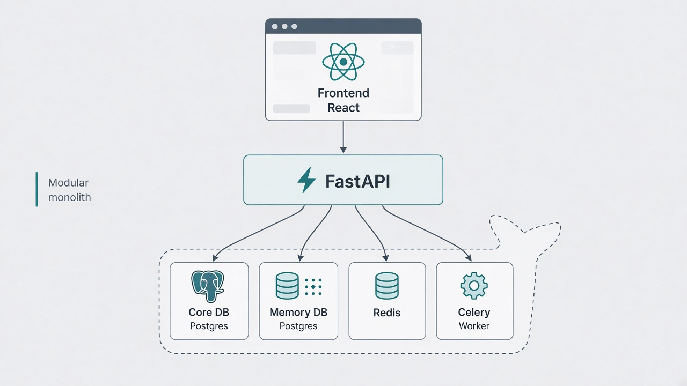

# Карта всей системы

**Baseline:** `origin/main` `73c2e25e6aed323174b11dea4514946d5897f54b` (снимок 2026-11-23)  
**Техническая версия:** `1.0.0` (`VERSION`)  
**Продуктовая метка в UI:** Kraken **1.05** (`frontend/src/version/manifest.ts`)  
**Официальный CHANGELOG:** зафиксирован релиз **Kraken V1.0** / `1.0.0` от 2026-09-27. Микровыпуски 1.01–1.05 живут в manifest и не равны новому SemVer-тегу.

Kraken — имя зрелого продукта, а не пакет в `backend/app/modules`. Код — Docker-first [[Modular monolith]]: один backend, явные слои и сменяемые адаптеры.

## Как читать эту карту

| Заметка | О чём |
|---|---|
| [[Слои архитектуры]] | api / application / domain / infrastructure / modules / worker |
| [[Потоки данных]] | рынок, личный журнал, Shadow, исследования, intelligence |
| [[Хранилища]] | Core DB, Memory DB, Redis, raw volume |
| [[Docker и сервисы]] | compose-сервисы и health |
| [[Архитектурные принципы]] | инварианты и ADR |
| [[Модули]] | индекс паспортов |

Доказательность: [[Evidence level]]. Живой Docker и повторный опрос GitHub API в этом проходе не выполнялись.

## Топология runtime

Источник: `docs/architecture/overview.md` на этом SHA. `[GITHUB_VERIFIED]`



*Иллюстрация Vault: Docker-first modular monolith. Схема-ориентир, не скриншот compose и не доказательство живого runtime.*

```text
Браузер → Frontend (React / Vite)
            → REST /api/v1
              → Backend (FastAPI)
                   ├─ postgres-core     операционные схемы
                   ├─ postgres-memory   Decision Memory + pgvector
                   ├─ Redis             брокер Celery, кэш, intraday-котировки
                   └─ Celery worker + scheduler
```


Контур решения, который обзор называет целевым и **частично собранным**: прогноз → оценка доверия (Meta Model в обзоре назван будущим) → торговая политика → риск → намерение ордера → сменяемый адаптер исполнения → исходы → обучение → [[Память решений]].

Слияние этих ролей в один сервис обзор запрещает. Реальных брокерских заявок в релизе V1.0 нет (`CHANGELOG.md`).

## Что уже стоит на main

Краткий срез. Детали и оговорки — в паспортах.

| Контур | Где в продукте | Состояние на этом SHA |
|---|---|---|
| [[Рыночные данные]] | `/market`, `/instruments` | RAW OHLCV, MOEX ISS + ЦБ, сплиты как события |
| [[Персональный портфель]] | `/portfolio/mine`, `/portfolio/:id` | Multi-Portfolio V2, много книг |
| [[Ручной журнал операций]] | операции личного портфеля | append-only журнал, проекция остатков |
| [[Portfolio Hub]] | `/portfolio` | карточки с общей стоимостью (PR #91 влит) |
| [[Shadow-портфель]] | `/shadow` | виртуальные книги V1 и Realism V2 |
| [[Журнал решений]] | панель на `/shadow` | Variant 4 **в коде main** (PR #99). V4.1 — открытые PR #100 и #101, не влиты |
| [[Память решений]] | API под личным портфелем | отдельная БД; экран `/decision-memory` — заглушка |
| [[Company Intelligence]] | `/intelligence` | контракт стека и код модуля; advisory |
| [[Прогноз]] | Forward / Candidate | Candidate V0/V1 исследовательские, не champion |
| [[Торговая политика]] | порт `PortfolioPolicy` | ранговые long-only политики; stub правил пустой |
| [[Риск]] | `/portfolio-risk`, investment | пакет `modules/risk` пустой; логика в других модулях |
| [[Исполнение]] | Shadow fill, симулятор | виртуальное и исследовательское; брокерских заявок нет |
| [[Исследования]] | `/research`, `/research/evidence` | Lab, цикл, Evidence Engine |
| [[Исторический симулятор]] | `/simulator` | дробные веса по умолчанию |
| [[Фундаментал]] | `/fundamentals` | RAS/ФНС; банки вне поддержки V1 |
| [[Дивиденды и корпоративные действия]] | события | сплиты есть; полный total return не READY |
| [[Датасет]] | `pit_daily_core` | активная спецификация **v1**; v2–v4 собираются и не активируются сами |
| [[Backend API]] | `/api/v1` | набор роутеров на main |
| [[Frontend]] | Vite | USER/OWNER — режим показа |
| [[Инфраструктура]] | Docker Compose | core, memory, redis, backend, worker, scheduler, frontend |

## Чего карта не утверждает

- Прибыльность и автономную торговлю. CHANGELOG прямо исключает торгового робота и «доказанную прибыльность».
- Dataset V3/V4 как production Candidate. Активная версия в коде: `PIT_DAILY_CORE_ACTIVE_VERSION = 1`.
- Смерженный Journal V4.1. Master Context на этом SHA держит [#100](https://github.com/UberSerg/ProjectAI/pull/100) и [#101](https://github.com/UberSerg/ProjectAI/pull/101) открытыми. Живой `gh` в этом проходе недоступен — статус PR помечен снимком документа, не повторным API.
- Принятие журнала владельцем. В Master Context зафиксирован отказ по качеству экрана V4 (`SCREENSHOTS_REPORTED_BY_OWNER`).
- Пустую или заполненную таблицу дивидендов в живой БД. Документы расходятся; содержимое Postgres не читалось. См. [[Дивиденды и корпоративные действия]].

## Связанные термины

[[Point-in-Time (PIT)]] · [[Raw candles]] · [[Shadow portfolio]] · [[Personal portfolio]] · [[Candidate vs Champion]] · [[Docker-first]] · [[USER vs OWNER mode]]
