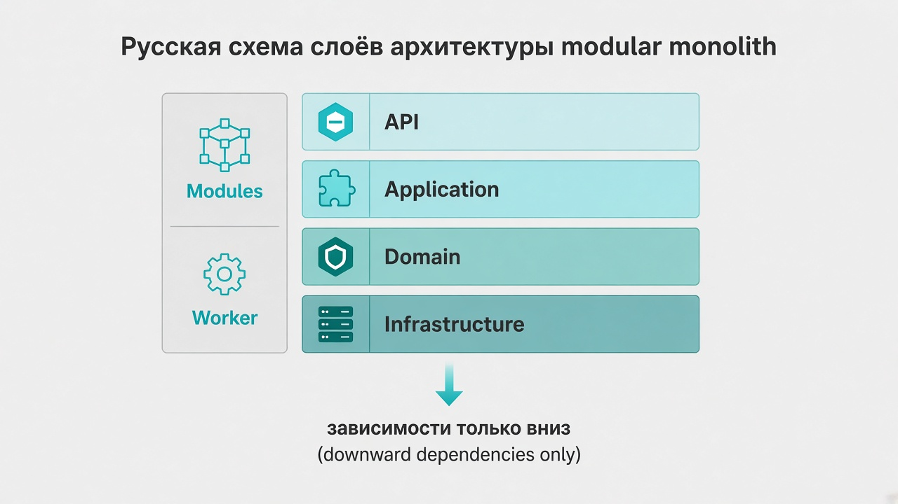

# Модули

## Визуальный ориентир

*Индекс паспортов системы. Иллюстрация Vault; не скриншот приёмки.*

**Baseline:** `origin/main` `73c2e25e6aed323174b11dea4514946d5897f54b`  
Индекс волны System Documentation. Карта: [[Карта всей системы]]. Принципы: [[Архитектурные принципы]].

Паспорт содержит разделы 1–17. Пункт «реализовано» несёт метку: `GITHUB_VERIFIED`, `REPORTED_BY_CURSOR`, `REPORTED_BY_OWNER`, `PROPOSED`, `НЕ ПОДТВЕРЖДЕНО`.

## Паспорта

| Заметка | Пакет или роль | Коротко на этом SHA |
|---|---|---|
| [[Рыночные данные]] | `market`, `market_history` | RAW-свечи, каталог, DQ, сплиты |
| [[Персональный портфель]] | `portfolio` | много книг, DRAFT/ACTIVE |
| [[Ручной журнал операций]] | `personal_operations` | источник правды личных денег |
| [[Portfolio Hub]] | экран `/portfolio` | список книг и общая стоимость |
| [[Shadow-портфель]] | `shadow` | виртуальный эксперимент, лоты V2 |
| [[Журнал решений]] | read-model Shadow | V4 в main; V4.1 не влит |
| [[Память решений]] | `memory` + отдельная БД | снимки; UI-маршрут — заглушка |
| [[Company Intelligence]] | `intelligence` | сигналы и комитет, advisory |
| [[Прогноз]] | `prediction` | Candidate, не champion |
| [[Торговая политика]] | порт `PortfolioPolicy` | ранговые правила long-only |
| [[Риск]] | роль + `investment` | пакет `risk` пустой |
| [[Исполнение]] | Shadow / Simulator | без брокерских заявок |
| [[Исследования]] | lab, cycle, evidence | доказательства, не продакшен-модель |
| [[Исторический симулятор]] | `simulator` | исторический прогон, дробные веса |
| [[Фундаментал]] | `fundamentals` | RAS/ФНС, PIT публикации |
| [[Дивиденды и корпоративные действия]] | события | сплиты есть; вселенский TR не READY |
| [[Датасет]] | `learning` | активен `pit_daily_core` v1 |
| [[Backend API]] | `backend/app/api/v1` | HTTP-фасад |
| [[Frontend]] | `frontend/src` | кабинет React/Vite |
| [[Инфраструктура]] | compose, worker, system | семь сервисов, две миграции |

## Пакеты на диске без отдельного паспорта

Каталог есть на этом SHA. Описание сознательно короткое: отдельный паспорт в задачу не входил.

| Пакет | Что видно без домысла |
|---|---|
| `analytics` | feature store, ADR 0004, широкие дневные таблицы |
| `relations` | Relations Engine V1 в обзоре и в `modules.md` |
| `technical` | Technical Agent V1, сигналы `rules_v1` |
| `historical` | историческая вселенная; политика `historical_equity_universe_v2` импортируется датасетом |
| `investment` | аллокация, облигации, кредит, кандидат портфеля, сервисы риска; часть роли разобрана в [[Риск]] и [[Торговая политика]] |
| `market_history` | роутер `/market-history/external` |
| `model_edge` | роутер API есть; поведение эндпоинтов не разбиралось |
| `news` | в дереве модуля только `__init__.py`; новостной контур intelligence — другой пакет |
| `recommendations` | только `__init__.py`; экран `/recommendations` — заглушка |
| `research_lab` | входит в паспорт [[Исследования]] |
| `research_cycle` | дневной цикл; входит в [[Исследования]] и [[Shadow-портфель]] |
| `research_evidence` | входит в [[Исследования]] |
| `system` | health; входит в [[Инфраструктура]] |
| `workflows` | пакет — `__init__.py`; HTTP `/workflows` подключён из рыночного роутера |
| `learning` | сборка датасета; паспорт [[Датасет]] |

## Расхождения источников

1. `docs/architecture/modules.md` называет portfolio и risk будущими. Код личного портфеля и `investment` на main уже есть.
2. `docs/architecture/data-storage.md` помечает `portfolio` как future virtual accounts. Продукт V2 это сужает.
3. `docs/market-data/overview.md` (аудит 2026-09-05) описывает `dividend_events` пустыми. Поздний контракт провайдера IR XLSX ограничен двумя эмитентами. Живая таблица не читалась. См. [[Дивиденды и корпоративные действия]].
4. Текст Dataset V4 пишет «OPEN / NOT MERGED» и «продукт 1.03». Файл и `v4_enrichment.py` лежат на этом main, manifest показывает 1.05. Активации v4 нет. См. [[Датасет]].
5. Контракт intelligence пишет «no 1.05 here». Manifest содержит запись Kraken 1.05 про intelligence-контур. См. [[Company Intelligence]].
6. Открытость PR #100 и #101 взята из Master Context на этом SHA. Повторный вызов GitHub API здесь не делался.

## Журнал и версии, которые легко смешать

- **Журнал личных операций** — деньги пользователя. [[Ручной журнал операций]].
- **Журнал решений Shadow** — объяснение виртуальных решений. [[Журнал решений]]. На main — Variant 4. Предложение V4.1 — PR #100 (read-model) и #101 (UI), не влиты. Цветные плашки и P&L на каждое решение в эти PR, по тексту Master Context, не входят.
- **Память решений** — отдельная база снимков. [[Память решений]].
