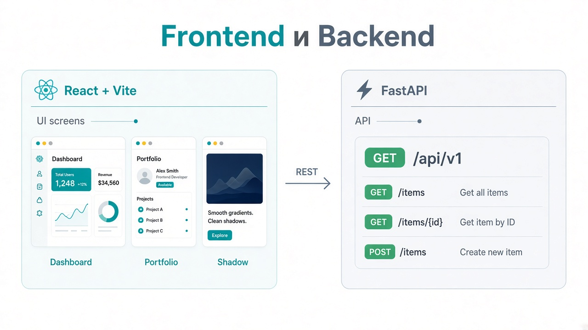

---
aliases:
  - Backend API
---

# Backend API


## Визуальный ориентир



*FastAPI как единая точка REST. Иллюстрация Vault.*

**aliases:** Backend API  
**Baseline:** `origin/main` `73c2e25e6aed323174b11dea4514946d5897f54b`  
**Код:** `backend/app/api`, `backend/app/main.py`  
**См.:** [[Слои архитектуры]], [[Frontend]], [[Инфраструктура]]

## 1. Назначение

Отдать кабинету и оператору HTTP-фасад сценариев. Роутер не становится местом, где живут формулы портфеля и модели.

## 2. Какую задачу решает

Собирает модули монолита под одним префиксом `/api/v1`, чтобы frontend не знал про SQL.

## 3. Как работает простыми словами

Страница вызывает REST. FastAPI принимает запрос, открывает сессию нужной базы и зовёт сервис модуля. Ответ описывает состояние. Заявка брокеру из этого фасада не уходит.

## 4. Архитектура

`main.py` подключает `api_router` с префиксом `/api/v1`.  
Сборка роутеров — `backend/app/api/v1/router.py`. `[GITHUB_VERIFIED]`

| Префикс | Тег | Файл |
|---|---|---|
| `/system` | system | `system.py` |
| `/market` | market, intraday-market | `market.py`, `intraday_market.py` |
| `/instruments` | instruments | `instruments.py` |
| `/manual-portfolios` | manual-portfolios | `manual_portfolios.py` |
| `/personal-portfolios` | personal-portfolios и personal-decision-memory | `personal_portfolios.py`, `decision_memory.py` |
| без отдельного префикса в include | broker-accounts | `broker_accounts.py` |
| `/market-history/external` | market-history | `market_history.py` |
| `/analytics` | analytics | `analytics.py` |
| `/relations` | relations | `relations.py` |
| `/technical` | technical | `technical.py` |
| `/learning` | learning | `learning.py` |
| `/predictions` | predictions | `predictions.py` |
| `/shadow` | shadow | `shadow.py` |
| `/simulator` | simulator | `simulator.py` |
| `/research-lab` | research-lab | `research_lab.py` |
| `/research-cycle` | research-cycle | `research_cycle.py` |
| `/research/evidence` | research-evidence | `research_evidence.py` |
| тег model-edge | model-edge | `model_edge.py` |
| `/fundamentals` | fundamentals | `fundamentals.py` |
| `/intelligence` | intelligence | `intelligence.py` |
| тег investment | investment | `investment.py` |
| `/workflows` | workflows | роутер из `market.py` |

Точные пути каждой операции в паспорт не копировались. Продуктовые пути личного портфеля перечислены в [[Персональный портфель]].

## 5. Поток данных

```text
HTTP /api/v1/...
  → зависимость сессии core или memory
  → application-сервис
  → JSON
```

Health не ходит в полный цикл решения. См. [[Инфраструктура]].

## 6. Что уже реализовано (только подтверждённое)

- Перечисленные роутеры подключены на этом SHA. `[GITHUB_VERIFIED]`
- Три health-ручки: live, ready, полный diagnostics. `[GITHUB_VERIFIED]` `system.py` и обзор.
- Брокерский роутер ограничен тарифом и оценкой комиссии. `[GITHUB_VERIFIED]` docstring.
- Память решений висит на id личной книги, а не на отдельном корне `/decision-memory`. `[GITHUB_VERIFIED]`

## 7. Что частично реализовано

- Роль USER/OWNER на API не является IAM. Документы называют её уровнем показа. Какой заголовок прячет исследовательские ручки, построчно не разбирался. Контракт Evidence просит не расширять диагностику на публичного пользователя одной только подписью роли.
- `manual-portfolios` всё ещё смонтирован, тогда как продукт снял `/primary`. Оставшиеся операции этого роутера не инвентаризировались.

## 8. Что пока исследуется

Отдельного «API v2» в прочитанных документах нет. Ломающее изменение V2 уже сидит внутри `/api/v1` (удаление `/primary`).

## 9. Технические ограничения

- Доменный код не импортирует FastAPI.
- Секреты брокерского OAuth в этом фасаде не принимаются.
- Две базы означают две сессии. Ручка памяти не должна писать рыночные свечи.
- Полный system health не используется как Docker-зависимость worker.

## 10. Известные ошибки

Именного дефекта контракта API на `73c2e25`, воспроизведённого здесь, нет. Постановка PR B описывает расхождение превью и журнала на границе UI и сервиса операций. См. [[Ручной журнал операций]].

## 11. Основные пользовательские сценарии

Пользователь их не вызывает по имени. Кабинет ходит в коллекцию портфелей, рынок, Shadow и исследования. Оператор проверяет `/api/v1/system/health/ready`.

## 12. Тестирование

Этот аудит pytest не запускал. Исторические полные прогоны CI в Master Context относятся к конкретным старым SHA, не к `73c2e25`.

## 13. История развития

Фасад рос вместе с модулями: от рынка и health к личному портфелю, Shadow, симулятору, фундаменталу, intelligence и evidence. Снятие `/primary` — часть Multi-Portfolio V2.

## 14. Потенциальное развитие

Настоящая авторизация, если появится IAM. В CHANGELOG V1.0 её нет, и паспорт её не назначает.

## 15. Зависимости

Все доменные пакеты из [[Модули]], [[Инфраструктура]] (порт 8000, обе базы, Redis). Клиент: [[Frontend]].

## 16. Связанные задачи

PR #100 меняет read-model журнала Shadow и, пока не влит, в этот фасад main не входит. PR B/C меняют поведение операций и гонки клиента, не список префиксов.

## 17. Технические источники

- `backend/app/main.py`
- `backend/app/api/v1/router.py`
- `backend/app/api/v1/*.py`
- `docs/architecture/overview.md`
- `docs/architecture/docker-development.md`
- `docs/product/multi-portfolio-v2.md`
