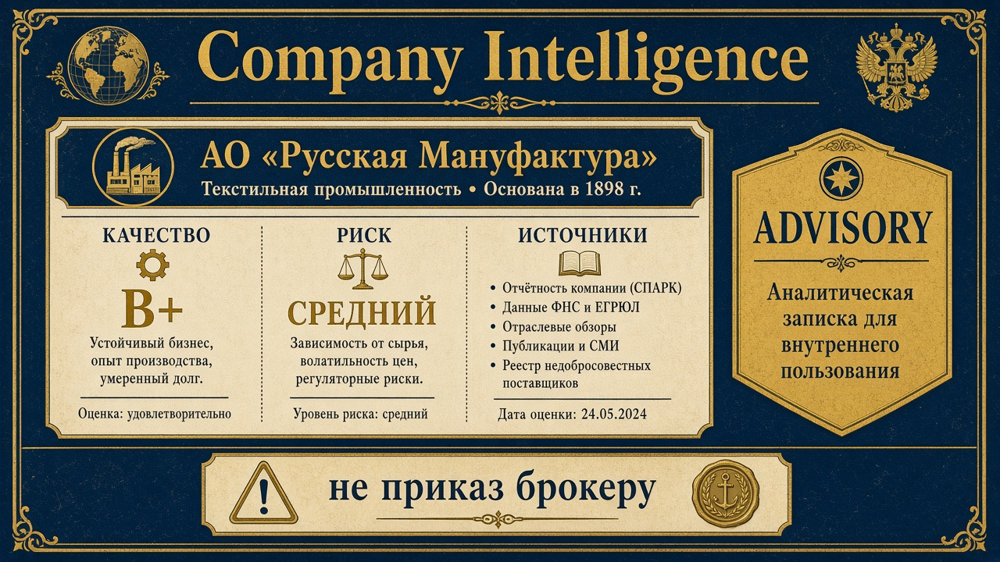

---
aliases:
  - Company Intelligence
---

# Company Intelligence


## Визуальный ориентир



*Advisory, не приказ брокеру. Иллюстрация Vault; не скриншот приёмки.*

**aliases:** Разведка по компании  
**Baseline:** `origin/main` `73c2e25e6aed323174b11dea4514946d5897f54b`  
**Пакет:** `backend/app/modules/intelligence`  
**Экран:** `/intelligence`  
**См.:** [[Фундаментал]], [[Прогноз]], [[Риск]], [[Архитектурные принципы]]

## 1. Назначение

Собрать по компании несколько независимых свидетельств и показать владельцу снимок, где разногласие моделей сохранено, а неизвестность не замаскирована баллом.

## 2. Какую задачу решает

Даёт advisory-взгляд: фундаментал, новости, макро, внутридневной контекст и правила. Не подменяет прогноз доходности, политику портфеля и заявку.

## 3. Как работает простыми словами

Каждая модель отвечает состоянием: положительно, нейтрально, отрицательно, воздержалась или не знает. Комитет может советовать рассмотреть увеличение, держать, рассмотреть уменьшение или воздержаться. Среднее «настроение» вместо разногласия контракт запрещает. Снимок не становится ордером.

## 4. Архитектура

Контракт `docs/architecture/kraken-intelligence-stack-v1.md` на этом SHA называет статус ACTIVE implementation contract и изоляцию RESEARCH / ADVISORY.  
Корень: `backend/app/modules/intelligence/`.  
Подпакеты в дереве: application, banks, committee, contracts, extraction, fundamentals, intraday, knowledge, macro, news, operations, prospective, quality, research, resolution, risk, signals. Наличие каталога не равно законченности каждого агента. `[GITHUB_VERIFIED]` листинг.  
Схема хранения по контракту: `intelligence` (добавочная).  
Выходы: `SignalOutputV1`, `CommitteeDecisionV1`, `IntelligenceSnapshotV1`.  
HTTP: `/api/v1/intelligence`. Страница: `CompanyIntelligencePage`.

Внутреннее предложение контракта говорит «post–Kraken 1.04; no 1.05 here». Manifest на том же SHA уже содержит запись **Kraken 1.05** от 2026-10-07 с текстом про intelligence-контур, независимые модели, risk layer и комитет, без переключения production Candidate и без брокерских операций. Паспорт фиксирует оба текста и не выбирает «более смелый».

## 5. Поток данных

```text
источник с source_published_at / observed_at / known_at
  → модель с as_of видит только known_at ≤ as_of
  → SignalOutputV1
  → комитет + правила + риск
  → снимок на инструмент
```

`period_end`, момент публикации, момент наблюдения и `known_at` контракт требует хранить раздельно. См. [[known_at vs effective_date]].

## 6. Что уже реализовано (только подтверждённое)

- Контракт и дерево модуля на main. `[GITHUB_VERIFIED]`
- Роутер и страница `/intelligence`. `[GITHUB_VERIFIED]`
- Состояния сигнала и совета, перечисленные в контракте. `[GITHUB_VERIFIED]` как спецификация. Исполнение каждой модели на живых данных не проверялось.
- Запись manifest 1.05 описывает контур теми же границами: без смены Candidate и без реальных заявок. `[GITHUB_VERIFIED]` текст manifest.
- Изоляция от активного датасета: в `intelligence/isolation.py` есть проверка, что `PIT_DAILY_CORE_ACTIVE_VERSION` не уехал. `[GITHUB_VERIFIED]` наличие проверки; значение активной версии в конфиге равно 1.

## 7. Что частично реализовано

- Подпакеты banks, news, macro, intraday и другие сосуществуют. Какие источники на машине владельца реально наполнены, паспорт по коду каталогов не устанавливает. `runtime_status: unverified`.
- Новостной пакет `backend/app/modules/news` — заглушка `__init__.py`. Новости intelligence, если они есть, живут внутри `modules/intelligence/news`, а не в пустом модуле `news`.
- Контракт запрещает платные обходы, выдуманные метки времени новостей и скрытое хранение chain-of-thought. Это ограничения, не отчёт о покрытии ленты.

## 8. Что пока исследуется

Следующий этап после кампании 1.04: manifest 1.04 говорит, что каноническая кампания не показала улучшения OOS-сигнала V4 относительно BASE, и называет это baseline для intelligence. Это текст релизной заметки, не повторный запуск кампании этим аудитом. См. [[Исследования]].

## 9. Технические ограничения

- Нет объектов «заявка» внутри сигнала.
- Нет HFT, стакана и тиков в контракте.
- Число из LLM без провененции источника не является числовой правдой.
- Инструмент справочника не становится членом исследовательской вселенной.
- Комитет не усредняет разногласие до одного скрытого скора.

## 10. Известные ошибки

Противоречие формулировок «no 1.05 here» в контракте и записи 1.05 в manifest — документальный разрыв на одном SHA. Функциональный дефект из него не выводится.

## 11. Основные пользовательские сценарии

- OWNER открывает `/intelligence` и смотрит снимок компании.
- Видит UNKNOWN или ABSTAIN там, где данных нет.
- Не ожидает, что совет комитета купит бумагу в личной книге или в Shadow.

## 12. Тестирование

Этот аудит тесты intelligence не запускал. Имена тестовых модулей не инвентаризировались.

## 13. История развития

- Продуктовая заметка 1.04 (2026-10-04) фиксирует research/evidence baseline.
- Заметка 1.05 (2026-10-07) описывает intelligence-контур.
- Технический `VERSION` остаётся `1.0.0`. Отдельного тега поверх `v1.0.0` в CHANGELOG нет.

## 14. Потенциальное развитие

Контракт сам запрещает считать текущий стек переключением Shadow и Daily Decision. Любое такое переключение было бы новым явным заданием. `PROPOSED` только в смысле дорожной карты дифференциации, не как разрешённая работа.

## 15. Зависимости

[[Фундаментал]], [[Рыночные данные]], при необходимости внутридневные свечи с отдельным `timeframe` (контракт разрешает переиспользовать `market.candles`, если семантика честная). Риск внутри пакета — подпакет `intelligence/risk`, не пустой `modules/risk`. См. [[Риск]].

## 16. Связанные задачи

Не расширять Candidate и не поднимать Dataset V5 из этого контура (запрет в Master Context на спекулятивную архитектуру).

## 17. Технические источники

- `docs/architecture/kraken-intelligence-stack-v1.md`
- `backend/app/modules/intelligence`
- `backend/app/api/v1/intelligence.py`
- `frontend/src/pages/intelligence/CompanyIntelligencePage.tsx`
- `frontend/src/version/manifest.ts`
- `docs/intelligence/AGENT_OWNERSHIP.md` (на него ссылается контракт; содержимое в паспорт не копировалось)
