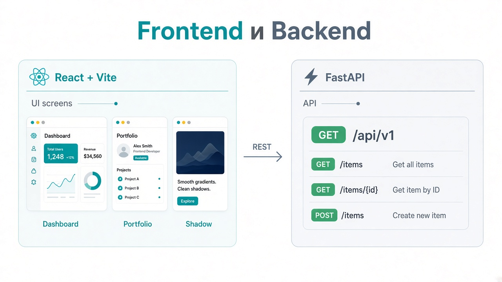

---
aliases:
  - Frontend
---

# Frontend


## Визуальный ориентир



*React/Vite кабинет поверх /api/v1. Иллюстрация Vault.*

**aliases:** Frontend  
**Baseline:** `origin/main` `73c2e25e6aed323174b11dea4514946d5897f54b`  
**Код:** `frontend/src`  
**См.:** [[Backend API]], [[Docker и сервисы]], [[USER vs OWNER mode]]

## 1. Назначение

Показать кабинет инвестора и расширенную диагностику владельца поверх одного и того же API.

## 2. Какую задачу решает

Собирает рынок, книги, Shadow, исследования и систему в тёмный desktop-кабинет. Переключатель USER/OWNER меняет подробность показа, а не права доступа.

## 3. Как работает простыми словами

Браузер открывает Vite-приложение. Оболочка рисует разделы. Выбор портфеля определяет, какую книгу анализировать. Пустые и частичные состояния должны быть видны как есть. Английские технические статусы в журнале решений владелец уже отклонил как сырой вид, хотя код Variant 4 на main есть.

## 4. Архитектура

React и React Router в `App.tsx`. Оболочка `AppShell`. Страницы в `frontend/src/pages`, фичи в `frontend/src/features`.  
Роль показа: `localStorage.kraken.presentationRole` (техническая заметка CHANGELOG). `[GITHUB_VERIFIED]`  
Продуктовая версия на экране берётся из `frontend/src/version/manifest.ts`: текущая запись **Kraken 1.05**. Технический `VERSION` репозитория при этом `1.0.0`.

Контейнер монтирует `./frontend/src` в `/app/src`. Какой каталог на диске является этим `./`, зависит от того, откуда запущен compose. См. [[Инфраструктура]].

## 5. Поток данных

```text
действие на экране
  → клиент API
  → /api/v1
  → состояние страницы
```

Оценки и журналы считаются на сервере. Экран не имеет права заменить пропущенную цену нулём.

## 6. Что уже реализовано (только подтверждённое)

Маршруты `App.tsx` на этом SHA. `[GITHUB_VERIFIED]`

Живые страницы: `/` дашборд, `/about`, рынок и карточки, каталог инструментов, аналитика, связи, теханализ, фундаментал и компании, `/intelligence`, облигации, аллокация, инвестиционное решение, калибровка, риск портфеля, Shadow, набор research-страниц, симулятор, `/portfolio`, `/portfolio/mine`, `/portfolio/:portfolioId`, кандидат (`/portfolio/candidate` и `/portfolio/builder`), workflows, `/system`.

Заглушки `PlaceholderPage`:

- `/recommendations` — раздел появится после аналитического слоя;
- `/decision-memory` — история решений будет здесь;
- `/models` — реестр моделей появится позже.

Дизайн-система V2 влита PR #98, merge `8fbea8d`. `[GITHUB_VERIFIED]` Master Context.  
Журнал на `/shadow` в коде V4 есть и визуально не принят. См. [[Журнал решений]].  
Карточки Hub со стоимостью влиты PR #91. См. [[Portfolio Hub]].

## 7. Что частично реализовано

- Приёмка экрана владельцем: скриншоты 2026-10-30 показывали старый UI при новом main. `[REPORTED_BY_OWNER]`
- V4.1 (плашки, группировка) в PR #101 не влит.
- Гонки старых ответов на котировках, каталоге и создании портфеля описаны как PR C и остаются PLANNED.
- Переключатель портфеля: доступность с клавиатуры названа необязательным хвостом, не частью B/C.

## 8. Что пока исследуется

Паритет с ручным учётом Snowball по дорожной карте 2026-11-19: понятный P&L, календарь выплат, цели. Это продуктовое направление без разрешения начинать импорт брокера. `PROPOSED`.

## 9. Технические ограничения

- USER/OWNER не защищает API.
- Нельзя рисовать рекомендацию как уже исполненную сделку.
- Нельзя показывать частичный NAV как полный.
- Монтирование исходников означает, что контейнер может показывать не тот worktree, из которого кажется, что идёт main.
- Мобильная вёрстка в прочитанном Master Context остаётся долгом приёмки (Agent 09 / скриншоты), не подтверждённым здесь фактом «сломано» или «готово».

## 10. Известные ошибки

- Отклонённый визуал журнала V4. `[REPORTED_BY_OWNER]`
- Возможный старый mount frontend. Гипотеза, `НЕ ПОДТВЕРЖДЕНО` инспекцией в этом проходе.
- Постановка PR C: устаревший ответ может затереть свежие котировки, каталог или список портфелей. Воспроизведение на `73c2e25` не делалось.

## 11. Основные пользовательские сценарии

- Утром открыть дашборд выбранной книги.
- Проверить рынок и карточку бумаги.
- Вести несколько книг через Hub и «Мой портфель».
- Посмотреть Shadow и, в роли OWNER, доказательства и систему.
- Прочитать «О Kraken» и записи manifest.

## 12. Тестирование

Рядом со страницами лежат `*.test.tsx`. Этот аудит Vitest и браузер не запускал. `runtime_status: unverified`. Исторические числа frontend CI из Master Context к этому SHA не переносятся.

## 13. История развития

- 2026-09-27: релиз V1.0, тёмный кабинет, честные пустые состояния.
- Продуктовые записи 1.01–1.05 в manifest, даты 2026-09-28 … 2026-10-07.
- 2026-10-29: PR #91, карточки стоимости.
- 2026-10-30: PR #98 и #99, дизайн и журнал.
- 2026-10-30: отказ по визуалу и открытие #100/#101.
- 2026-11-23: main `73c2e25` содержит эти влитые изменения и не содержит merge #100/#101.

## 14. Потенциальное развитие

V4.1 UI после отдельного принятия, PR C, затем продуктовые экраны P&L и календаря, если их поставят в работу. Заглушки рекомендаций, памяти и моделей сами по себе не являются обещанием срока.

## 15. Зависимости

[[Backend API]], контейнер frontend, контекст выбранной книги. Журнал решений зависит от контракта Shadow read-model.

## 16. Связанные задачи

- PR #101 — OPEN по снимку Master Context.
- PR C — PLANNED.
- Приёмка mount — операционный хвост.

## 17. Технические источники

- `frontend/src/App.tsx`
- `frontend/src/version/manifest.ts`
- `frontend/src/pages`
- `frontend/src/features/shadow/DecisionJournalPanel.tsx`
- `docker-compose.yml` (монтирование `./frontend/src`)
- `CHANGELOG.md`
- `docs/development/CHATGPT_MASTER_CONTEXT.md`
- `docs/ui/KRAKEN_DESIGN_SYSTEM_V2.md` (файл на main; полный текст не копировался)
