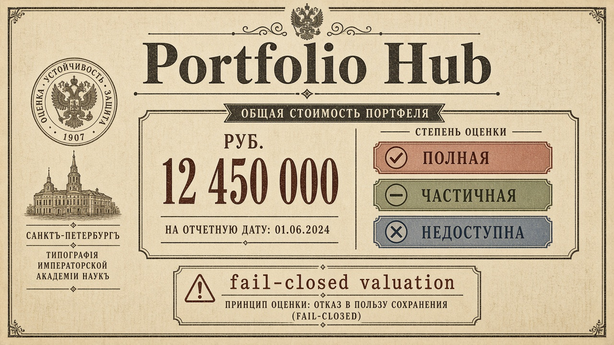

---
aliases:
  - Portfolio Hub
---

# Portfolio Hub


## Визуальный ориентир



*Полная / частичная / недоступна. Иллюстрация Vault; не скриншот приёмки.*

**aliases:** Центр портфелей  
**Baseline:** `origin/main` `73c2e25e6aed323174b11dea4514946d5897f54b`  
**Экран:** `/portfolio`  
**См.:** [[Персональный портфель]], [[Ручной журнал операций]], [[Missing price ≠ zero]]

## 1. Назначение

Показать коллекцию личных книг и выбрать, какая из них дальше открывается в анализе.

## 2. Какую задачу решает

Даёт на карточке не только кэш и число позиций, а общую стоимость книги, с честным состоянием, если часть бумаг не оценена.

## 3. Как работает простыми словами

Список — это витрина. Цифра «общая стоимость» складывается из кэша и оценённых позиций. Если цены не хватает, карточка говорит о частичной или недоступной оценке и не подставляет ноль.

## 4. Архитектура

Лёгкий список и оценённый снимок одной книги — разные операции. Master Context фиксирует, что `list_user_portfolios()` задуман лёгким и без цен, а цена приходит отдельной оценкой. PR #91 добавил пакетную оценку для карточек. `[GITHUB_VERIFIED]` текст Master Context и факт merge в том же документе.  
Выбор книги в UI — источник правды для дашборда (формулировка Multi-Portfolio V2).

## 5. Поток данных

```text
коллекция книг
  → пакетная оценка (кэш + известные цены)
  → карточка: полная / частичная / недоступная стоимость
  → переход в /portfolio/:id
```

Журнал операций карточка не заменяет. См. [[Ручной журнал операций]].

## 6. Что уже реализовано (только подтверждённое)

- Маршрут `/portfolio` → `PortfolioPage`. `[GITHUB_VERIFIED]` `App.tsx`.
- PR #91 влит в main на merge `512628b2798bc81f91a480769e08adfcdbe6169d`. Тема в реестре: Portfolio Hub total balance. `[GITHUB_VERIFIED]` Master Context + реестр источников.
- Поведение, описанное ревью: неизвестная бумага не равна `0 ₽`; тестовые портфели фильтруются, явные id учитываются. `[GITHUB_VERIFIED]` как запись ревью в Master Context, не как повторный прогон тестов.
- На SHA main после #99 исходники, по тексту Master Context, содержат блок общей стоимости и состояния качества. `[GITHUB_VERIFIED]` утверждение документа. Этот аудит `PortfolioPage.tsx` построчно не цитировал.

## 7. Что частично реализовано

- Если оценка неполная, полная NAV и полный P&L не объявляются авторитетными (инвариант). Карточка обязана это показать. Детальный перечень подписей UI в паспорт не копировался.
- Владелец 2026-10-30 видел на `/portfolio` старый вид без блока общей стоимости, хотя код #91 уже был в main. Master Context считает вероятной причиной монтирование frontend из старого worktree. Гипотеза не подтверждена инспекцией Docker в этом проходе. `[REPORTED_BY_OWNER]` скриншоты; причина — `НЕ ПОДТВЕРЖДЕНО`.

## 8. Что пока исследуется

Ничего отдельного «Hub V2» в прочитанных документах нет. Улучшения доступности переключателя портфеля Master Context оставляет необязательным P2 и запрещает тащить их в PR B/C без отдельного задания.

## 9. Технические ограничения

- Лёгкий список без цен нельзя выдавать за оценку.
- Пропуск цены запрещено рисовать как ноль.
- Сброс и удаление действуют на одну книгу (правила V2), не на всю коллекцию сразу. Сами команды живут в паспорте книги, не в витрине.

## 10. Известные ошибки

Расхождение «код в main / старый UI в браузере» зафиксировано 2026-10-30 как P0 приёмки, снят ли он на машине владельца к 2026-11-23 — этот аудит не проверял. `[REPORTED_BY_OWNER]` + гипотеза монтирования.

## 11. Основные пользовательские сценарии

- Увидеть несколько книг и их общую стоимость.
- Понять, что стоимость частичная.
- Открыть книгу и продолжить в «Моём портфеле».
- Создать книгу из списка. PR C отдельно требует, чтобы неудачный повторный GET после успешного POST не заставлял создавать книгу второй раз. Статус PR C — PLANNED.

## 12. Тестирование

`PortfolioPage.test.tsx` есть в дереве. `[GITHUB_VERIFIED]` имя файла. Запуск в этом аудите не выполнялся. Для #91 Master Context ссылается на успешный GitHub run `40864314012` на тогдашнем tip, не на SHA `73c2e25`.

## 13. История развития

- 2026-10-29 владелец попросил общую стоимость на карточке, а не только кэш и число позиций.
- Тот же день: PR #91 влит после PR #85; конфликт в `PortfolioPage.tsx` сохранён в пользу карточек оценки и общего `formatRub`.
- 2026-10-30: скриншоты владельца ещё показывали старые карточки при уже влитом коде.

## 14. Потенциальное развитие

Отдельного утверждённого расширения Hub сверх честной оценки в прочитанных источниках нет. Производительность и XIRR на карточке не заявлены как сделанные.

## 15. Зависимости

[[Персональный портфель]], [[Ручной журнал операций]], цены [[Рыночные данные]].

## 16. Связанные задачи

- Приёмка актуального mount frontend — операционный хвост, не новый продукт.
- PR C — гонка обновления списка после создания.

## 17. Технические источники

- `frontend/src/pages/PortfolioPage.tsx`
- `frontend/src/App.tsx`
- `docs/product/multi-portfolio-v2.md`
- `docs/development/CHATGPT_MASTER_CONTEXT.md` (PR #91, скриншоты 2026-10-30)
- `backend/app/modules/portfolio/application/user_portfolio_service.py` (имя из Master Context)
