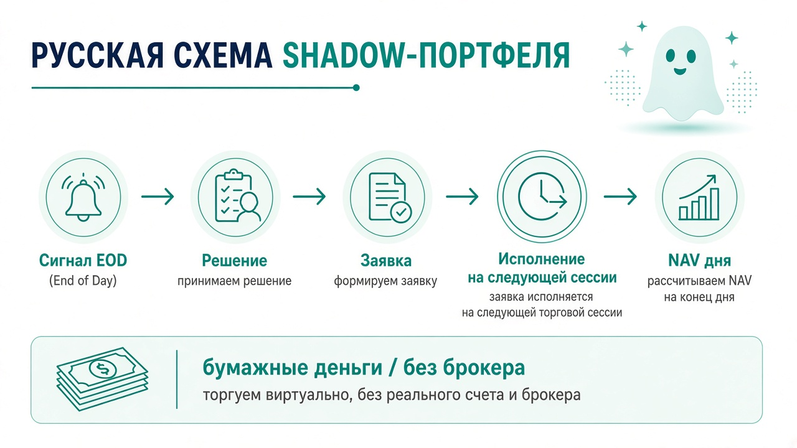

---
aliases:
  - Shadow
---

# Shadow-портфель


## Визуальный ориентир



*Сигнал → решение → заявка → исполнение → NAV. Иллюстрация Vault; не скриншот приёмки и не доказательство runtime.*

**aliases:** Shadow  
**Baseline:** `origin/main` `73c2e25e6aed323174b11dea4514946d5897f54b`  
**Пакет:** `backend/app/modules/shadow`  
**См.:** [[Исполнение]], [[Журнал решений]], [[Торговая политика]], [[Прогноз]]

## 1. Назначение

Вести виртуальный портфель решений: цель, ордер, исполнение на следующем открытии и дневная стоимость. Реальных денег здесь нет.

## 2. Какую задачу решает

Проверяет, можно ли честно провести сигнал до сделки в лотах и с комиссией, не подглядывая в уже известную цену открытия и не портя личную книгу.

## 3. Как работает простыми словами

Вечером, когда дневные свечи полны, система строит цель и план ордеров. Утром подходящие ордера исполняются по официальному OPEN. Днём LAST может показывать живую оценку. Пропущенный день не лечится задним числом тем OPEN, который уже прошёл для нового ордера.

## 4. Архитектура

Две группы эксперимента, обе может двигать Daily Research Cycle:

| Группа | Количества | История |
|---|---|---|
| `SHADOW_FORWARD_V0` | могли быть дробными | заморожена, не переписывается |
| `SHADOW_PORTFOLIO_REALISM_V2` | только целые лоты MOEX | новый капитал, вперёд |

Политика и прогноз V2 те же, что у операционного V1: документ называет Candidate V0 и гистерезис. Меняется реализм исполнения. `[GITHUB_VERIFIED]` `shadow-portfolio-realism-v2.md`, ADR 0008.

Инициализация V2 не трогает V1:

```text
python -m app.modules.shadow.cli init --group realism-v2
POST /api/v1/shadow/init?group=realism-v2
```

Операции: `GET /api/v1/shadow/daily-operations` (псевдоним `/operations/status`).

## 5. Поток данных

```text
EOD свечи → Forward → цель политики → план лотов (продажи, затем покупки)
  → PENDING
следующая сессия OPEN → fill
LAST в Redis → живая пометка, не дневной NAV
полный дневной close → ShadowNavDaily
```

Сравнение с [[Исторический симулятор]] ограничено: симулятор по умолчанию всё ещё дробный.

## 6. Что уже реализовано (только подтверждённое)

- Разделение EOD-решения и intraday-исполнения (ADR 0007). Заполнение `SHADOW_NEXT_SESSION_OPEN_V1` берёт OPEN котировки, не LAST. Свечной путь заполнения остаётся для истории и бэкфилла. `[GITHUB_VERIFIED]`
- Целые лоты, обязательный LOTSIZE, запрет молчаливого `lot_size=1`. Причины пропуска названы, среди них `UNKNOWN_LOT_SIZE` и `INSUFFICIENT_CASH_FOR_ONE_LOT`. Остаток кэша после округления законен. `[GITHUB_VERIFIED]` ADR 0008 и документ V2.
- Поля позиции V2: `quantity`, `lots`, `lot_size`, `avg_entry`, `cost_basis`, `realized_pnl`. `[GITHUB_VERIFIED]`
- Готовность к следующей сессии: полнота данных, а не «часы пробили». Пропуск готовности — инцидент, не ретро-сделка. `[GITHUB_VERIFIED]` ADR 0009.
- Ордер, созданный после открытия, ждёт следующую сессию. Догоняющий расчёт вчерашнего Forward не разрешает сегодняшний OPEN для новых ордеров. `[GITHUB_VERIFIED]`
- CHANGELOG V1.0 описывает виртуальные книги, исполнение на следующей сессии, догон пропущенных дней без дублей и без будущих данных. `[GITHUB_VERIFIED]` текст релиза.
- PR #85 (надёжность Shadow: замок восстановления, heartbeat, ограждение коммитов) влит, merge `a1c165b5d6378cff8e7cfae86a2aaf79199e4a1a`. Полный живой догон Master Context отдельно называет не подтверждённым. `[GITHUB_VERIFIED]` запись merge; живой догон — `НЕ ПОДТВЕРЖДЕНО`.
- Экран `/shadow`. `[GITHUB_VERIFIED]`

## 7. Что частично реализовано

- Автоматический цикл зависит от флагов (`DAILY_RESEARCH_CYCLE_*`, `EOD_READINESS_RETRY_*`, `INTRADAY_MARKET_*`, `RESEARCH_LIVE_MODE`). Документ не утверждает, что на машине владельца они включены.
- Живая оценка и EOD NAV — разные вещи. EOD NAV пишется после полных дневных закрытий, не из intraday LAST.
- Журнал объяснений на экране есть в коде V4 и не принят владельцем как готовый UX. См. [[Журнал решений]].

## 8. Что пока исследуется

- Сопоставимость V1, V2 и дробного симулятора. Документ прямо ограничивает сравнение до отдельного Simulator Realism.
- P&L, привязанный к каждому историческому решению, в текущем `live_valuation` Master Context не находит: есть агрегированный нереализованный результат позиции при наличии отметки и себестоимости, нет пожизненной атрибуции на когорту решений. `PROPOSED` отдельным контуром.

## 9. Технические ограничения

- Не переписывать fills V1.
- Не уничтожать ордера, fills и NavDaily ради удобства (инвариант Master Context).
- Intraday не входит в признаки и прогноз.
- Пропущенное OPEN не заменяется тихим close.
- LOTSIZE неизвестен — ордер пропускается с причиной, размер лота не выдумывается.

## 10. Известные ошибки

- Исторический NAV и провененция были предметом HOLD по PR #85 до исправлений; PR позже влит по решению владельца. Остаточный риск: полный live catch-up не подтверждён независимо.
- Старые решения без `candidate_traces` честно помечаются как без детализации. Это свойство журнала, не порча ledger. См. [[Журнал решений]].

## 11. Основные пользовательские сценарии

- Смотреть `/shadow`: что решено, что ждёт открытия, что исполнено.
- Различить «сегодняшняя сессия» и «подготовка следующей» при включении середины дня (ADR 0009).
- OWNER видит коды блокеров готовности и отставание рынка (формулировка CHANGELOG).

## 12. Тестирование

Этот аудит тесты не запускал. Master Context хранит исторические цифры CI для PR #85 (в том числе backend 1880 на одном из tip) и локальный отчёт Cursor «162 Shadow passes» как `REPORTED_BY_CURSOR` на тот момент. К SHA `73c2e25` эти числа не приписываются. Файлы `ShadowPage.test.tsx` в дереве есть.

## 13. История развития

- V0/V1: PENDING после EOD Forward, fill на следующем OPEN; сначала ждали дневную свечу.
- ADR 0007: OPEN можно взять из intraday-слоя в Redis.
- ADR 0008: лоты и готовность, новая группа V2.
- ADR 0009: запрет исполнения по уже прошедшему OPEN.
- 2026-10-29: PR #85 влит.

## 14. Потенциальное развитие

Simulator Realism с теми же лотами — отдельная задача, в документе V2 не сделана. Атрибуция P&L по решениям — отдельное проектирование, не часть #100/#101 по тексту ревью.

## 15. Зависимости

[[Рыночные данные]], [[Прогноз]], [[Торговая политика]], [[Исполнение]], Daily Research Cycle, Redis при intraday. Не пишет в личный журнал.

## 16. Связанные задачи

- Журнал V4.1: PR #100 и #101 открыты по снимку Master Context.
- Живой догон истории Shadow — операционный хвост, не автоматически завершённый merge #85.
- Не смешивать с PR B (личный журнал).

## 17. Технические источники

- `docs/architecture/shadow-portfolio-realism-v2.md`
- `docs/adr/0007-separate-eod-decision-from-intraday-execution.md`
- `docs/adr/0008-lot-aware-shadow-portfolio-and-daily-readiness.md`
- `docs/adr/0009-prospective-session-readiness.md`
- `backend/app/modules/shadow`
- `backend/app/api/v1/shadow.py`
- `frontend/src/pages/ShadowPage.tsx`
- `CHANGELOG.md`
- `docs/development/CHATGPT_MASTER_CONTEXT.md`
