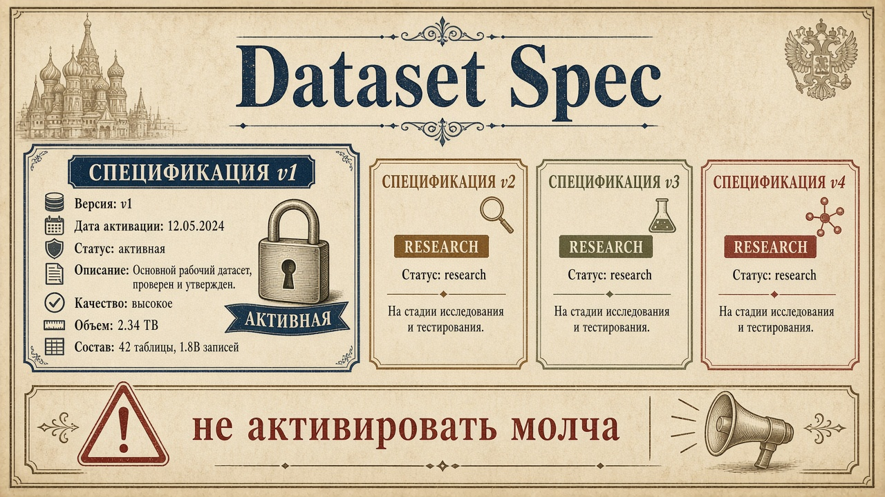

---
aliases:
  - Dataset
---

# Датасет


## Визуальный ориентир



*Активна v1; v2+ research. Иллюстрация Vault; не скриншот приёмки.*

**aliases:** Dataset  
**Baseline:** `origin/main` `73c2e25e6aed323174b11dea4514946d5897f54b`  
**Пакет:** `backend/app/modules/learning`  
**См.:** [[Dataset Spec]], [[Прогноз]], [[Исследования]], [[Point-in-Time (PIT)]]

## 1. Назначение

Собирать версионированную точку «признаки на дату `t` и метки будущего» так, чтобы старый контракт не менял смысл молча.

## 2. Какую задачу решает

Даёт воспроизводимый объект для обучения и честного сравнения, не подменяя собой боевого чемпиона и не записывая исследовательский прогон в продакшен-реестр.

## 3. Как работает простыми словами

Есть несколько версий одной спецификации `pit_daily_core`. Боевой указатель стоит на версии 1. Версии 2, 3 и 4 можно собрать для исследования. Четвёртая добавляет фундаментал и события к тем же ценовым меткам, что и третья, и сама себя не включает.

## 4. Архитектура

Код: `dataset_config.py`.

```text
PIT_DAILY_CORE_CODE = pit_daily_core
PIT_DAILY_CORE_ACTIVE_VERSION = 1
версии 2, 3, 4 объявлены и не автоактивируются
```

`[GITHUB_VERIFIED]`  
Обзор: v1 заморожен; v2 в исследовании; Dataset V3 / total return не READY. Документ V4 уточняет семантику 3 и 4 и лежит на этом же main вместе с `v4_enrichment.py` и `compare_v3_v4.py`. Внутренняя фраза документа «Status at writing: OPEN / NOT MERGED» и «последний продукт 1.03» описывают момент написания, а не отсутствие файлов на `73c2e25`.

Сравнение: `POST /api/v1/learning/datasets/compare-v3-v4`. CLI: `python -m app.modules.learning.cli_compare --pair v3-v4`. Документ помечает это как OWNER/research и говорит, что в той вехе не было UI Research Lab. Позже экран доказательств на main есть. См. [[Исследования]].

## 5. Поток данных

```text
аналитика + technical + relations
  → X версии 1/2/3
  → для v4: пакет отношений отчёта и пакет event_*
  → метки ценовой доходности (не total return)
  → DatasetRun + покрытие + оценка качества исследования
```

Вселенная V3 и V4: `historical_equity_universe_v2`. Если она не резолвится, сборка падает, а не молча берёт текущие активные бумаги. `instrument_ids` не обходят допуск. `[GITHUB_VERIFIED]`

## 6. Что уже реализовано (только подтверждённое)

- Замороженная активная v1 и собираемые v2–v4 без автоактивации. `[GITHUB_VERIFIED]`
- Разница V3 и V4 по документу: та же вселенная, те же горизонты меток 1/5/10/20, та же механическая цена (только сплит), тот же базовый манифест признаков; V4 добавляет отношения отчёта и события; пропуски остаются NaN. `[GITHUB_VERIFIED]`
- Имена фундаментального пакета V4 перечислены в документе (`fund_net_margin`, `fund_debt_to_equity` и соседние). Сырая выручка в X не входит. `[GITHUB_VERIFIED]`
- Валидация валит DatasetRun, если `feature_known_at` заглядывает вперёд. `[GITHUB_VERIFIED]`
- Оценки качества исследования: `READY_FOR_RESEARCH`, `PARTIAL`, `NOT_READY`. `READY_FOR_RESEARCH` не означает «отдать кандидату». Пороги в конфиге: `RESEARCH_V4_PARTIAL_MIN_ENRICHMENT_PCT = 10`, `RESEARCH_V4_PARTIAL_CURRENT_ONLY_PCT = 50`. `[GITHUB_VERIFIED]`
- OOS: версии 2, 3, 4; обучение строго до разреза; нет случайного сплита; `persist_registry=False`. `[GITHUB_VERIFIED]`
- Candidate V0/V1 остаются на Dataset V2. `[GITHUB_VERIFIED]` документ V4.
- Эндпоинт сравнения не должен звать `seed_dataset_specs()`, потому что сид активирует v1. `[GITHUB_VERIFIED]`

## 7. Что частично реализовано

- Покрытие дивидендов, банков и делистинга документ V4 называет ограничениями. Полная доходность не является первичной меткой.
- `CURRENT_ONLY` в идентичности эмитента слабее датированного окна.
- Обзор архитектуры по-прежнему говорит, что Dataset V3 не READY. Это согласуется с активной версией 1 и не отменяет существование исследовательской сборки v3.

## 8. Что пока исследуется

Честный выбор метки: скорректированная цена или total return. ADR 0005 оставляет выбор первой ML-метки открытым и запрещает считать total return первой целью по умолчанию. Dataset V5 не авторизован (Master Context, документ Evidence).

## 9. Технические ограничения

- Нельзя тихо сменить смысл `forward_return_Nd` внутри v1.
- Нельзя заменять пропуск нулём, медианой или протяжкой неизвестного.
- Нельзя обойти историческую вселенную списком текущих id.
- Нельзя писать продакшен-реестр из compare.
- Сравнение V3 и V4 обязано совпасть по ключам сэмплов и по семантике 20-дневной метки, иначе `FAIR_CONTRACT_FAIL`.
- Relations в V0 датасета включены флагом `RELATIONS_JOIN_ENABLED = True` и закреплены за `basic_relations` v1. `[GITHUB_VERIFIED]` конфиг.

## 10. Известные ошибки

Устаревшие статусные абзацы внутри `dataset-v4-research-foundation-v1.md` (ветка ещё открыта, продукт 1.03). Код и manifest ушли дальше, запрет активации сохранился. Это документальный дефект.

## 11. Основные пользовательские сценарии

Прямого пользовательского конструктора датасета в кабинете документ V4 не обещал. OWNER запускает сборку и сравнение. Результат кампании человек читает в «Доказательствах», не в реестре моделей: экран `/models` — заглушка.

## 12. Тестирование

Тесты не запускались. Документ описывает падение валидации на lookahead и отказ при несовпадении контракта. Зелёность на SHA `73c2e25` не проверялась.

## 13. История развития

- V1 заморожен контрактом ADR 0005.
- V2 остаётся пином кандидатов.
- V3 добавляет вселенную с учётом выживания и механические ценовые метки.
- V4 добавляет только признаки и диагностику честности.
- Запись manifest 1.04 фиксирует, что эта добавка не улучшила OOS против BASE в канонической кампании.

## 14. Потенциальное развитие

Условия любого будущего повышения перечислены в разделе 14 документа V4: заморозка контракта после успешных прогонов, walk-forward, отдельное решение по total return, затем Shadow и человеческое подтверждение. Автопереключение из одного compare запрещено. `PROPOSED` как условия, не как работа.

## 15. Зависимости

[[Рыночные данные]], аналитика, technical, relations, [[Фундаментал]], [[Дивиденды и корпоративные действия]]. Потребители: [[Прогноз]], [[Исследования]]. Память решений датасет не заменяет. См. [[Хранилища]].

## 16. Связанные задачи

Не поднимать активную версию в PR журнала, intelligence или дивидендного календаря без явного задания и смены версии.

## 17. Технические источники

- `backend/app/modules/learning/dataset_config.py`
- `backend/app/modules/learning/application/v4_enrichment.py`
- `backend/app/modules/learning/application/builder.py`
- `backend/app/modules/learning/application/compare_v3_v4.py`
- `backend/app/api/v1/learning.py`
- `docs/research/dataset-v4-research-foundation-v1.md`
- `docs/architecture/overview.md`
- `docs/architecture/decisions/0005-raw-market-corporate-actions-returns.md`
- `docs/architecture/decisions/0004-analytics-feature-store-v1.md`
- `frontend/src/version/manifest.ts`
