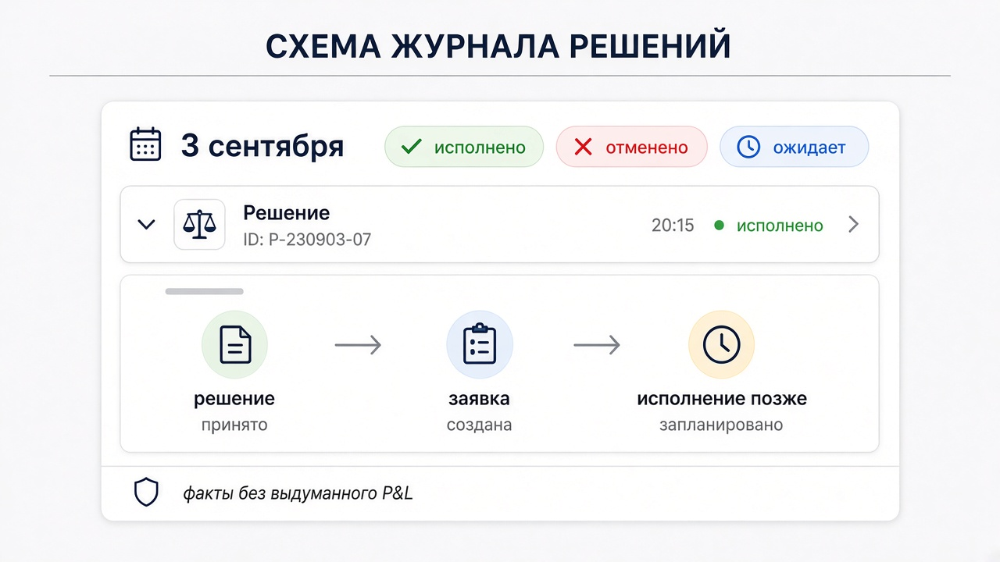

---
aliases:
  - Decision Journal
---

# Журнал решений


## Визуальный ориентир



*День фактов без выдуманного P&L. Иллюстрация Vault; не скриншот приёмки и не доказательство runtime.*

**aliases:** Decision Journal  
**Baseline:** `origin/main` `73c2e25e6aed323174b11dea4514946d5897f54b`  
**Код:** read-model в `shadow`, панель на `/shadow`  
**См.:** [[Shadow-портфель]], [[Память решений]], [[Decision vs Order vs Fill]]

## 1. Назначение

Показать человеку, почему виртуальный портфель в конкретный день хотел купить или держать бумагу, и что из этого стало ордером и сделкой.

## 2. Какую задачу решает

Отделяет объяснение решения от бухгалтерской книги. Журнал читает уже записанные факты и не создаёт сделки.

## 3. Как работает простыми словами

На экране Shadow раскрывается день: решение, следы по бумагам, ордера и исполнения. Если старая запись не сохранила подробный след, экран так и говорит, а не выдумывает причину. Дата сигнала и дата исполнения могут различаться: ордер связан неизменяемым идентификатором.

## 4. Архитектура

Это не отдельный пакет и не личный журнал операций.  
Модуль: `backend/app/modules/shadow/application/decision_journal.py`.  
Заголовок файла: read-only модель «Decision → traces → Orders → Fills → NAV». Не выдумывает fills и candidate traces. Без `candidate_traces` в metadata ставится `detail_available=false` и русский текст, что подробный trace этой исторической версии не сохранялся. `[GITHUB_VERIFIED]`  
UI: `frontend/src/features/shadow/DecisionJournalPanel.tsx`.  
Публичные поля следа перечислены белым списком. Свободный chain-of-thought наружу не отдаётся.

Вариант 4 (раскрываемые карточки) выбран владельцем 2026-10-29 как визуальное направление и затем реализован в PR #99.

## 5. Поток данных

```text
ShadowDecision + metadata.candidate_traces
  → ордера ShadowOrder (причина, статус)
  → ShadowFill по дате исполнения
  → дневной NAV, если он есть
  → панель «Детали решения»
```

Личный `personal_operations` сюда не пишется. Снимки postgres-memory — другой контур. См. [[Память решений]].

## 6. Что уже реализовано (только подтверждённое)

- Read-model и панель на main. PR #99 влит, merge `95f2fd857764448168343d22bacf8e49ed445d29`. `[GITHUB_VERIFIED]` Master Context.
- Честный флаг `detail_available` только по наличию `candidate_traces`. `[GITHUB_VERIFIED]` docstring и разбор Master Context на SHA `53a1596`, файл на текущем main тот же путь.
- Счётчики BUY/SELL при отсутствии следов опираются на стороны ордеров. Исполнения группируются по `ShadowFill.execution_date`, поэтому в день сигнала исполнений может быть ноль при статусе FILLED у ордера. `[GITHUB_VERIFIED]` разбор в Master Context.
- В белом списке следа есть поля вроде ранга, веса, `avg_entry`, `current_mark`, `unrealized_pnl`, если они уже были записаны в trace. Это показ сохранённого поля, не расчёт P&L по решению. `[GITHUB_VERIFIED]` ключи `_TRACE_PUBLIC_KEYS`.
- Регрессии, описанные ревью #99: убраны выдуманные ROTATE и голое REVIEW→held; ожидание смотрит на `order.status`. CI на tip #99 Master Context помечает успешным (run `40927914670`). Это исторический run, не прогон SHA `73c2e25`.

## 7. Что частично реализовано

- Код V4 в main и принятие владельцем — разные состояния. 2026-10-30 владелец отклонил вид: английские статусы, `Decision #3`, длинный список, несовпадение с макетом Variant 4. `[REPORTED_BY_OWNER]`
- Тот же день скриншоты не показывали кнопку «Детали решения», хотя исходник на main её содержал. Вероятная причина — старый mount frontend. `[REPORTED_BY_OWNER]` + гипотеза, runtime этой машины не проверялся.
- Цветные плашки статусов и P&L на каждое решение / ордер в открытых PR #100 и #101, по независимому разбору, **не считаются**. `[GITHUB_VERIFIED]` текст ревью в Master Context. Сами PR на этот main не влиты.

## 8. Что пока исследуется

- V4.1: [#100](https://github.com/UberSerg/ProjectAI/pull/100) read-model, HEAD в снимке `5d65ebb49853f9432ef19e0feca3140a0cdbeea3`; [#101](https://github.com/UberSerg/ProjectAI/pull/101) UI, HEAD `88eb135f8720cbc9283eeb4a27d89bc678f1d42e`. Статус в Master Context: OPEN. Повторный `gh` здесь не вызывался.
- Отдельный будущий read-model: реализованный и нереализованный результат, привязанный к покупкам и продажам Kraken, с лотами, комиссиями и явным «недоступно» вместо нуля. Владелец просил это 2026-10-30. В #100/#101 этого расчёта нет. `PROPOSED`.

## 9. Технические ограничения

- Нельзя дописывать исторический ledger и выдумывать причину.
- Нельзя рисовать NAV на дату сигнала, если NAV того дня не записан. Пример из ревью: сигнал 2026-09-03, решение 2026-09-07, fills 2026-09-08 — три разные даты.
- Нельзя называть агрегированный нереализованный P&L позиции результатом конкретного решения.
- Содержимое реальной БД портфеля владельца №5 независимо не проверялось (оговорка Master Context).

## 10. Известные ошибки

- Для старых дней детализация честно недоступна, хотя ордера и `decision.targets` могут существовать. Пользователь воспринимал это как поломку. Это описанное поведение V4, не молчаливая потеря ордеров.
- Визуальное качество V4 отклонено владельцем. Исправление живёт в невлитом V4.1.
- Рассинхрон экрана и main из-за Docker mount — открытая приёмочная гипотеза.

## 11. Основные пользовательские сценарии

- Открыть `/shadow` и раскрыть день.
- Увидеть бумагу, статус ордера и связь с более поздним исполнением.
- Прочитать, что след не сохранялся, если это старая запись.
- OWNER может видеть вторичную диагностику. Точный состав OWNER-блока V4.1 на main не переносить: V4.1 не влит.

## 12. Тестирование

Файлы `DecisionJournalPanel.test.tsx`, `ShadowPage.test.tsx`, `helpers.test.ts` есть. Этот аудит их не запускал. Cursor сообщал браузерный смоук `/shadow` за 2026-09-03; Master Context помечает его `REPORTED_BY_CURSOR`.

## 13. История развития

- 2026-10-29: владелец выбирает Variant 4 как макет, ещё без разрешения на реализацию.
- 2026-10-29: рой UX, PR #99.
- 2026-10-30: #99 влит вместе с дизайн-системой #98 (`8fbea8d`).
- 2026-10-30: отказ по визуалу и постановка V4.1.
- 2026-11-23: снимок Master Context по-прежнему держит #100 и #101 открытыми, main уже содержит более поздние документальные коммиты вплоть до `73c2e25`.

## 14. Потенциальное развитие

Только утверждённый владельцем хвост: человеческие русские статусы, группы по бумаге, различимые даты, и отдельно — атрибуция P&L. Dataset, брокер и переписывание Shadow fills в этот хвост не входят.

## 15. Зависимости

[[Shadow-портфель]] (решения, ордера, fills, NAV). Не зависит от личного журнала. Рядом на экране может быть живая оценка, но она не становится текстом причины.

## 16. Связанные задачи

- PR #100, PR #101 — OPEN по снимку, не merged.
- Приёмка владельца V4 — отклонена, V4.1 ещё не принят («NOT FINALLY ACCEPTED» в Master Context).
- Отдельный контур decision P&L — не начат этими PR.

## 17. Технические источники

- `backend/app/modules/shadow/application/decision_journal.py`
- `frontend/src/features/shadow/DecisionJournalPanel.tsx`
- `frontend/src/features/shadow/decisionJournalCopy.ts`
- `frontend/src/pages/ShadowPage.tsx`
- `docs/development/CHATGPT_MASTER_CONTEXT.md`
- `docs/ui/KRAKEN_UX_SWARM_AUDIT_2026-10-29.md` (файл есть на main; полный текст в паспорт не копировался)
