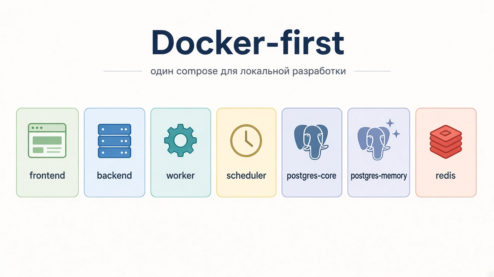

---
aliases:
  - Infrastructure
---

# Инфраструктура


## Визуальный ориентир



*Docker-first контур сервисов. Иллюстрация Vault.*

**aliases:** Infrastructure  
**Baseline:** `origin/main` `73c2e25e6aed323174b11dea4514946d5897f54b`  
**См.:** [[Docker и сервисы]], [[Хранилища]], [[Docker-first]], [[Backend API]]

## 1. Назначение

Поднять один и тот же контур на машине разработчика и позже на VPS: две базы, очередь, API, воркер, планировщик и кабинет.

## 2. Какую задачу решает

Убирает локальную установку PostgreSQL и Redis с Windows-машины и сохраняет данные в томах между перезапусками.

## 3. Как работает простыми словами

Одна команда compose собирает сервисы. Правка кода в примонтированной папке подхватывается без пересборки для обычных правок. Данные переживают `docker compose down`. Стирание томов — отдельная сознательная команда с флагом `-v`.

## 4. Архитектура

ADR 0003: Docker Desktop и Linux-контейнеры, bind-mount исходников.  
Сервисы и тома перечислены в [[Docker и сервисы]] и [[Хранилища]].  
Один образ backend обслуживает API, worker и scheduler (следствие ADR 0001).  
Миграции разделены: `alembic_core.ini`, `alembic_memory.ini`.  
Рядом лежит `docker-compose.release.yml`. Его отличие от dev-compose в этот паспорт не разбиралось.

Пакет `backend/app/modules/system` содержит application-код здоровья. Пакет `workflows` на диске — только `__init__.py`, а HTTP workflows подключён из рыночного роутера.

## 5. Поток данных

```text
compose up
  → postgres-core, postgres-memory, redis
  → backend (health live)
  → worker и scheduler
  → frontend :5173
```

Готовность зависимостей проверяется отдельно от живости процесса. Dashboard смотрит полную диагностику, включая probe worker.

## 6. Что уже реализовано (только подтверждённое)

- Семь сервисов compose и пять томов: core, memory, redis, raw, models. `[GITHUB_VERIFIED]` `docker-compose.yml`.
- Health-ручки и запрет циклического `depends_on` через полный health. `[GITHUB_VERIFIED]` обзор.
- Hot reload backend и frontend, для Vite на Windows включён polling. `[GITHUB_VERIFIED]` документ разработки.
- Порты по умолчанию: 5432, 5433, 6379, 8000, 5173, через переменные `HOST_*`. `[GITHUB_VERIFIED]`
- CHANGELOG V1.0: Docker, автотесты, CI, версионируемые миграции. `[GITHUB_VERIFIED]` текст релиза. Зелёность CI именно на `73c2e25` не запрашивалась.
- Политика владельца 2026-10-30: объём проверок зависит от риска. Документ прямо говорит, что сами GitHub Actions этой политикой ещё не переписаны и могут запускать полный набор на каждый push. `[GITHUB_VERIFIED]` Master Context.

## 7. Что частично реализовано

- Флаги рынка, intraday и дневного цикла по умолчанию выключены или требуют явного включения. Инфраструктура их содержит, оператор их включает.
- Закрытие публикации портов наружу отложено решением 2026-10-28. Текущие пробросы остаются как в compose. `[GITHUB_VERIFIED]` как решение; аудит сети машины не делался.
- Наблюдаемость сверх health (отдельный стек логов и метрик) в прочитанном docker-документе не описана.

## 8. Что пока исследуется

Оптимизация CI путями и фильтрами — отдельная будущая задача в тексте политики, не сделанная этим коммитом документации. Вынос Vault в свой git репозиторий — решение «позже», к контейнерам Kraken не относится.

## 9. Технические ограничения

- `down -v` уничтожает рыночную историю и память в томах.
- Нельзя чинить «старый UI» пересборкой, если примонтирован чужой worktree: контейнер читает файлы с хоста.
- Worker не должен зависеть от ручки, которая сама ждёт worker.
- Секреты остаются в `.env` и в Vault не копируются.
- Две базы мигрируются двумя командами alembic.

## 10. Известные ошибки

Гипотеза устаревшего монтирования `projectai-frontend` (2026-10-30) объясняет расхождение экрана и main. Подтверждение через `docker inspect` в этот проход не входило. `[REPORTED]` в Master Context как likely cause.

## 11. Основные пользовательские сценарии

- Поднять стенд и открыть кабинет на порту 5173.
- Проверить ready перед работой с книгами.
- Обновить схему обеих баз.
- Посмотреть логи backend и worker.
- Остановить стенд без удаления томов.

## 12. Тестирование

Docker health этим аудитом не вызывался. `runtime_status: unverified`. Документ CI описывает исторические успешные сборки Docker на конкретных SHA PR #85, #86, #91, #98, #99. Они не являются прогоном `73c2e25`.

## 13. История развития

- ADR 0003 закрепил Docker-first.
- ADR 0002 добавил второй Postgres с pgvector.
- Релиз V1.0 описал воспроизводимый стенд.
- 2026-10-28 владелец отложил сетевое закручивание.
- 2026-10-30 зафиксирована политика экономии CI без изменения workflow-файлов в том коммите.

## 14. Потенциальное развитие

Фильтры CI, отдельный hardening портов, разбор release-compose. Всё это требует явного задания. Объектное хранилище вместо тома сырья в data-storage названо возможным позже.

## 15. Зависимости

Docker Desktop, файл окружения из примера, образы Postgres 16, pgvector pg16, Redis 7. Потребители: все паспорта, которые ходят в базы и в кабинет.

## 16. Связанные задачи

Не менять порты и firewall внутри продуктовых PR, пока владелец не снимет отложение. Не удалять тома ради «чистой» приёмки журнала.

## 17. Технические источники

- `docker-compose.yml`
- `docker-compose.release.yml` (наличие; содержимое не разбиралось)
- `docs/architecture/docker-development.md`
- `docs/architecture/decisions/0003-docker-first-development.md`
- `docs/architecture/decisions/0001-modular-monolith.md`
- `docs/architecture/data-storage.md`
- `backend/app/api/v1/system.py`
- `docs/development/CHATGPT_MASTER_CONTEXT.md`
- `CHANGELOG.md`
