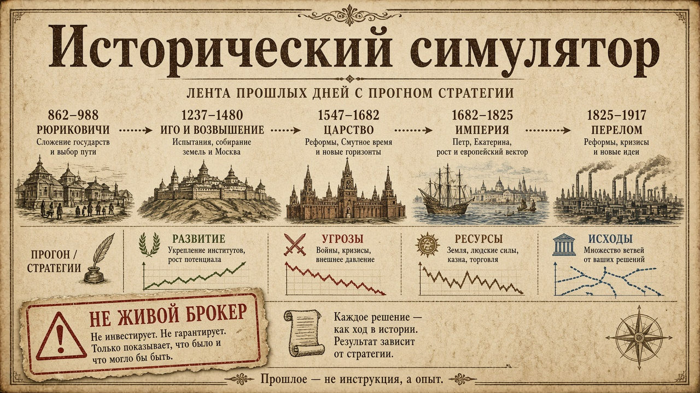

---
aliases:
  - Simulator
---

# Исторический симулятор


## Визуальный ориентир



*Прогон прошлого, не живой брокер. Иллюстрация Vault; не скриншот приёмки.*

**aliases:** Simulator  
**Baseline:** `origin/main` `73c2e25e6aed323174b11dea4514946d5897f54b`  
**Пакет:** `backend/app/modules/simulator`  
**См.:** [[Исполнение]], [[Торговая политика]], [[Исследования]], [[Shadow-портфель]]

## 1. Назначение

Проигрывать политику по уже известной истории и сохранять прогон. Это лабораторная экономика, не виртуальный счёт Shadow и не личные деньги.

## 2. Какую задачу решает

Позволяет сравнить правила на прошлом отрезке, не записывая ордера в живой Shadow и не улучшая прошлое задним числом.

## 3. Как работает простыми словами

Выбирается политика и окно. Движок идёт по дням, считает веса и стоимость. По умолчанию количества дробные: биржа в этом режиме не заставляет покупать целый лот. Рядом можно показать избыточную доходность над ключевой ставкой ЦБ. Ставка при этом не капает на кэш как депозит.

## 4. Архитектура

Пакет: `application/engine.py`, `policy.py`, `policy_hysteresis.py`, каталог `infrastructure`. Отдельного `domain/` в листинге верхнего уровня не было.  
HTTP: `/api/v1/simulator`.  
Экраны: `/simulator`, `/simulator/:runId`.  
ADR 0008: реализм лотов Shadow не переносится на симулятор, пока нет отдельной задачи Simulator Realism. `[GITHUB_VERIFIED]`  
ADR 0006: CBR hurdle можно показать рядом со стратегией и IMOEX. Это бенчмарк.  
ADR 0010: режим `TOTAL_RETURN_GROSS_V1` в том решении не включается.

Экономический симулятор внутри [[Исследования]] — другой код (`research_evidence/economics.py`) со своими правилами 20 сессий и равного веса. Его результаты не являются прогоном этого пакета.

## 5. Поток данных

```text
исторические ряды и сигналы ≤ t
  → политика
  → дробные веса (текущий контракт по умолчанию)
  → кривая прогона
  → экран прогона
```

Будущая свеча в решение дня `t` входить не должна. Это общий PIT-инвариант, не отдельный отчёт о каждом баге движка.

## 6. Что уже реализовано (только подтверждённое)

- Движок и две ранговые политики в пакете симулятора. `[GITHUB_VERIFIED]` файлы.
- Роутер и две страницы. `[GITHUB_VERIFIED]`
- Решение показывать ключевую ставку как hurdle. `[GITHUB_VERIFIED]` ADR 0006.
- Явное ограничение сопоставимости с лотовым Shadow. `[GITHUB_VERIFIED]` ADR 0008.
- Отложенное включение полной доходности. `[GITHUB_VERIFIED]` ADR 0010.

## 7. Что частично реализовано

- Целые лоты, денежный запас под комиссию и причины `UNKNOWN_LOT_SIZE` описаны для Shadow V2 и для общего примитива с кандидатом. Документ говорит, что симулятор остаётся дробным. `[GITHUB_VERIFIED]`
- Дивидендный кэш в прогоне не подключён как включённый режим.

## 8. Что пока исследуется

Simulator Realism V2 как отдельная задача в тексте Shadow. Статус «сделано» в прочитанных файлах не стоит. `PROPOSED`.

## 9. Технические ограничения

- Дробный прогон нельзя сравнивать с лотовым Shadow как с одним и тем же опытом.
- Hurdle не является начислением на кэш и не является безрисковой ставкой.
- Полная доходность не включается, пока покрытие дивидендов не готово.
- Прогон не пишет `personal_operations` и не создаёт `ShadowOrder`.

## 10. Известные ошибки

Именного открытого дефекта движка на `73c2e25` этот паспорт не выводит. Путаница трёх экономик (симулятор, Shadow, Evidence) — риск чтения, его снимают разные паспорта.

## 11. Основные пользовательские сценарии

- Открыть список прогонов `/simulator`.
- Открыть один прогон и смотреть кривую.
- В лаборатории сопоставить стратегию со ставкой ЦБ, помня смысл hurdle.

## 12. Тестирование

Тесты не запускались. `SimulatorRunsPage.test.tsx` и `SimulatorRunPage.test.tsx` есть. `[GITHUB_VERIFIED]` имена.

## 13. История развития

Симулятор входил в исследовательский стек обзора вместе с портфелем и Shadow. Лотовый реализм 2026 года специально оставил симулятор дробным. ADR 0006 и 0010 добавили контракты бенчмарка и полной доходности, не включая вторую в прогоны.

## 14. Потенциальное развитие

Отдельная версия прогонов с целыми лотами и отдельная версия с gross total return, если владелец поставит задачу и покрытие дивидендов будет честным. Оба пункта в ADR названы будущими и версионируемыми. `PROPOSED`.

## 15. Зависимости

[[Торговая политика]], [[Рыночные данные]], ряд `KEY_RATE`. Не зависит от Redis-intraday.

## 16. Связанные задачи

Не смешивать с экономикой Evidence и с PR журнала Shadow.

## 17. Технические источники

- `backend/app/modules/simulator`
- `backend/app/api/v1/simulator.py`
- `frontend/src/pages/SimulatorRunsPage.tsx`
- `frontend/src/pages/SimulatorRunPage.tsx`
- `docs/adr/0006-cbr-key-rate-primary-hurdle.md`
- `docs/adr/0008-lot-aware-shadow-portfolio-and-daily-readiness.md`
- `docs/adr/0010-gross-total-return-v1.md`
- `docs/architecture/shadow-portfolio-realism-v2.md`
- `docs/architecture/overview.md`
