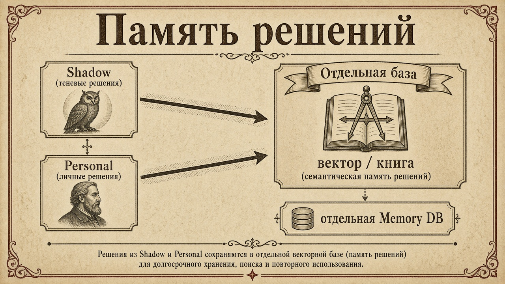

---
aliases:
  - Decision Memory
---

# Память решений


## Визуальный ориентир



*Отдельная Memory DB. Иллюстрация Vault; не скриншот приёмки.*

**aliases:** Decision Memory  
**Baseline:** `origin/main` `73c2e25e6aed323174b11dea4514946d5897f54b`  
**Пакет:** `backend/app/modules/memory`  
**База:** postgres-memory  
**См.:** [[Decision Memory DB]], [[Журнал решений]], [[Персональный портфель]]

## 1. Назначение

Хранить неизменяемые снимки решений, факторы, исходы, разборы и эмбеддинги отдельно от рыночных таблиц и от журнала денег.

## 2. Какую задачу решает

Позволяет позже спросить, что было показано и что случилось после, не переписывая свечи и не превращая рекомендацию в сделку.

## 3. Как работает простыми словами

Когда система показывает дневное решение по личной книге, его можно сохранить как снимок. Позже к снимку добавляется исход. Связь с реальной операцией пользователя, если её проводят, остаётся явной связью, а не доказательством, что рекомендация вызвала сделку.

## 4. Архитектура

ADR 0002: отдельный Postgres с pgvector, свои миграции `alembic_memory.ini`.  
Таблицы в `docs/architecture/data-storage.md`: `memory.decisions`, `memory.decision_factors`, `memory.decision_outcomes`, `memory.decision_reviews`, `memory.embeddings`.  
HTTP висит на префиксе личного портфеля, тег `personal-decision-memory`.  
Экран маршрута `/decision-memory` в `App.tsx` — `PlaceholderPage` с текстом, что история решений появится здесь. `[GITHUB_VERIFIED]`

Shadow-решения (`ShadowDecision`) в эту схему не переносятся автоматически. См. [[Журнал решений]].

## 5. Поток данных

```text
показанное Daily Decision по книге
  → POST .../decision-memory/capture
  → строка в postgres-memory
  → refresh исходов
  → возможные связи с операциями и снятие связи
```

Исследовательский Evidence Engine читает перспективные исходы отдельно от исторического OOS и запрещает склеивать их в одну точность. `[GITHUB_VERIFIED]` документ Evidence Engine.

## 6. Что уже реализовано (только подтверждённое)

- Отдельная база и перечисленные таблицы в архитектурном документе. `[GITHUB_VERIFIED]`
- Эндпоинты в `decision_memory.py`: capture, список, summary, refresh исходов, possible-matches, создание и удаление связи, карточка решения. Префикс `/{portfolio_id}/decision-memory`. `[GITHUB_VERIFIED]`
- Сервис `decision_memory_service.py` с типами ошибок валидации. Поведение каждого метода построчно не разбиралось.
- Manifest 1.03 (2026-09-30): система умеет сохранять показанное Daily Decision и смотреть, что было после; сохранение не создаёт сделку и не меняет реальный портфель. `[GITHUB_VERIFIED]` текст manifest.
- PR #86 включил async-защиту Decision Memory. Merge описан в Master Context. `[GITHUB_VERIFIED]` как запись, diff не перечитывался.

## 7. Что частично реализовано

- Пользовательский маршрут `/decision-memory` остаётся заглушкой при живом API. Значит, кабинет не обещает отдельный экран памяти, даже если захват идёт из сценария Daily Decision.
- Evidence Engine говорит: подтверждённая связь с `PersonalOperation` не равна причинности; выборка перспективных исходов может быть `INSUFFICIENT_SAMPLE`. `[GITHUB_VERIFIED]`

## 8. Что пока исследуется

Использование эмбеддингов для поиска похожих решений в data-storage названо смыслом pgvector. Готовый пользовательский поиск по эмбеддингам этим паспортом не подтверждён. `НЕ ПОДТВЕРЖДЕНО` как продукт.

## 9. Технические ограничения

- Память не заменяет датасет и feature store.
- Запись рекомендации не является ордером.
- Реконструкция не должна маскироваться под живую запись. См. [[LIVE vs COUNTERFACTUAL_REPLAY]].
- Две базы: сбой memory не лечится записью в `market.candles`.

## 10. Известные ошибки

Отдельного открытого дефекта памяти, проверенного на `73c2e25`, этот паспорт не выводит. Исторический PR #86 чинил гонки async. Нельзя пересказывать его как неисправленный баг.

## 11. Основные пользовательские сценарии

- Сохранить показанное дневное решение по выбранной книге (описание 1.03).
- Позже обновить исход.
- Связать или отвязать действие и операцию, не объявляя связь причиной P&L.
- Отдельной витрины `/decision-memory` пользователь пока не получает: страница-заглушка.

## 12. Тестирование

Этот аудит тесты не запускал. Наличие тестов модуля memory поимённо не инвентаризировалось.

## 13. История развития

- ADR 0002 принят вместе с ранней архитектурой двух баз.
- К продуктовой метке 1.03 захват Daily Decision описан как видимое поведение.
- 2026-10-28 PR #86 влит, в составе была защита Decision Memory.

## 14. Потенциальное развитие

Экран вместо заглушки в прочитанных документах назван будущим текстом самой заглушки, без срока и без принятого макета. Поиск по эмбеддингам не утверждён к реализации.

## 15. Зависимости

[[Инфраструктура]] (postgres-memory, pgvector), [[Персональный портфель]] (идентификатор книги), исходы рынка для refresh. Исследовательский контур читает память только как prospective evidence.

## 16. Связанные задачи

Не путать с PR #100/#101 (журнал Shadow). Не путать с PR B (денежный журнал).

## 17. Технические источники

- `docs/architecture/decisions/0002-separate-memory-database.md`
- `docs/architecture/data-storage.md`
- `backend/app/modules/memory/application/decision_memory_service.py`
- `backend/app/api/v1/decision_memory.py`
- `backend/app/api/v1/router.py`
- `frontend/src/App.tsx` (заглушка `/decision-memory`)
- `frontend/src/version/manifest.ts` (запись 1.03)
- `docs/research/research-evidence-engine-v1.md`
