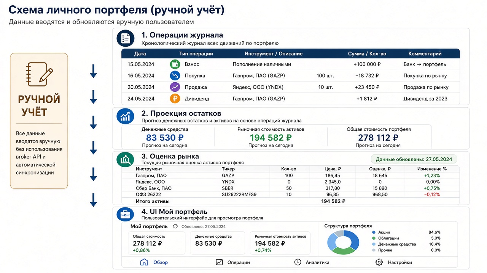

---
aliases:
  - Personal Portfolio
---

# Персональный портфель


## Визуальный ориентир



*Журнал операций → проекция → оценка → UI. Иллюстрация Vault; не скриншот приёмки и не доказательство runtime.*

**aliases:** Personal Portfolio  
**Baseline:** `origin/main` `73c2e25e6aed323174b11dea4514946d5897f54b`  
**Пакет:** `backend/app/modules/portfolio`  
**См.:** [[Ручной журнал операций]], [[Portfolio Hub]], [[Shadow-портфель]]

## 1. Назначение

Вести одну или несколько реальных книг пользователя: кэш, позиции, себестоимость, NAV и аналитику по выбранной книге.

## 2. Какую задачу решает

Отделяет деньги человека от виртуального Shadow и от исследовательских портфелей. Выбор книги в интерфейсе задаёт, какой снимок видят дашборд и анализ.

## 3. Как работает простыми словами

Пользователь создаёт портфели («Основной», «Дивидендный», «ОФЗ» и другие). Пока книга в черновике, остатки можно править свободно. Команда «Начать учёт» переводит книгу в режим журнала: дальше меняются операции, а не поля остатков напрямую.

## 4. Архитектура

Текущая модель — **Multi-Portfolio V2**. Документ V1 помечен superseded: одиночный путь `/primary` и автосоздание «Основной портфель» сняты. `[GITHUB_VERIFIED]`  
Состояния: `DRAFT` и `ACTIVE`.  
Чтение аналитики для пользователя идёт через `load_personal_snapshot`, а не через сырой `ManualPortfolio` как независимый источник.

## 5. Поток данных

```text
черновик или журнал операций
  → проекция кэша и позиций
  → PersonalPortfolioSnapshot
  → экраны Dashboard / My Portfolio / анализ
```

Shadow, Candidate и Research в снимок «Мой портфель» не подмешиваются. `[GITHUB_VERIFIED]`

## 6. Что уже реализовано (только подтверждённое)

- Коллекция API вместо `/primary`: `GET/POST /personal-portfolios`, `GET/PATCH/DELETE /personal-portfolios/{id}`, черновик, `activate`, `reset`, операции, анализ, денежные потоки, daily-decision, compare, rebalance — всё с `{id}`. `[GITHUB_VERIFIED]` `docs/product/multi-portfolio-v2.md`, роутер `personal_portfolios.py`.
- Действия документа: «Начать учёт» (DRAFT→ACTIVE), «Очистить» только для DRAFT, «Сбросить» ACTIVE в пустой DRAFT этой книги, «Удалить» только эту книгу. `[GITHUB_VERIFIED]`
- Учёт средней себестоимости и деньги в `Decimal` / `NUMERIC` описаны в V1 и переиспользуются V2. `[GITHUB_VERIFIED]` как текст продукта.
- Миграция `20260928_0025` по документу очищает одноразовые строки ручной книги и начинает с пустой коллекции, не трогая Market / Shadow / Candidate / Dataset. `[GITHUB_VERIFIED]` текст миграционного решения; содержимое живой БД не проверялось.
- Изоляция тестов: портфели `is_test=true` не являются книгой владельца. `[GITHUB_VERIFIED]`
- Продуктовые заметки manifest 1.02 и 1.03 описывают обновление личного портфеля и сохранение показанного Daily Decision. `[GITHUB_VERIFIED]` текст manifest. Повторный просмотр UI не делался.
- Маршруты frontend: `/portfolio/mine`, `/portfolio/:portfolioId`. `[GITHUB_VERIFIED]` `App.tsx`.

## 7. Что частично реализовано

- Облигации: документ V2 разрешает хранение и грязную оценку; полноценный учёт новых сделок BUY/SELL по облигациям может оставаться закрытым. Себестоимость открытия облигации — необязательная сумма в рублях (`cost_basis_total_rub`), не чистая цена MOEX в процентах. Если суммы нет, рыночная стоимость допустима, а P&L позиции и инвестиционный P&L портфеля остаются пустыми. `[GITHUB_VERIFIED]`
- TWR и XIRR документ V2 явно выносит за объём. `[GITHUB_VERIFIED]`
- Целостность ввода операций (лоты против штук, дата, идемпотентность и тариф) описана как PR B и на этом SHA остаётся `PLANNED` в Master Context. См. [[Ручной журнал операций]].

## 8. Что пока исследуется

Дорожная карта 2026-11-19 (Master Context) ставит следующим продуктовым смыслом честный realized/unrealized P&L и XIRR, затем календарь дивидендов и купонов. Это решение о направлении, `PROPOSED`, не статус кода.

## 9. Технические ограничения

- IAM и мультиарендность отсутствуют.
- Shadow и исследовательские книги — другие домены.
- Аналитика не имеет права выдумывать нереализованный P&L облигации из старой средней цены «в процентах номинала» (текст V1).
- Пропуск котировки не заменяется нулём. См. [[Missing price ≠ zero]].
- `investment_pnl = NAV − (contributed − withdrawn)`.

## 10. Известные ошибки

PR B в Master Context перечисляет расхождения превью и журнала (лоты/штуки, сброс даты при смене типа, грязная форма, повтор идемпотентного ключа после смены тарифа). Это постановка от 2026-10-28, статус PLANNED сохранён в более поздних записях. Построчно модалка на SHA `73c2e25` в этот паспорт не перечитывалась. `[GITHUB_VERIFIED]` как текст Master Context; воспроизведение бага — `НЕ ПОДТВЕРЖДЕНО` этим аудитом.

## 11. Основные пользовательские сценарии

- Создать вторую книгу и переключать её: дашборд показывает выбранную.
- Заполнить черновик и нажать «Начать учёт».
- Внести взнос: взнос и NAV растут вместе, инвестиционный результат от «рынок ничего не сделал» остаётся нулевым.
- Открыть анализ, сравнение и ребаланс выбранной книги.

## 12. Тестирование

Тесты этим аудитом не запускались. В дереве есть `MyPortfolioPage.test.tsx`. `[GITHUB_VERIFIED]` наличие файла. Исторический CI PR #86 (frontend 357 / backend 1838 на старом SHA) к текущему main автоматически не переносится.

## 13. История развития

- V1: один первичный портфель и журнал. Документ сохранён как история модели.
- V2: коллекция книг, ломающее удаление `/primary`.
- Manifest: 1.01 (2026-09-28), 1.02 (2026-09-29), 1.03 (2026-09-30) описывают шаги личного контура и Daily Decision. Технический `VERSION` остаётся `1.0.0`.
- PR #84 в реестре: Investor portfolio journey V1, merge `c7c1d14`. Diff не перечитывался.
- PR #86 влит (async-надёжность, в том числе контекст портфеля). Merge SHA в реестре `7752372` / `0846bd8`.

## 14. Потенциальное развитие

`PROPOSED` по Master Context и V2 «не в объёме»: XIRR/TWR, полный учёт сделок по облигациям, PR B, календарь выплат. Брокерский импорт сделок владельцем исключён.

## 15. Зависимости

[[Ручной журнал операций]], [[Рыночные данные]] (оценки), [[Portfolio Hub]], [[Память решений]] (API рядом с книгой), тарифные профили комиссий. Не зависит от Shadow ledger.

## 16. Связанные задачи

- PR B — целостность операций, PLANNED.
- PR C — гонки загрузки frontend, PLANNED; затрагивает создание портфеля и список.
- Decision-attributed P&L в дорожной карте — отдельный будущий контур, не этот журнал.

## 17. Технические источники

- `docs/product/multi-portfolio-v2.md`
- `docs/product/personal-portfolio-v1.md`
- `docs/product/KRAKEN_COMPETITIVE_ROADMAP_NO_BROKER_IMPORT_2026-11-19.md` (направление; файл на main)
- `backend/app/api/v1/personal_portfolios.py`
- `backend/app/modules/portfolio`
- `frontend/src/pages/MyPortfolioPage.tsx`
- `frontend/src/pages/DashboardPage.tsx`
- `docs/development/CHATGPT_MASTER_CONTEXT.md` (PR B/C)
