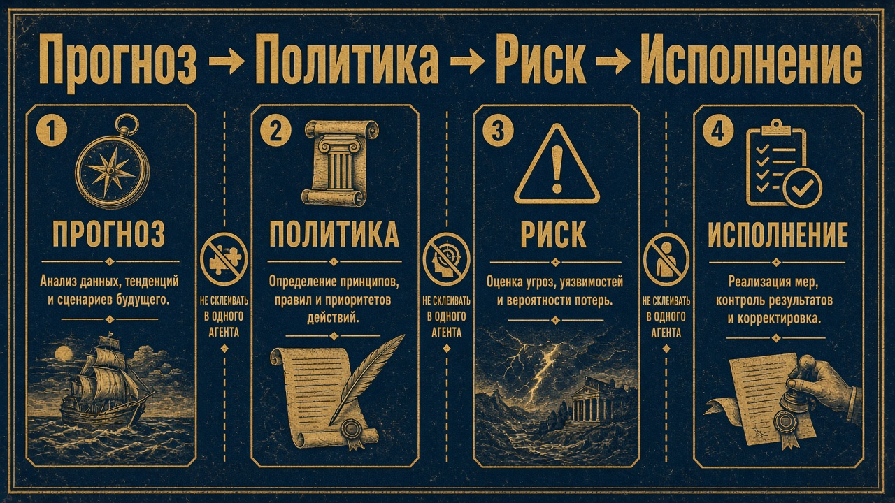

---
aliases:
  - Prediction
---

# Прогноз


## Визуальный ориентир



*Не склеивать роли в одного агента. Иллюстрация Vault; не скриншот приёмки.*

**aliases:** Prediction  
**Baseline:** `origin/main` `73c2e25e6aed323174b11dea4514946d5897f54b`  
**Пакет:** `backend/app/modules/prediction`  
**См.:** [[Датасет]], [[Торговая политика]], [[Candidate vs Champion]]

## 1. Назначение

Давать числовую оценку по инструменту на момент `t` для дальнейшей политики и исследований. Прогноз не покупает и не объявляет себя чемпионом.

## 2. Какую задачу решает

Отделяет модель, которая оценивает будущую доходность или ранг, от правил, которые превращают оценки в веса портфеля.

## 3. Как работает простыми словами

На закрытых признаках дня модель выдаёт либо ожидаемую доходность, либо ранг. Политика сортирует по полю `score`. Ранг нельзя показывать человеку как процент доходности. Боевой чемпион из этих кандидатов на этом SHA не назначен.

## 4. Архитектура

Пакет: application (runner, runner_v1, forward_runner, метрики, калибровка), domain (confidence, calibration_v1, ports), infrastructure (артефакты).  
Конфиги: `candidate_config.py`, `candidate_v1_config.py`.  
HTTP: `/api/v1/predictions`.  
Обзор архитектуры: Prediction Candidate V0/V1 — research, не champion. Активный датасет v1; кандидаты закреплены за Dataset V2. `[GITHUB_VERIFIED]` обзор + `dataset_config.py` + документ V4.  
Порт `TechnicalModel` существует рядом и не равен этому прогнозу: в `PredictionSignal` прямо сказано, что это вход политики, а не технический сигнал.

## 5. Поток данных

```text
сборка признаков ≤ t
  → Candidate V0 (expected return) или V1 (RANKING_SCORE)
  → PredictionSignal.score
  → политика
  → для Shadow: Forward-артефакт дня
```

Метки будущей доходности в признаки не входят. Intraday-котировки в этот вход не входят (ADR 0007).

## 6. Что уже реализовано (только подтверждённое)

- Код кандидатов, forward-сборки, готовности, исходов и исследовательского прогона в пакете. `[GITHUB_VERIFIED]` список файлов.
- Семантика `EXPECTED_RETURN` и `RANKING_SCORE` в `PredictionSignal`. Для V0 `predicted_return_20d` совпадает с ожидаемой доходностью и является score. Для V1 в score кладётся `prediction_score`, и его нельзя форматировать как процент. `[GITHUB_VERIFIED]` docstring порта.
- Запрет автопереключения на Dataset V4: документ V4 и Evidence Engine оставляют Candidate V0/V1 на V2, `persist_registry=False` для исследовательского сравнения. `[GITHUB_VERIFIED]`
- Экран `/calibration` есть. Что именно он показывает на живых данных, не проверялось.

## 7. Что частично реализовано

- Обзор называет целевой Meta Model частью петли и одновременно запрещает преждевременную реализацию. Отдельного champion-реестра, который бы сам повышал модель, паспорт не нашёл. Экран `/models` — заглушка. `[GITHUB_VERIFIED]` `App.tsx`.
- Dataset V3/V4 умеют исследовательский OOS, и это не перевод кандидата на новую спецификацию.

## 8. Что пока исследуется

Сравнение V3 и V4 при фиксированных вселенной, метках и модели. Manifest 1.04 утверждает, что кампания не показала выигрыша V4 против BASE. Повторный запуск этим аудитом не делался. См. [[Исследования]].

## 9. Технические ограничения

- Прогноз не читает базу изнутри порта: вход собирает сервис.
- Смена смысла целевой переменной требует новой версии датасета, а не тихой подмены `forward_return_Nd`.
- Ранговый score не является ожидаемой доходностью.
- Каталожная бумага вне research-вселенной не обязана иметь прогноз (ADR 0011).

## 10. Известные ошибки

Отдельного дефекта прогноза, воспроизведённого на этом SHA, паспорт не фиксирует. Путать ранг с процентом — запрещённая ошибка отображения, не подтверждённый открытый баг UI.

## 11. Основные пользовательские сценарии

- OWNER смотрит исследовательские сравнения и диагностику, а не «кнопку купить от модели».
- Shadow использует Forward как вход политики. Пользователь видит следствие на `/shadow`, а не сырой вектор.
- Экран рекомендаций `/recommendations` всё ещё заглушка и не является витриной прогноза.

## 12. Тестирование

Тесты этим аудитом не запускались. Модуль содержит runner-код; список test-файлов не снимался.

## 13. История развития

Обзор фиксирует V0/V1 как исследовательский слой поверх датасета. Продуктовые заметки 1.01–1.05 не объявляют champion. CHANGELOG V1.0 прямо говорит: это не завершённый Candidate V2 и не доказанная прибыльность.

## 14. Потенциальное развитие

Путь кандидат → walk-forward → сравнение → champion → shadow описан инвариантами как обязательный порядок. Ни один прочитанный документ не разрешает перепрыгнуть его из одного OOS-отчёта. Dataset V5 в Master Context назван неавторизованным. `PROPOSED` только как принцип, не как задача в работе.

## 15. Зависимости

[[Датасет]], [[Рыночные данные]], аналитика и technical/relations как поставщики признаков. Потребители: [[Торговая политика]], [[Shadow-портфель]], [[Исследования]].

## 16. Связанные задачи

Не вливать V4 в активного кандидата попутно с журналом V4.1. Не считать Evidence UI повышением модели.

## 17. Технические источники

- `docs/architecture/overview.md`
- `backend/app/modules/prediction`
- `backend/app/domain/ports/portfolio.py` (`PredictionSignal`)
- `backend/app/modules/learning/dataset_config.py`
- `backend/app/api/v1/predictions.py`
- `docs/research/dataset-v4-research-foundation-v1.md`
- `frontend/src/App.tsx`
