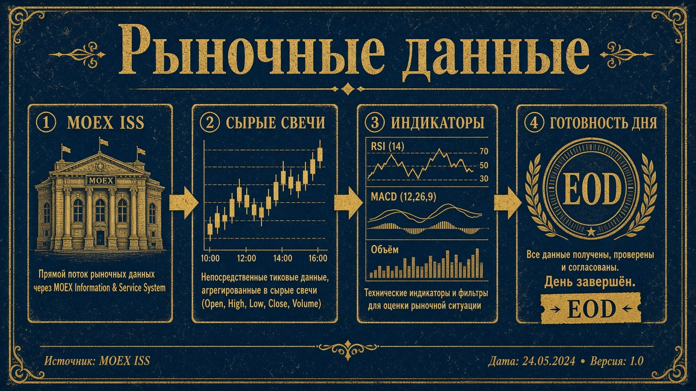

---
aliases:
  - Market Data
---

# Рыночные данные


## Визуальный ориентир



*MOEX EOD → сырые свечи. Иллюстрация Vault; не скриншот приёмки.*

**aliases:** Market Data  
**Baseline:** `origin/main` `73c2e25e6aed323174b11dea4514946d5897f54b`  
**Пакеты:** `backend/app/modules/market`, `market_history`  
**См.:** [[Карта всей системы]], [[Потоки данных]], [[Хранилища]], [[Дивиденды и корпоративные действия]]

## 1. Назначение

Хранить фактическую дневную историю российского рынка и справочник инструментов так, чтобы аналитика и модели опирались на сырые наблюдения, а не на переписанные цены.

## 2. Какую задачу решает

Даёт котировки, каталог MOEX, проверку полноты дня и события сплитов для личного портфеля, Shadow, датасета и экранов рынка.

## 3. Как работает простыми словами

Kraken забирает дневные данные у Московской биржи и официальные ряды у Банка России, кладёт сырой ответ на диск и нормализованные свечи в Postgres. Сплит записывается отдельным событием и объясняет скачок цены. Свеча при этом остаётся той, которая торговалась.

## 4. Архитектура

Слой `market`: application / domain / infrastructure. HTTP: `/api/v1/market`, `/api/v1/instruments`, `/api/v1/market-history/external`, intraday под `/api/v1/market`.  
Канон источников в обзоре: **MOEX ISS + ЦБ**. `[GITHUB_VERIFIED]`  
ADR 0011: каталог `market.instruments` растёт на месте, без `instruments_v2`. Членство исследовательской вселенной — отдельная таблица `market.universe_memberships`. Прогноз разрешён только члену research-вселенной (`InstrumentCapabilities.can_predict`).

## 5. Поток данных

```text
ISS / CBR → /data/raw → нормализация и DQ → market.candles (RAW)
                      → corporate_actions (SPLIT)
                      → instrument_sources (valid_from / valid_to)
```

Intraday-котировки, если флаг включён, идут в Redis и в свечи не пишутся (ADR 0007). См. [[Исполнение]].

## 6. Что уже реализовано (только подтверждённое)

- Контракт RAW OHLCV в `market.candles`. `[GITHUB_VERIFIED]` ADR 0005, обзор Market Data.
- Источники: акции TQBR, индексы SNDX, FX ЦБ (`XML_dynamic.asp`), KEY_RATE и RUONIA через DailyInfo SOAP. Старый `XML_KeyRate.asp` в обзоре помечен как 404. `[GITHUB_VERIFIED]`
- Пайплайны, названные в обзоре: `MarketDataBackfill`, `MarketDataUpdate`, `MarketSplitsIngest` (`POST /api/v1/market/corporate-actions/splits`), `DataQualityCheck`. `[GITHUB_VERIFIED]`
- Окна `valid_from` / `valid_to` у источников (H2) и загрузка официальной сырой истории в доказанных окнах текущей когорты (H3). Обзор прямо говорит: это не ML-ready и не историческая вселенная. `[GITHUB_VERIFIED]`
- Планировщик инкрементального обновления по умолчанию выключен: `MARKET_UPDATE_ENABLED=false`. `[GITHUB_VERIFIED]`
- CHANGELOG V1.0 описывает догрузку пропущенных сессий и экран полноты. Это текст релиза, не повторный прогон. `[GITHUB_VERIFIED]` как содержимое CHANGELOG.
- Пустой ответ доски не должен массово гасить инструменты (ADR 0011). `[GITHUB_VERIFIED]` как решение ADR.

## 7. Что частично реализовано

- Глубокая история H3 есть как сырьё для доказанных окон. Механическая корректировка аналитики (H4A, `basic_daily` v2) учитывает только SPLIT / REVERSE_SPLIT. H4B/H5/H6 обзор оставляет незакрытыми. `[GITHUB_VERIFIED]`
- Внешняя история: роутер `/market-history/external` есть. Правила дозаполнения чужими файлами в ADR 0005 требуют провененции и того же DQ-пути. Операционным источником Finam ADR не делает.
- Intraday-слой опционален и по умолчанию выключен.

## 8. Что пока исследуется

- Полная историческая вселенная с делистингом (в датасете V3/V4 это отдельная политика `historical_equity_universe_v2`, не то же самое, что «все активные сейчас»). См. [[Датасет]].
- Дивидендный PIT-поток как рыночный факт. Обзор рынка откладывает H3.1. См. [[Дивиденды и корпоративные действия]].

## 9. Технические ограничения

- Свечи не перезаписываются adjusted-ценами.
- `history_from` текущей когорты не равен выжившей вселенной прошлых лет.
- Каталог облигаций и фондов может быть в справочнике и при этом быть вне прогноза (ADR 0011).
- Обогащение тысяч облигаций не делается синхронно внутри sync справочника (ADR 0012).

## 10. Известные ошибки

Отдельный баг-тикет рынка этим паспортом не верифицировался. Смежные зафиксированные разрывы: устаревший абзац `modules.md` про «будущий» portfolio; расхождение документов о пустоте `dividend_events`. Это пробелы документации, не подтверждённый дефект загрузчика свечей.

## 11. Основные пользовательские сценарии

- Открыть `/market` и карточку инструмента.
- Найти бумагу в `/instruments` и увидеть её в личном портфеле, даже если прогноза по ней нет.
- OWNER смотрит полноту дня перед расчётами (формулировка CHANGELOG V1.0).

## 12. Тестирование

В этом аудите pytest не запускался. `test_status: not_executed_in_this_audit`. Страничные тесты `MarketPage.test.tsx`, `InstrumentsPage.test.tsx` в дереве frontend есть. `[GITHUB_VERIFIED]` наличие файлов.

## 13. История развития

- ADR 0005 принят 2026-09-03 как контракт H0. H1 позже добавил ingest официальных сплитов, не меняя RAW-свечи.
- Релиз CHANGELOG `1.0.0` от 2026-09-27 описывает дневные котировки и догрузку.
- PR #82 в реестре источников: historical ingestion backfill, merge `7687743`. Детали diff этого паспорта не перечитывались.

## 14. Потенциальное развитие

Только то, что документы оставляют открытым: дивидендный провайдер с честным `known_at`, более глубокая история режимов, чужие файлы как gap-fill с провененцией. Это `PROPOSED` / deferred, не задание на реализацию.

## 15. Зависимости

Питает [[Фундаментал]] (читает `market.*`, не пишет его), [[Датасет]], [[Shadow-портфель]], [[Прогноз]], [[Персональный портфель]] (оценки).  
Зависит от сети MOEX/ЦБ и от тома сырья.

## 16. Связанные задачи

- Открытый по снимку Master Context PR #58 (Dividend PIT / Calendar / Universe V3) — независимый research, не влит этим паспортом. Статус live API не перепроверялся.
- Включение `MARKET_UPDATE_ENABLED` — операционный флаг, не описан как всегда включённый.

## 17. Технические источники

- `docs/market-data/overview.md`
- `docs/architecture/data-storage.md`
- `docs/architecture/decisions/0005-raw-market-corporate-actions-returns.md`
- `docs/adr/0011-dynamic-moex-instrument-master-vs-research-universe.md`
- `docs/adr/0012-instrument-discovery-vs-async-enrichment.md`
- `docs/adr/0007-separate-eod-decision-from-intraday-execution.md`
- `backend/app/modules/market`
- `backend/app/api/v1/market.py`
- `backend/app/api/v1/instruments.py`
- `backend/app/api/v1/market_history.py`
- `backend/app/api/v1/intraday_market.py`
