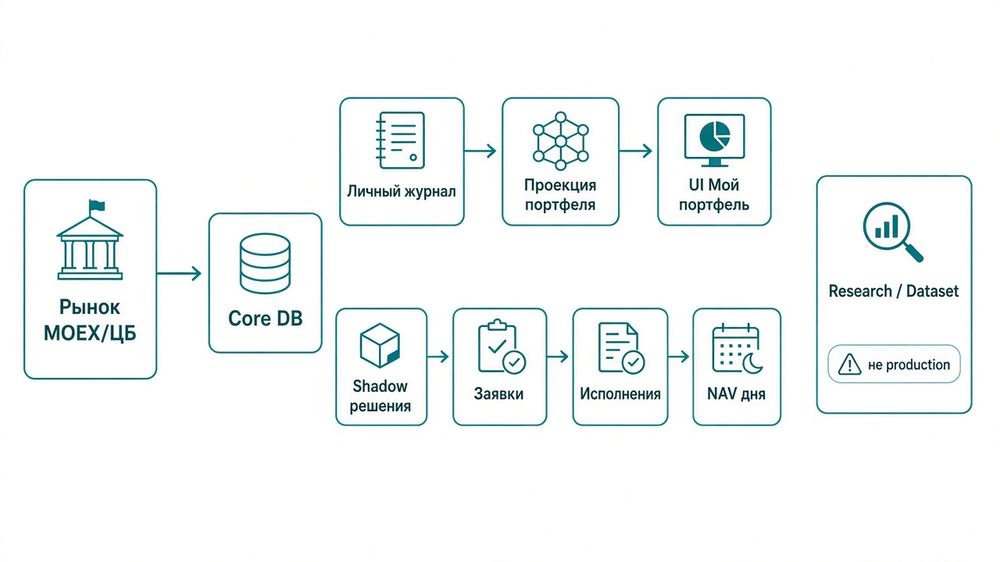

# Потоки данных


## Визуальный ориентир



*Рынок, личный журнал, Shadow и Research — разные контуры. Иллюстрация Vault; не скриншот приёмки и не доказательство runtime.*

**Baseline:** `origin/main` `73c2e25e6aed323174b11dea4514946d5897f54b`  
См. [[Карта всей системы]], [[Хранилища]], [[Архитектурные принципы]].

Ниже — потоки, которые описаны документами и подтверждены наличием кода на этом SHA. Это не обещание, что каждый шаг включён в расписании по умолчанию: часть флагов выключена (см. [[Docker и сервисы]]).

## 1. Рынок → признаки → датасет

`[GITHUB_VERIFIED]` по `docs/market-data/overview.md`, ADR 0005, `dataset_config.py`.

```text
MOEX ISS (TQBR, индексы) и ЦБ (FX, KEY_RATE, RUONIA)
  → сырой payload на томе /data/raw/{moex|cbr}
  → market.candles = RAW OHLCV
  → market.corporate_actions = события (H1: официальные SPLIT / REVERSE_SPLIT)
  → analytics: feature sets и дневные признаки
  → relations (Relations Engine V1) и technical (rules_v1 / signals)
  → learning: сборка pit_daily_core
```

Канонические источники — MOEX ISS и ЦБ. Чужой файл может позже заполнить дыру только с явной провененцией и тем же нормализатором. Свечи задним числом не переписываются. См. [[Рыночные данные]], [[Raw candles]], [[Датасет]].

Три вида доходности остаются разными производными: сырая, механически скорректированная (сплит / обратный сплит / деноминация), полная с дивидендами. См. [[Total return]].

## 2. Личный портфель

`[GITHUB_VERIFIED]` по `docs/product/personal-portfolio-v1.md` и `multi-portfolio-v2.md`.

```text
Операция пользователя
  → portfolio.personal_operations (журнал, источник правды)
  → проекция cash_rub / manual_positions
  → load_personal_snapshot (единственная граница чтения для аналитики «Мой портфель»)
  → аллокация, концентрация, риск, сравнение, ребаланс, денежные потоки
  → Dashboard и My Portfolio
```

Shadow, Candidate и исследовательские книги в эту проекцию не смешиваются. См. [[Персональный портфель]], [[Ручной журнал операций]], [[Portfolio Hub]].

Формула инвестиционного результата в продуктовой заметке: `investment_pnl = NAV − (contributed − withdrawn)`. Взнос поднимает и взнос, и NAV, поэтому при неподвижном рынке инвестиционный P&L остаётся нулём.

## 3. Shadow: решение вечером, исполнение на открытии

`[GITHUB_VERIFIED]` по `docs/architecture/shadow-portfolio-realism-v2.md`, ADR 0007, ADR 0008, ADR 0009.

```text
EOD: свечи → аналитика → Forward → цель политики → целочисленный план лотов
  → PENDING-ордера
Intraday (опционально, Redis): официальный OPEN закрывает подходящие ордера
  LAST только помечает живую оценку
  intraday не пишется в market.candles и не входит в прогноз
```

Группы эксперимента: `SHADOW_FORWARD_V0` (история V1, дробные количества, не переписывается) и `SHADOW_PORTFOLIO_REALISM_V2` (новые лоты). Daily Research Cycle двигает обе, когда включён. См. [[Shadow-портфель]], [[Исполнение]], [[Журнал решений]].

Ордер, созданный после открытия текущей сессии, ждёт следующую допустимую сессию. Догоняющий Forward вчерашнего дня не разрешает заполнить новый ордер сегодняшним уже известным OPEN.

## 4. Исследовательские доказательства

`[GITHUB_VERIFIED]` по `docs/research/research-evidence-engine-v1.md`. Код модуля `research_evidence` есть на этом SHA.

```text
Dataset V3/V4
  → хронологический OOS
  → ablation / stability
  → экономическая симуляция (исследовательский портфель, не Shadow и не личная книга)
  → Historical Evidence

Forward Outcomes + Personal Decision Memory
  → Prospective Evidence
```

Два класса доказательств на экране стоят рядом и статистически не склеиваются в одну «точность Kraken». См. [[Исследования]], [[Research Evidence Engine]], [[Walk-forward]].

## 5. Company Intelligence

`[GITHUB_VERIFIED]` по `docs/architecture/kraken-intelligence-stack-v1.md` и дереву `modules/intelligence`.

```text
внешний факт (publication / observed / known_at)
  → независимый SignalOutputV1 (POSITIVE | NEUTRAL | NEGATIVE | ABSTAIN | UNKNOWN)
  → CommitteeDecisionV1 (совет, не заявка)
  → IntelligenceSnapshotV1 на инструмент и as_of
```

Контракт запрещает переключение production Candidate, Shadow и Daily Decision из этого контура. См. [[Company Intelligence]].

## 6. Здоровье системы

| Вызов | Смысл |
|---|---|
| `GET /api/v1/system/health/live` | процесс отвечает; Docker healthcheck backend |
| `GET /api/v1/system/health/ready` | Core DB + Memory DB + Redis |
| `GET /api/v1/system/health` | диагностика, включая probe worker; её использует dashboard |

Обзор запрещает вешать Docker `depends_on` worker на полный system health: иначе старт зацикливается.
