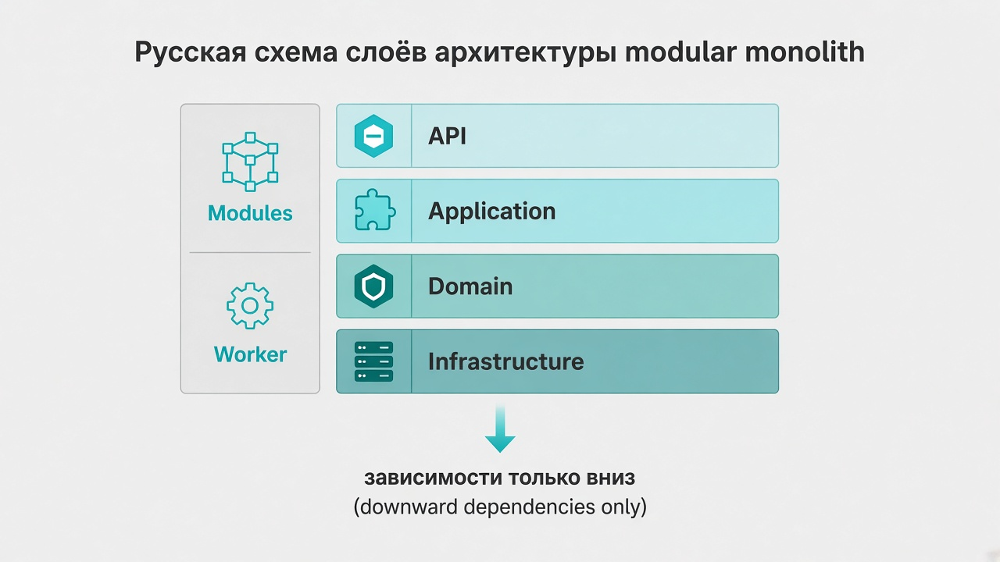

# Слои архитектуры


## Визуальный ориентир



*API → Application → Domain → Infrastructure. Иллюстрация Vault; не скриншот приёмки и не доказательство runtime.*

**Baseline:** `origin/main` `73c2e25e6aed323174b11dea4514946d5897f54b`  
**Источник:** `docs/architecture/overview.md`, ADR 0001. `[GITHUB_VERIFIED]`

См. [[Карта всей системы]], [[Архитектурные принципы]], [[Модули]].

## Границы

| Слой | Путь | Роль |
|---|---|---|
| API | `backend/app/api` | HTTP-адаптеры FastAPI, префикс `/api/v1` |
| Application | `modules/*/application`, сервисы | сценарии: собрать вход, вызвать домен, сохранить |
| Domain | `backend/app/domain`, `modules/*/domain` | сущности и порты без FastAPI, SQLAlchemy, Celery |
| Infrastructure | `backend/app/infrastructure`, `modules/*/infrastructure` | Postgres, Redis, файлы, ML-адаптеры |
| Modules | `backend/app/modules/*` | предметные контуры (рынок, портфель, обучение, …) |
| Worker | Celery worker + scheduler | фоновые задания и расписания |

Обзор фиксирует порты в `app/domain/ports`:

- `TechnicalModel` (`TechnicalModelInput` / `TechnicalModelOutput`)
- `PortfolioPolicy` (`PortfolioPolicyInput` / `PortfolioPolicyOutput`)
- `LLMProvider` (`LLMMessage` / `LLMResponse`)

Модели за портом сами базу не читают. Сервис приложения собирает вход, уже замороженный на момент `t`. Это правило чистоты из `docs/architecture/modules.md`.

## Пакеты модулей на этом SHA

Каталог `backend/app/modules` (листинг дерева):

analytics, fundamentals, historical, intelligence, investment, learning, market, market_history, memory, model_edge, news, portfolio, prediction, recommendations, relations, research_cycle, research_evidence, research_lab, risk, shadow, simulator, system, technical, workflows.

`docs/architecture/modules.md` всё ещё помечает portfolio, risk, recommendations и news как будущие. На этом SHA личный портфель, investment-риск и intelligence уже имеют код. Паспорта опираются на дерево и более поздние продуктовые документы, а расхождение с `modules.md` вынесено в [[Модули]].

## Как слои связаны с продуктом

```text
Frontend-страница
  → роутер backend/app/api/v1
    → application-сервис модуля
      → domain / port
        → infrastructure (Core DB | Memory DB | Redis | raw files)
```

Отдельного процесса на каждый модуль нет: ADR 0001 оставляет один deployable backend для API, worker и scheduler.

## Что слой не делает

- Domain не импортирует конкретный брокерский SDK как источник правды.
- Intraday-котировки в Redis не становятся входом Dataset и Prediction (ADR 0007). См. [[Потоки данных]].
- Схема `analytics` живёт в Core DB, отдельной analytics-СУБД нет (ADR 0004).
