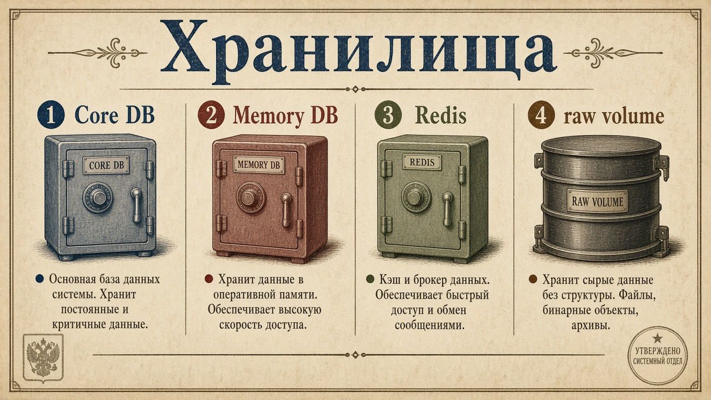

# Хранилища

## Визуальный ориентир

*Core, Memory, Redis, raw. Иллюстрация Vault; не скриншот приёмки.*

**Baseline:** `origin/main` `73c2e25e6aed323174b11dea4514946d5897f54b`  
**Источник:** `docs/architecture/data-storage.md`, ADR 0002, ADR 0004, ADR 0005. `[GITHUB_VERIFIED]`

См. [[Карта всей системы]], [[Docker и сервисы]], [[Память решений]], [[Датасет]].

## postgres-core

Именованный том: `projectai_core_pgdata`. Порт хоста по умолчанию `5432`.

Операционная база. Документ хранения перечисляет схемы:

| Схема | Что хранит по data-storage.md |
|---|---|
| `market` | инструменты, RAW-свечи, ряды, DQ, корпоративные события, окна источников |
| `analytics` | наборы признаков, дневные признаки инструментов и рядов, входы связей |
| `technical` | прогоны и дневные сигналы |
| `learning` | реестр моделей (фундамент), спецификации Dataset/PIT, прогоны, сэмплы |
| `portfolio` | в старом тексте — «virtual accounts (future)»; на этом SHA здесь же личные книги и ручной журнал. См. оговорку ниже |
| `system` | workflows, jobs, settings, журналы событий |

Дополнительно на этом SHA в коде и документах есть схемы, которых короткий data-storage.md не перечисляет целиком: `fundamentals`, `intelligence`, таблицы Shadow. Их назначение — в паспортах [[Фундаментал]], [[Company Intelligence]], [[Shadow-портфель]]. Полный список таблиц миграций в этот обзор не копировался.

`market.candles` — сырой биржевой OHLCV. Производные adjusted и total-return ряды свечи не подменяют.

Текст `portfolio — virtual accounts/positions/trades (future)` в `data-storage.md` старше Multi-Portfolio V2. Продуктовый документ V2 описывает текущую модель личных книг. Паспорт [[Персональный портфель]] следует V2 и коду API.

## postgres-memory

Именованный том: `projectai_memory_pgdata`. Образ `pgvector/pgvector:pg16`. Порт хоста по умолчанию `5433`.

Таблицы, названные в data-storage.md:

- `memory.decisions`
- `memory.decision_factors`
- `memory.decision_outcomes`
- `memory.decision_reviews`
- `memory.embeddings`

Это неизменяемые снимки решений, разборы и эмбеддинги. Они не заменяют ML-датасет и feature store в Core. Миграции отдельные: `alembic_memory.ini`. См. [[Decision Memory DB]].

Решения Shadow (`ShadowDecision` и связанные ордера) живут в контуре Shadow, а не в этой схеме. Путать две памяти нельзя. См. [[Журнал решений]].

## Redis

Том `projectai_redis_data`. Порт хоста по умолчанию `6379`.

Брокер и результаты Celery, короткие замки и кэш. Для Shadow intraday сюда кладутся котировки доски, не свечи. Redis не система записи рыночной истории.

## Сырьё и модели

| Том | Назначение по compose / обзору рынка |
|---|---|
| `projectai_raw_data` | сырые ответы MOEX/ЦБ, путь `/data/raw/{moex\|cbr}` |
| `projectai_models_data` | каталог артефактов моделей (том объявлен в compose; состав файлов этим аудитом не читался) |

Объектное хранилище (MinIO/S3) в data-storage.md указано как возможное позже, без смены доменных портов. В compose этого SHA отдельного MinIO-сервиса нет.

## Почему базы две

ADR 0002: другой жизненный цикл, другие бэкапы, другой профиль запросов, изоляция эмбеддингов от рыночного OLTP. Backend держит два движка. Memory можно позже вынести на другой хост, не переписывая рыночные таблицы.

`docker compose down` тома сохраняет. `docker compose down -v` стирает данные намеренно.
