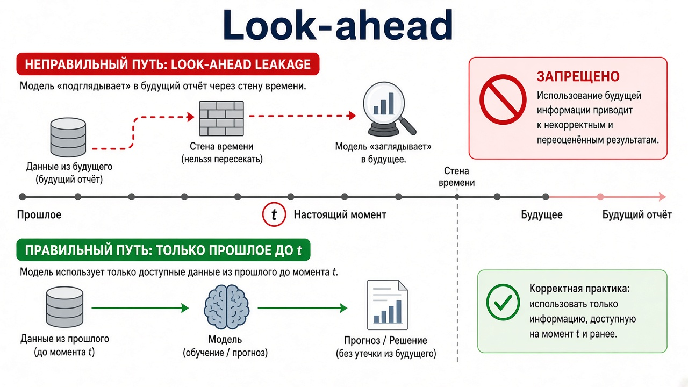

# Look-ahead leakage

## Визуальный ориентир

*Запрет подглядывания в будущее. Иллюстрация Vault; не скриншот приёмки и не доказательство runtime.*

Look-ahead leakage — утечка будущего в прошлое. Модель или отчёт в момент `t` уже пользуются фактом, которого участник рынка тогда не знал.

Утечка не всегда выглядит как `close[t+1]` в формуле. Она прячется в стыках.

## Обычные щели

- Обучающая выборка содержит форвардный лейбл, который пересекает начало тестового окна. Это закрывали в исследовательском сравнении V2/V3: утечку признали ошибкой, а не «особенностью метрики».
- Дивидендный `ex_date` выводят как «день реестра минус один», хотя календарь расчётов менялся. Догадка создаёт знание, которого не было.
- `known_at` отчёта ставят равным `period_end`.
- Свечи переписывают сегодняшним коэффициентом сплита, и старый день уже «знает» будущий сплит.
- Внутридневная котировка попадает в обучающую таблицу, хотя договор был: она только для исполнения и экрана.
- Повтор Shadow исполняет вчерашний ордер по сегодняшнему открытию, которое на момент ордера уже прошло (ADR 0009).

## Почему это опаснее шумной модели

Шумная модель теряет деньги честно. Утекающая модель показывает доход на истории и разваливается в первый же проспективный день. Её нельзя сравнить с честной базой: она играла в другую игру.

## Как проверять

Спросить у любой колонки: «если бы я сидел вечером `t`, эта ячейка уже существовала бы?» Если ответ «мы посчитали её в воскресенье за весь год разом» — это ещё не утечка, пока в ячейку дня `t` не попало ничего позднее `t`. Если ответ «коэффициент сплита взят из будущего» — утечка.

Учебный разбор: [[Look-ahead в обучении и решениях]].
