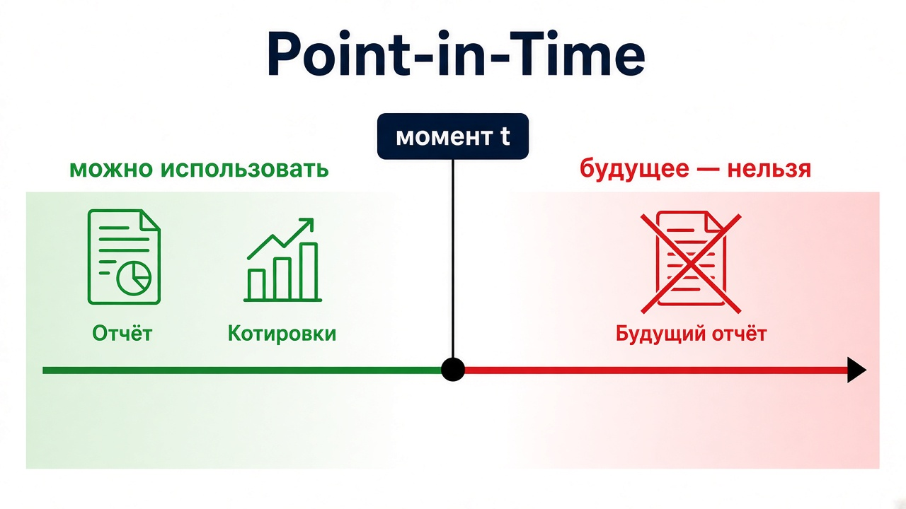

# Point-in-Time (PIT)

## Визуальный ориентир

*Только данные, известные к моменту t. Иллюстрация Vault; не скриншот приёмки и не доказательство runtime.*

Point-in-Time значит: в момент решения `t` можно пользоваться только тем, что уже было известно к `t`. Завтрашняя строка в базе не является знанием сегодня.

Это не «дата отчёта» и не «дата, на которую отчёт составлен». Годовой отчёт за 2024 год может быть опубликован в апреле 2025-го. Пока он не опубликован, модель 1 марта 2025 года его не видит, даже если файл уже лежит у разработчика в каталоге выгрузки.

## Зачем это Kraken

Иначе исследование покажет прекрасную стратегию, которая в жизни невозможна: она покупала, уже зная будущий дивиденд, будущую свечу или будущую поправку отчётности. Такая стратегия не переносится в Shadow и тем более в личные деньги.

Инварианты проекта называют look-ahead жёсткой ошибкой корректности. Он касается рынка, аналитики, связей, техники, фундаментала, макро, консенсуса, входов модели и состояния портфеля.

## Маленький пример

Решение вечером 2 марта. В базе есть свеча за 2 марта (день завершён) и черновик дивиденда, который биржа опубликует 3 марта. В признак `X(2 марта)` дивиденд не входит. Он может войти в решение 3 марта, если `known_at` не позже этого вечера.

Лейбл «доходность следующие 20 дней» — это `Y`, будущее. Его считают после, для оценки. В вектор `X(t)` он не входит никогда.

## Как не перепутать

- `period_end` отчёта — про какой срок цифры. Это не момент, когда рынок их узнал. См. [[known_at vs effective_date]].
- Текущая котировка для экрана «сколько стоит сейчас» может быть операционной ценой. Она не становится историческим доказательством для обучения, если у сопоставления инструмента нет исторического интервала действия.
- Повтор истории Shadow должен идти состоянием на каждый день, а не сегодняшним справочником, применённым ко всей ленте.

См. также [[Look-ahead leakage]] и [[Walk-forward]].
