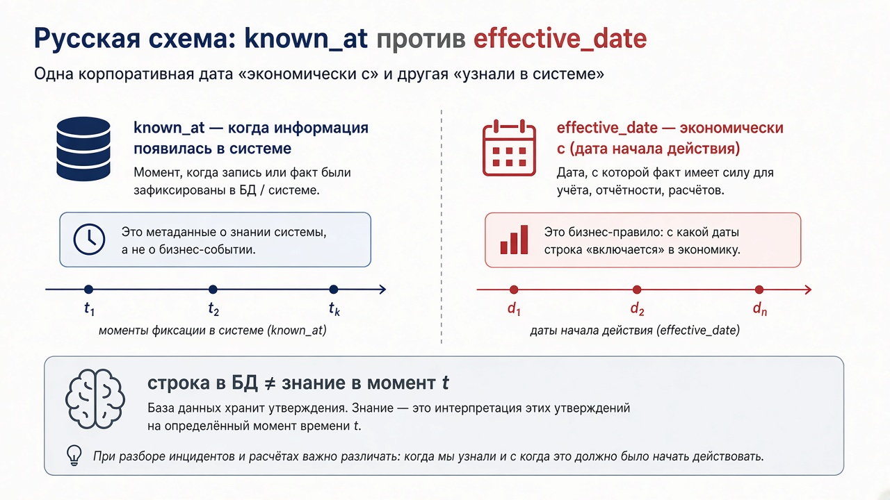

# known_at vs effective_date

## Визуальный ориентир

*Узнали ≠ экономическая дата. Иллюстрация Vault; не скриншот приёмки и не доказательство runtime.*

У события почти всегда две разные даты, и Kraken хранит их отдельно.

**effective_date** (и соседние экономические даты: отсечка, реестр, выплата, конец отчётного периода) говорит, *к какому хозяйственному моменту* относится факт. Дивиденд режут цену на отсечке. Отчёт описывает год, кончившийся 31 декабря.

**known_at** говорит, *когда этот факт стал доступен* наблюдателю. Пока публикации не было, экономическая дата ничего не даёт модели.

`published_at` — когда источник это показал, иногда с временем. Для фундаментала FNS точность знания сознательно грубая: дата, не час, даже если штамп времени есть. Это консервативно: лучше не видеть отчёт в день публикации «утром», чем увидеть его до открытия.

## Пример с дивидендом

Совет директоров рекомендует 25 ₽ в мае. Собрание утверждает в июне. Отсечка в июле, выплата в августе. Для total return право на деньги обычно связано с утверждённой суммой и известной отсечкой, и только если `known_at` уже наступил. Рекомендация мая — не право июля. Пустая отсечка остаётся пустой. Её не вычисляют как «реестр минус день»: с 2023-07-31 расчёты MOEX перешли с T+2 на T+1, и такая формула врёт в обе стороны календаря.

## Пример с отчётом

`period_end = 2024-12-31`, `known_at = 2025-04-02`. Решение 2025-03-01 этот отчёт не видит. Решение 2025-04-03 видит. Поправка отчётности — новая версия со своим `known_at`, а не тихая перезапись старой строки.

## Частая путаница

Текущий экран портфеля может показать последнюю честную цену. Это операционная оценка «сейчас». Она не доказывает, что та же цена была известна как исторический PIT-факт для любого прошлого `t`. Сопоставление инструмента с `valid_from` пустым годится для текущей оценки и не годится как историческое свидетельство.
