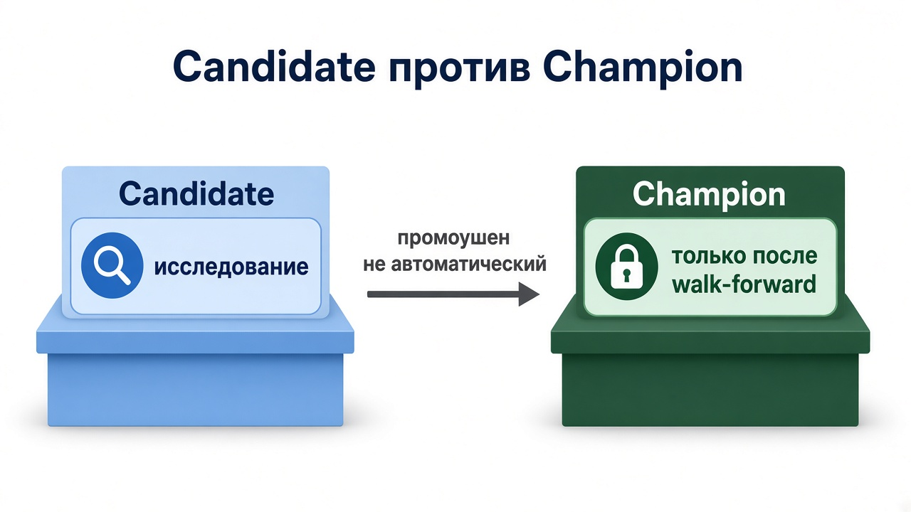

# Candidate vs Champion

## Визуальный ориентир

*Промоушен только после проверки. Иллюстрация Vault; не скриншот приёмки и не доказательство runtime.*

**Candidate** — версия модели или политики, которую ещё проверяют. Она не имеет права сама стать источником личного плана покупок только потому, что прогон закончился.

**Champion** — версия, которую явно повысили после сравнения. Пока чемпиона нет, «боевой» контур остаётся на закреплённой старой версии, даже если в лаборатории лежит более новая таблица.

Лестница проекта: кандидат → walk-forward или бэктест на невидимом будущем → сравнение → чемпион → тень или живое наблюдение → повышение или откат. Повтор одного и того же известного периода не считается новым опытом.

## Как это устроено на main

Production Candidate V0/V1 закреплены на Dataset V2. Спецификация `pit_daily_core` активной версии — v1. Dataset V3 и V4 живут как research. Сравнение V2 с V3 не имело права менять активную спецификацию. Выпуск 1.05 прямо говорит: production Candidate не переключался.

Кампания 1.04 не показала, что добавки фундаментала и событий обгоняют базу на отложенном окне. Значит, повышать этот пакет в чемпионы было бы нечем. Отрицательный результат — причина остаться на базе, не причина тихо собрать V5.

Устаревший или неподтверждённый кандидат нельзя использовать как точный план покупок личного портфеля (заметка 1.01). Свежесть кандидата — часть честности совета.

## Бытовая аналогия

Кандидат — блюдо на дегустации. Чемпион — то, что уже стоит в меню. Пока дегустация не закончена, гостю не говорят, что новое блюдо уже подают.
