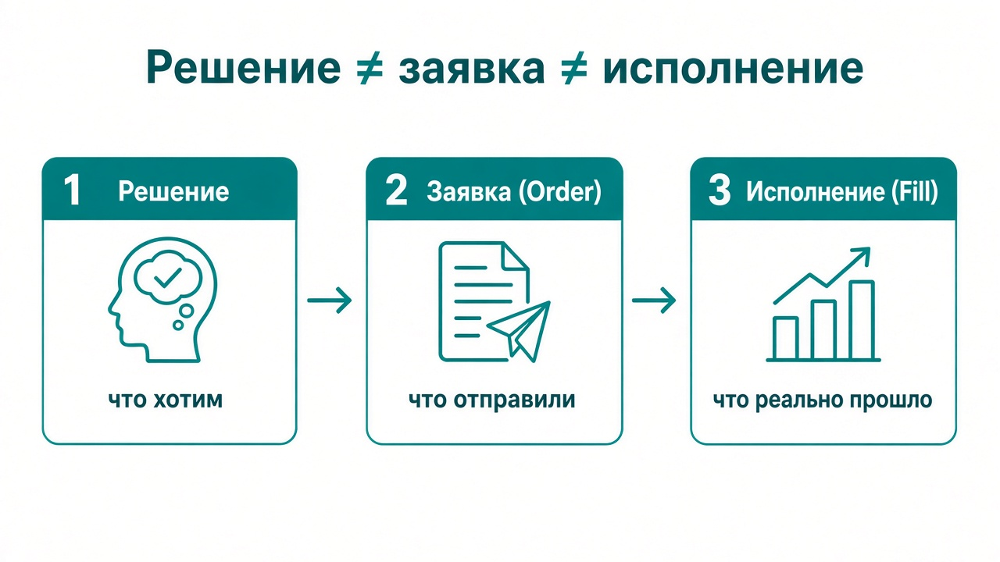

# Decision vs Order vs Fill

## Визуальный ориентир

*Три разные сущности. Иллюстрация Vault; не скриншот приёмки и не доказательство runtime.*

Три слова описывают три момента. Склеить их в одну «сделку Kraken» — потерять смысл журнала.

**Decision** — что система или человек решили, глядя на данные на момент `t`. Это намерение и объяснение: держать, пересмотреть, купить в рамках плана. Само по себе оно не двигает акции.

**Order** — поручение внутри контура исполнения: сколько, в какую сторону, с какого момента его можно исполнять. У Shadow ордер может ждать следующей сессии.

**Fill** — факт исполнения: цена, количество, комиссия, дата. В бумаге это модельное исполнение. В личном портфеле факт появляется, только когда человек записал операцию. Совпадение рекомендации с операцией без подтверждения — `POSSIBLE_MATCH`, не причинность.

## Пример дат, который просил сохранить владелец

Сигнал 2026-09-03, отметка решения 2026-09-07, исполнения 2026-09-08. Это не один день и не один NAV. Исполнения группируются по дате fill, поэтому в день сигнала исполнений может быть ноль, хотя ордер позже станет исполненным. Журнал обязан показывать связь по идентификатору ордера, а не притворяться, что всё случилось в день сигнала.

## Как устроено в Shadow

Решение на конец дня. Исполнение — официальное открытие следующей допустимой сессии, не последняя цена и не уже прошедшее открытие сегодняшнего дня, если ордер создан после открытия. Исторический путь может взять open из дневной свечи. Живой путь может взять open из отдельного внутридневного слоя. Оба не имеют права писать эту котировку в обучающие сырые свечи.

## Личный контур

Кнопка «зафиксировать решение» пишет снимок советов в память. Она не создаёт `personal_operations` и не меняет кэш. Покупка появляется отдельной ручной операцией.

См. [[Решение принято за сделку]] и [[Shadow portfolio]].
