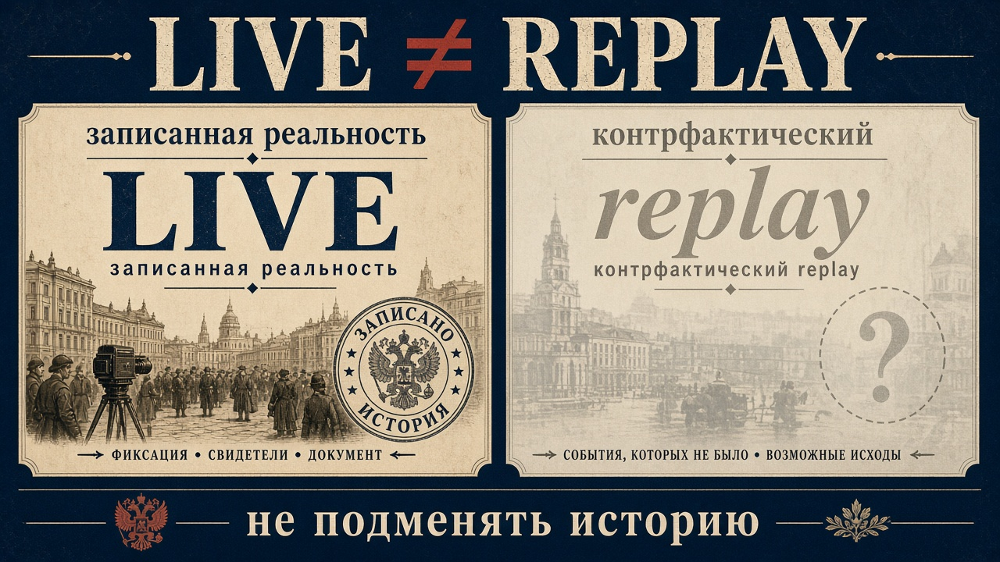

# LIVE vs COUNTERFACTUAL_REPLAY

## Визуальный ориентир

*Не подменять историю. Иллюстрация Vault; не скриншот приёмки.*

**LIVE** — запись того, что контур сделал в своё время: решение приняли тогда, ордер создали тогда, исполнение легло тогда. Эту ленту не переписывают, когда правила стали умнее.

**COUNTERFACTUAL_REPLAY** — повтор «как было бы», прогнанный позже. Он обязан нести другое происхождение. Нельзя подменить им живую историю и нельзя поставить на старые дни сегодняшнюю логику так, будто она уже работала тогда.

## Зачем различие

Иначе отчёт смешает два опыта. Первый: система реально ждала открытия и купила. Второй: в воскресенье пересчитали год новыми правилами и «как будто» купили. Для обучения и для разговора с инвестором это разные доказательства.

Shadow после простоя догоняет пропущенные дни вперёд, состоянием на каждый день. Это восстановление очереди, а не право заново исполнить старый ордер по цене, которая уже была известна в момент создания ордера. Повторный запуск догона не должен плодить вторую пачку сделок.

Старые журналы V1/V2 не получают выдуманный след решения только потому, что у V3 след появился. Дыра в объяснении честнее фантазии.

## Что говорить в интерфейсе

Если день восстановлен или пересчитан, подпись должна это показывать. NAV «как будто мы жили в тот день с сегодняшним кодом» без пометки — ложный LIVE. Выдуманный P&L на дате, где не было ни цены, ни сопоставления сделок, — тот же класс лжи.

См. [[Decision vs Order vs Fill]] и [[Look-ahead leakage]].
