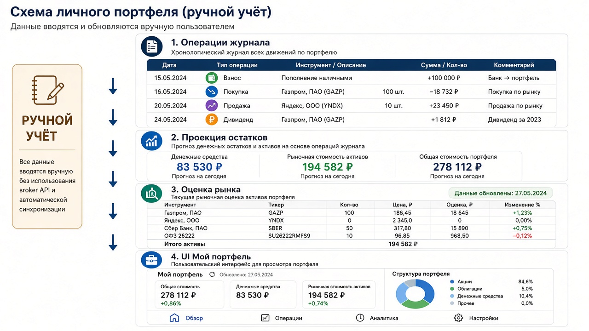

# Personal portfolio

## Визуальный ориентир

*Ручной учёт. Иллюстрация Vault.*

Личный портфель — ручной учёт реальных денег владельца. Источник правды после старта учёта — журнал операций, а не цифра остатка, которую поправили мышкой.

Цепочка: операция → кэш и позиции (проекция) → снимок для экранов → аналитика. Экраны не читают сырую таблицу остатков как второй независимый источник.

## Несколько портфелей

Модель V2 сменила одиночный «основной». У каждого портфеля свои деньги, бумаги, себестоимость, журнал, NAV и совет дня. Выбор портфеля в интерфейсе определяет обзор.

Черновик позволяет собрать старт без журнала. Активный учёт журнал включает и прямые правки закрывает. Очистка — только черновик. Сброс и удаление касаются одного портфеля. Тестовый портфель не смешивают с живой книгой.

## Деньги

Пополнение увеличивает и внесённый капитал, и NAV. Инвестиционный результат при прочих равных не меняется: NAV минус (внесено минус выведено).

Себестоимость — средневзвешенная. Комиссия одной и той же суммы живёт либо внутри сделки, либо отдельной строкой. Математика — десятичная, не двоичная плавающая.

Если цена известна, а себестоимость нет, рыночная стоимость может быть показана, P&L — нет. Для облигаций в черновике спрашивают потраченные рубли целиком. Процент от номинала рублями не считается. Пока нет отдельного облигационного учёта, нереализованный результат из старой «средней в процентах» не изобретают.

## Граница

Сюда не входят Shadow, Candidate и исследовательские прогоны. Фиксация совета пишет память решения и не пишет операцию. Импорт брокерского отчёта в эту книгу запрещён.
