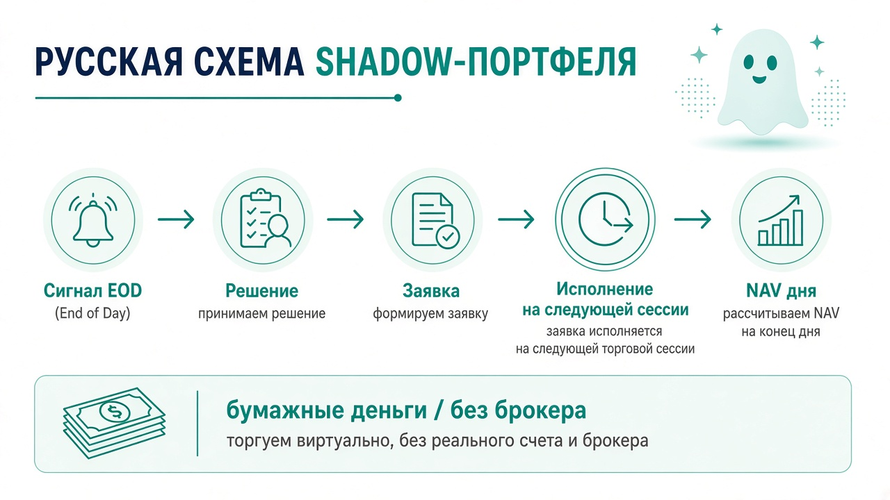

# Shadow portfolio

## Визуальный ориентир

*Виртуальный эксперимент. Иллюстрация Vault.*

Shadow — виртуальный портфель эксперимента. Он отвечает на вопрос «что было бы, если правила исполнялись дисциплинированно», а не «сколько у меня на брокерском счёте».

Деньги в нём модельные. Его NAV не суммируется с личным. Его сделки не попадают в «Мой портфель».

## Что он умеет сейчас

По релизам V1.0 и 1.02 и по слитым PR надёжности:

- хранит решения, ожидания, исполнения и дневную стоимость;
- исполняет план на следующей сессии, не подглядывая в уже известное открытие;
- после простоя проигрывает пропущенные дни по очереди и повторно не плодит дубликаты;
- в реализме V3 выход бумаги из полосы даёт REVIEW, а не автоматическую продажу;
- поворот в другую бумагу разрешён только если ожидаемое преимущество покрывает комиссии и проскальзывание обеих сторон и запас;
- неизвестная комиссия не считается нулём;
- старые эксперименты V1/V2 не переписываются новой семантикой и не получают выдуманное объяснение.

Если данных не хватает, предпочтение — DATA_HOLD, а не тихая продажа. Удержание на пересмотре не даёт планировщику лотов «продать незаметно» через веса.

## Чего от него не ждут

Он не доказывает прибыль. Он не исполняет реальный счёт. Полный живой догон после merge #85 в статусе проекта не записан как подтверждённый операционный факт. Журнал на экране может отставать от кода в git, если Docker смотрит в старый каталог.

Запись LIVE и повтор истории различаются происхождением. Повтор нельзя задним числом выдать за то, что «тогда так и торговали». См. [[LIVE vs COUNTERFACTUAL_REPLAY]].
