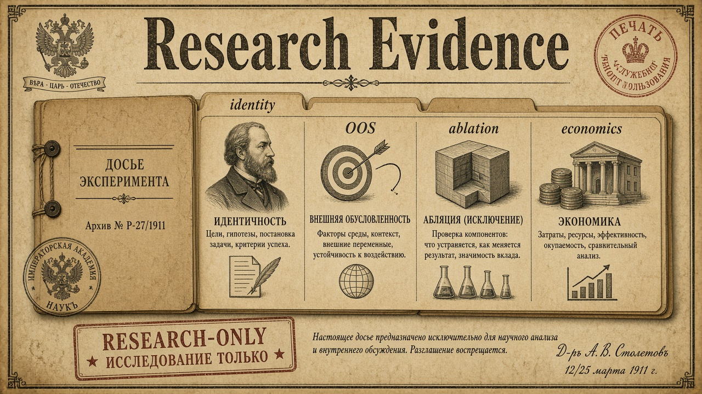

# Research Evidence Engine

## Визуальный ориентир

*Дossier и OOS — research-only. Иллюстрация Vault; не скриншот приёмки.*

Evidence Engine — контур, который сохраняет доказательство исследовательского прогона: что считали, на каком договоре данных, с каким отпечатком, что вышло на отложенном окне. Это не витрина доходности и не переключатель боевой модели.

Выпуск Kraken 1.04 (2026-10-04) как раз про этот контур и каноническую кампанию. Технический `VERSION` при этом остался 1.0.0, git-tag не создавали.

## Что считается фактом кампании

Канонический отпечаток досье: `fe5609a2ced6082992d923bc57cf99655d73e2787c119564de42bc48803bf233`.

Более ранний полный прогон оставили как неизменяемый аудит из-за несовпадения границы оценки: `caf1d5703aae7c2c008015e82cc1086cf68d0fa71f138eb05eb39bec2a25cd75`.

Оба dataset run, которые описывает снимок состояния, завершились успешно, PIT-проверка прошла, образцов 42 988. Смысл добавок на этом окне: база выглядела не хуже вариантов с фундаменталом и событиями. Средний rank IC базы был положительным и выше, чем у полного V4. Это не лозунг «фундаментал бесполезен вообще». Это отказ объявить победителем конкретный пакет на конкретном окне.

Экономическое сравнение того прогона тоже не объявляли победой стратегии над равным весом допустимой вселенной.

## Как читать досье

Досье нельзя подчистить, чтобы средний IC стал приятнее. Нельзя подменить канонический отпечаток аудитом с другой границей. Нельзя из фразы «кампания завершена» вывести «модель в проде». Production Candidate после 1.04 и 1.05 остаётся прежним.

Следующая кампания — новое исследование по задаче владельца, не автоматическое продолжение.
