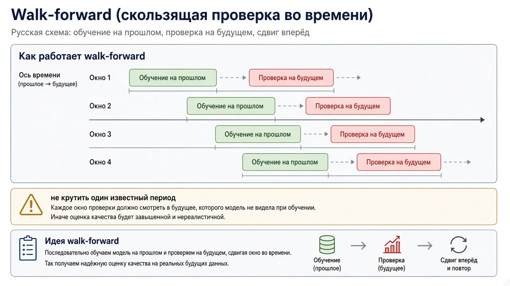

# Walk-forward

## Визуальный ориентир

*Обучение на прошлом, проверка на будущем. Иллюстрация Vault; не скриншот приёмки и не доказательство runtime.*

Walk-forward — проверка, при которой учатся на прошлом, оценивают на ещё не виденном будущем отрезке и сдвигают окно вперёд. Переобучение и повторный отчёт по тому же уже известному периоду не считаются новым рыночным опытом.

Глубокая история нужна, чтобы увидеть другие режимы рынка, а не чтобы нарастить число строк одного и того же режима и назвать это независимостью.

## Как это выглядит

Договор кампании 1.04: развитие строго до даты, оценка на отложенном хвосте, политика конца окна записана (`development_end_exclusive = 2026-09-02`). Первый полный досье сохранили как аудит, потому что окно оценки было несогласовано, и каноническим стал другой отпечаток. Расхождение границы не замазали: его оставили в истории досье.

Если лейбл «доходность вперёд» залезает из обучающей части в тестовую, окно порвано. Такую утечку в сравнении V2/V3 закрывали отдельно. Починить её важнее, чем улучшить красивую метрику.

## Чем walk-forward не является

- не многократный запуск одного и того же года с подкрученными параметрами;
- не право повысить кандидата в чемпионы;
- не симулятор, который уже торгует;
- не замена проспективному Shadow: даже честный исторический хвост — всё ещё история, один раз прожитая рынком.

Пока чемпион не назначен отдельным решением, личный совет не начинает жить по модели из последнего прогона.
