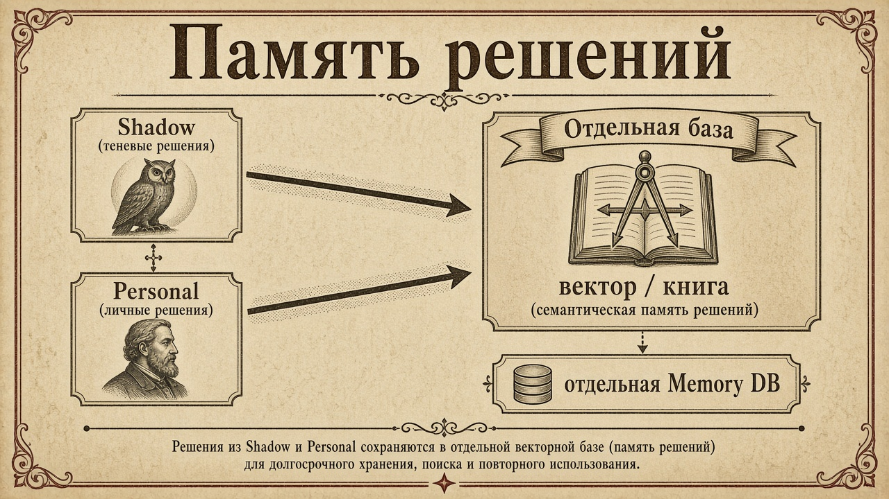

# Decision Memory DB

## Визуальный ориентир

*Отдельная память решений. Иллюстрация Vault; не скриншот приёмки.*

Память решений — отдельная PostgreSQL с pgvector, не та база, где лежат свечи и личный журнал. ADR 0002: у снимков решений, исходов, разборов и эмбеддингов другой срок жизни и другой профиль запросов. Свои миграции, свои настройки соединения, возможность позже уехать на другой хост, не переписывая рынок.

Снимок решения неизменяем. Когда исход стал известен, его пишут рядом, а не дописывают в прошлое решение задним числом. Разбор — третья сущность, не правка исходного текста.

Память не заменяет датасет и не заменяет журнал денег. Туда кладут структурированные факты, коды причин и происхождение. Скрытую цепочку мыслей модели туда не кладут.

## Две разные памяти, которые легко спутать

**Shadow Decision Journal** — след бумажного эксперимента: кандидаты, ордера, исполнения, модельные издержки.

**Personal Decision Memory** (продукт 1.03) — совет, который показали по реальному портфелю, и наблюдение цены через 5, 20 и 60 сессий. Запись не меняет кэш и позиции. Связь с реальной операцией человек подтверждает сам. Версия наблюдения — ценовая доходность, без дивидендов.

Одна таблица на оба смысла запрещена.

Пока IAM нет, отдельная база не означает «чужие пользователи изолированы». Она означает «решения не лежат вперемешку с котировками».
