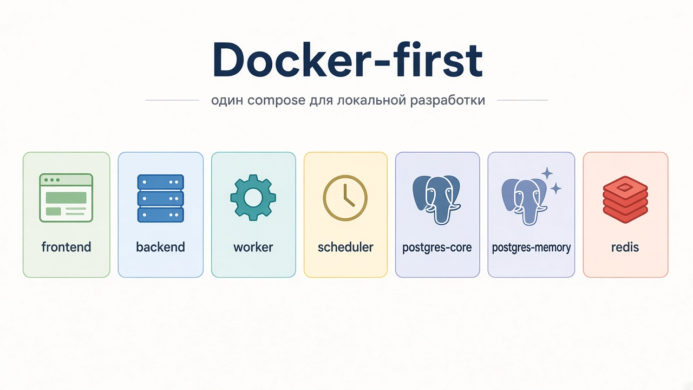

# Docker-first

## Визуальный ориентир

*Локальный compose. Иллюстрация Vault.*

Разработка Kraken рассчитана на Docker: PostgreSQL, Redis и само приложение поднимаются контейнерами, исходники примонтированы, чтобы править код без локальной установки всего зоопарка на Windows. ADR 0003 считает это базовым способом, в том числе потому что тот же контур ближе к будущему серверу, чем «у меня на ноутбуке поставлено иначе».

Из этого следует практическое правило. Контейнер frontend может монтировать каталог того worktree, из которого его запускали. Новый коммит в другом каталоге браузер не увидит. Фраза «починено в git» и фраза «открыто на localhost» становятся правдой одновременно только после проверки пути mount, ветки и HEAD.

Пересоздавать обычно нужно только frontend, когда переключаешься между worktree. Весь стек вместе с томами ради смены ветки не сносят: в томах лежат данные.

Сеть и опубликованные порты этой заметкой менять нельзя. Удобство Docker не разрешение открывать базу наружу.

См. [[Устаревший Docker mount]] и [[Git и worktrees]].
