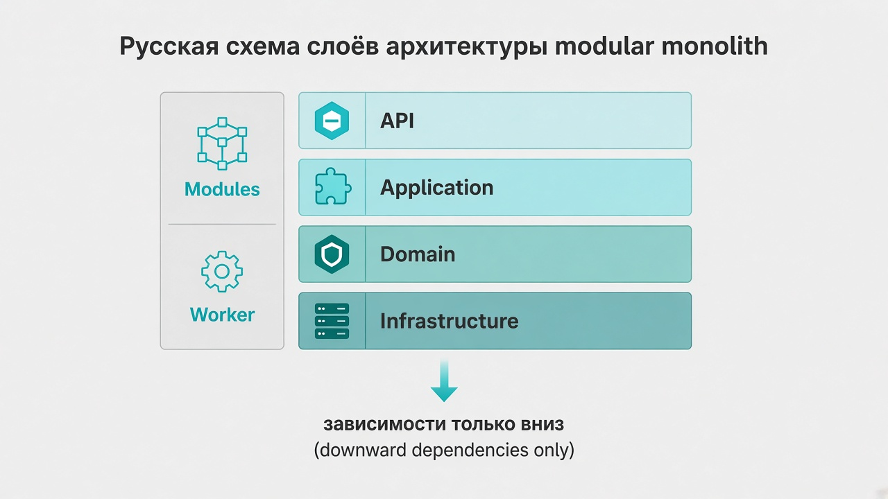

# Modular monolith

## Визуальный ориентир

*Один backend, явные слои. Иллюстрация Vault.*

Модульный монолит — одно приложение с жёсткими границами внутри, а не россыпь сервисов. ADR 0001 принят потому, что на текущем размере команды микросервисы добавили бы сеть и отказ раньше, чем пользу.

Слои не смешивают. Домен не тянет за собой веб-фреймворк, ORM, очередь, конкретную ML-библиотеку и HTTP-клиент. Инфраструктура реализует порты. Прогноз, политика, риск и исполнение остаются разными ролями, даже если их пакеты лежат в одном процессе.

Практически это один backend-образ, из которого поднимаются API, воркер и планировщик, общий язык типов и Docker Compose. Разрезать на сервисы можно позже, если появится операционная боль, не из эстетики.

Имя Kraken на эту схему не наклеивают отдельным пакетом. Новая база, шина событий или колоночное хранилище монолитностью не оправданы, пока нужда не доказана и владелец не попросил.

См. [[Как устроен код]] и [[Docker-first]].
