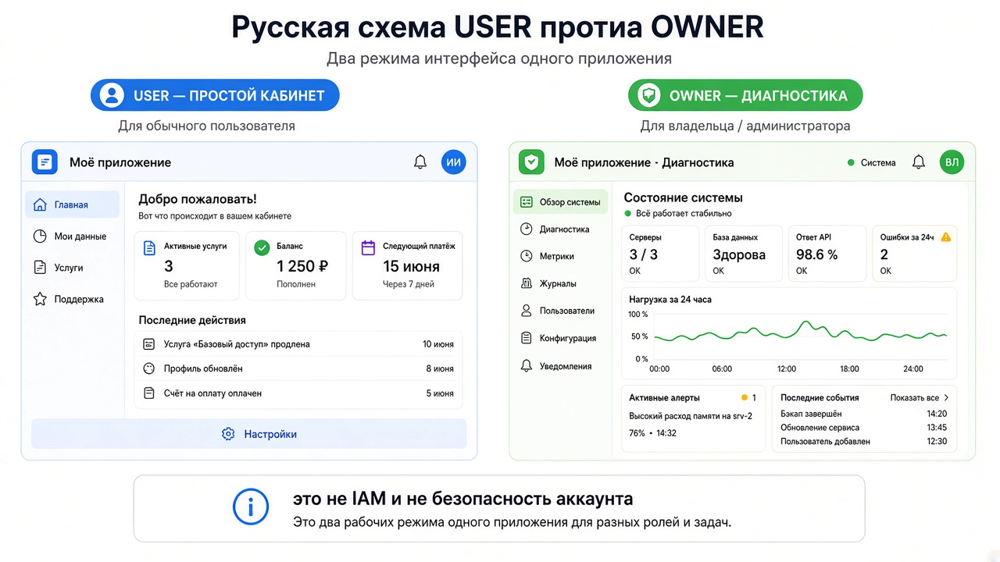

# USER vs OWNER mode

## Визуальный ориентир

*Режимы UI, не IAM. Иллюстрация Vault; не скриншот приёмки и не доказательство runtime.*

Два режима кабинета отличаются тем, сколько подробностей показывают.

**USER** говорит языком инвестора: портфель, качество оценки, совет, без внутренних номеров ордеров и сырых статусов движка.

**OWNER** добавляет операционную диагностику: покрытие данных, лаг Shadow, процессы. Технические детали допустимы здесь и не должны быть единственным видом продукта.

Переключатель лежит в боковой панели и запоминается в браузере (`localStorage`, ключ презентации). Это не логин, не роль в базе и не защита от чужого человека за тем же компьютером. Релиз V1.0 говорит об этом прямо, и с тех пор настоящий IAM не включали. Сетевое разграничение отдельно отложено владельцем.

Пока режима два только на экране, секреты и живой журнал нельзя считать защищёнными «потому что пользователь в USER». Тестовые данные и живая книга разделяются другими правилами, не этим переключателем.

Глубокий research и длинные идентификаторы досье остаются уровнем владельца, даже когда личный совет показывает короткий русский итог.
