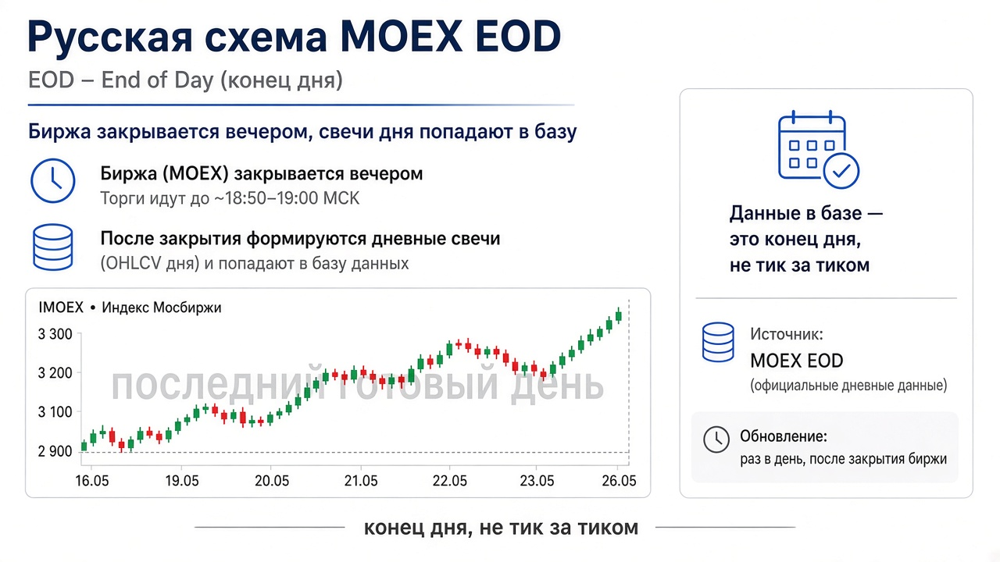

# MOEX EOD

## Визуальный ориентир

*Дневные свечи и watermark дня. Иллюстрация Vault; не скриншот приёмки и не доказательство runtime.*

EOD — end of day, дневной итог торгов. Для Kraken основная прочная история российского рынка — дневные свечи MOEX: открытие, максимум, минимум, закрытие, объём. Это сырьё для признаков, для исторического исполнения Shadow и для проверки «день полный или нет».

Догон устроен так, чтобы не качать всю историю заново после выходных. Сравнивают локальный полный день с ожидаемой завершённой сессией, а не только с максимальной датой одного тикера. Иначе один живой тикер маскирует дыру по остальным.

## Чем EOD не является

Внутридневная котировка и 60-минутные бары — другой слой. Они нужны, чтобы увидеть официальное открытие для бумажного исполнения и чтобы описать структуру дня. Они не подменяют дневную историю и не входят в обучение, пока отдельный контракт этого не разрешит. Прогноз и датасет не зависят от внутридневного порта.

Каталог инструментов MOEX шире исследовательской вселенной. Бумага может находиться в справочнике, оцениваться в личном портфеле и не участвовать в прогнозе. Пустой ответ доски не должен массово гасить инструменты.

## Честность дня

Покрытие бывает готовым и частичным. Частичный день не становится «рынком закрыт, всё по нулям». Для инвестора это экран качества данных, в первую очередь в режиме владельца.

Глобальные площадки в первый конкурентный контур не входят. MOEX EOD — не обещание мирового рынка.
