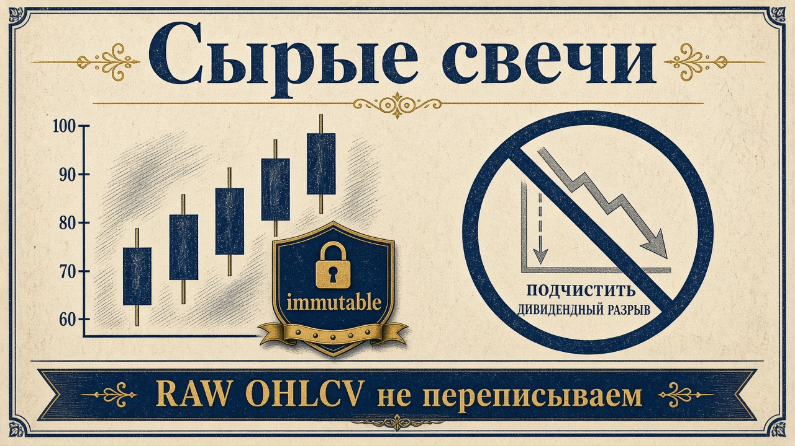

# Raw candles

## Визуальный ориентир

*RAW OHLCV immutable. Иллюстрация Vault; не скриншот приёмки.*

Сырые свечи в `market.candles` — то, что реально прошло на бирже. Их не перезаписывают «поправленными» ценами и не подменяют total return.

Если бумага стоит 100 ₽ и на следующий день после сплита 1 к 10 биржевая цена около 10 ₽, сырая свеча так и хранит скачок. Это не авария базы. Авария — тихо умножить всю историю на 10, чтобы график стал гладким, и забыть, каким коэффициентом и с какой даты это сделано.

## Три разных дохода, и ни один не затирает свечу

- сырой доход — как двигалась биржевая цена;
- механически поправленный — сплит, обратный сплит, изменение номинала, без дивидендов;
- полный доход владельца — цена плюс денежные дивиденды.

Все три — производные, версионируемые ряды. Они не источник факта сделки.

## Зачем хранить «некрасивый» провал

Дивидендный гэп — экономический факт, а не мусор. Если его стереть из истории, пропадает возможность изучать, была ли дивидендная стратегия чем-то большим, чем иллюзия на гладком графике. Сплитовый обвал, наоборот, нельзя учить как крах рынка. Пример из ADR 0005: PLZL около 2025-03-27, масштаб порядка 1 к 10. Это событие, не «рынок упал на 90%».

Поправка применяется как слой на момент `t` с известным коэффициентом, а не как глобальная перепись старых образцов задним числом.

См. [[Дивиденды, зашитые в свечи]] и [[Corporate actions]].
