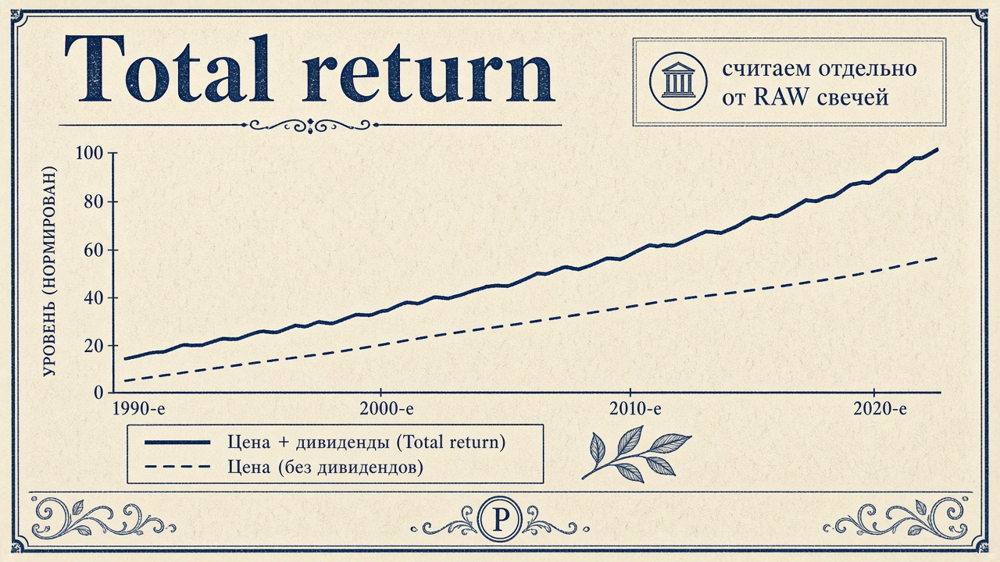

# Total return

## Визуальный ориентир

*Отдельно от RAW свечей. Иллюстрация Vault; не скриншот приёмки.*

Полный доход владельца за период учитывает не только то, как изменилась цена, но и деньги, которые бумага выплатила. Иначе дивидендная бумага выглядит хуже ростовой только потому, что цена падает на отсечке, а кеш на счёт в сравнении забыли.

**Gross total return** в принятом фундаменте — изменение цены плюс денежные дивиденды, до налога и до комиссии. Деньги для этой формулы относят на дату отсечки, если она есть. Учёт по дате фактической выплаты на счёте — забота будущего симулятора, не повод переписать формулу тихо.

Если цены нет, ряд не готов. Если внутри окна не хватает суммы дивиденда, покрытие частичное. Если по вселенной хранилище пустое, покрытие не готово. Пустота не означает «дивидендов не было».

## Что этой формулой не делают

- не переписывают сырые свечи;
- не меняют `pit_daily_core` v1;
- не включают режим симулятора total return одним фактом существования хелпера (ADR 0010 оставил проводку симулятора на потом);
- не объявляют вселенную обучающих лейблов total return: это отдельно запрещено, пока владелец не поставит задачу;
- не называют PRICE_RETURN из памяти решений 1.03 полным доходом. Там дивиденды сознательно не входят.

Налог и комиссия сделают из gross другой, меньший результат. Пока их нет в модели, полный доход не называют «что осталось инвестору на руки».

Сравнение с индексом в будущем обязано сказать, включены ли дивиденды бенчмарка. Иначе акцию с дивидендами сравнивают с ценовым индексом и объявляют победу.
