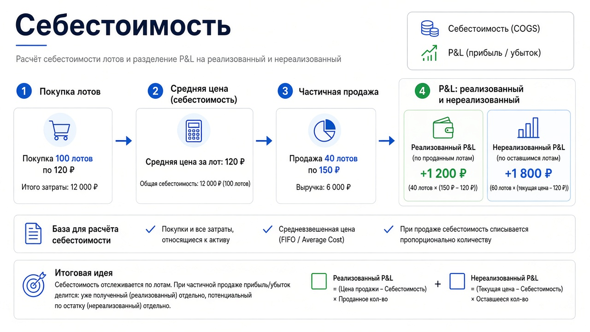

# Cost basis

## Визуальный ориентир

*Реализованный и нереализованный P&L раздельно. Иллюстрация Vault; не скриншот приёмки и не доказательство runtime.*

Себестоимость — сколько денег уже вложено в оставшиеся бумаги, с учётом того, как их покупали и что забрали при частичной продаже. Это не последняя цена и не «средняя на глаз».

В личном портфеле Kraken учёт — средневзвешенная себестоимость. Деньги считают десятичным типом, не двоичным float.

## Пример

Купили 10 акций по 100 ₽, комиссия 10 ₽ учтена в сделке. Себестоимость позиции 1 010 ₽, одной акции 101 ₽.

Потом купили ещё 10 по 120 ₽ без отдельной комиссии. Вложено 1 010 + 1 200 = 2 210 ₽ на 20 акций, средняя 110,50 ₽.

Продали 5 акций. Списывается 5 × 110,50 ₽ себестоимости. Остаток 15 акций хранит 1 657,50 ₽. Разница между выручкой и списанной себестоимостью — реализованный результат, а не «вся позиция заново».

Если ту же комиссию записать и внутри цены, и отдельной операцией, средняя станет хуже правды. См. [[Комиссии и двойной учёт]].

## Когда себестоимости нет

Неизвестная себестоимость не равна нулю и не равна текущей цене. Тогда рыночную стоимость показать можно, а прибыль по позиции — нет. Для облигаций в черновике нужна сумма потраченных рублей. Чистая цена в процентах от номинала рублями не является.

Сплит меняет число бумаг и цену, но не должен сам по себе создавать прибыль. Это корпоративное действие, отдельное от рыночного движения. Пока в продукте нет полного контура таких правок с аудиторским следом, Vault не обещает, что любая экзотическая цепочка уже считается.

Полная лотовая атрибуция «какая именно покупка закрылась этой продажей» для P&L решения — ещё впереди, не текущая формула экрана.
